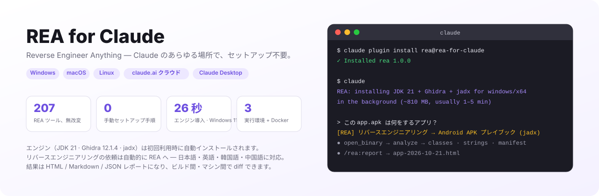
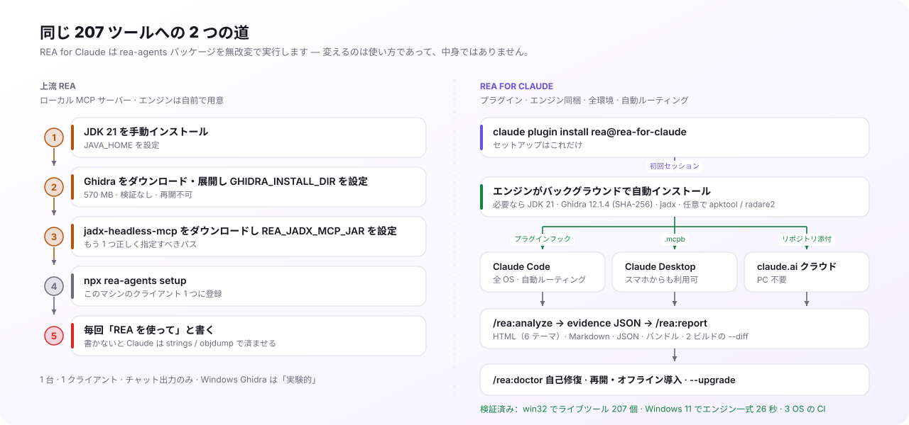
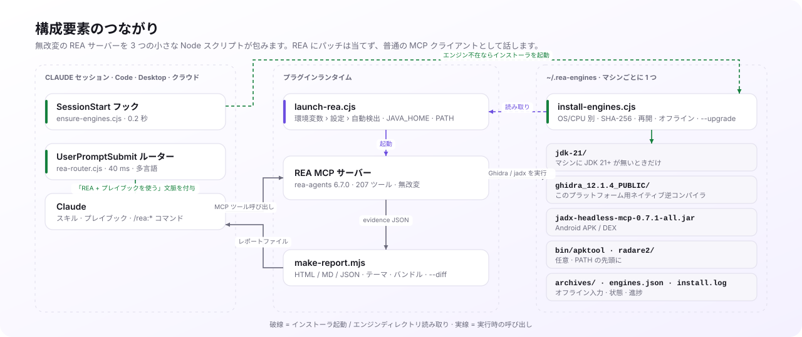

<p align="right"><a href="README.md">English</a> | <a href="README.ko.md">한국어</a> | <a href="README.zh-CN.md">简体中文</a> | <b>日本語</b></p>

<h1 align="center">REA for Claude</h1>

<p align="center">
  <b>Reverse Engineer Anything — Claude のあらゆる場所で、セットアップ不要。</b><br>
  <a href="https://github.com/morluto/rea">REA</a> の 207 個のリバースエンジニアリングツールを Claude プラグインに：エンジンは自動インストール、
  リバースエンジニアリングの依頼は REA へ自動ルーティング、結果は共有できるレポートになります。
</p>

<p align="center">
  <a href="https://github.com/NoLucas/REA-for-Claude/actions/workflows/ci.yml"></a>
  
  
  
  
  <a href="LICENSE"></a>
</p>

<p align="center">
  <a href="#インストール">インストール</a> ·
  <a href="#主な特長">主な特長</a> ·
  <a href="#上流-rea-との違い">上流 REA との違い</a> ·
  <a href="#仕組み">仕組み</a> ·
  <a href="#コマンドとスキル">コマンド</a> ·
  <a href="#設定">設定</a> ·
  <a href="#ベンチマーク">ベンチマーク</a> ·
  <a href="#トラブルシューティングと-faq">FAQ</a>
</p>

<p align="center">
  <picture>
    <source media="(prefers-color-scheme: dark)" srcset="docs/img/hero-ja-dark.svg">
    
  </picture>
</p>

## インストール

```bash
claude plugin marketplace add NoLucas/REA-for-Claude
claude plugin install rea@rea-for-claude
```

**Windows・macOS・Linux** のどれでも、セットアップはこれで終わりです — Java も Ghidra も先に入れる必要はありません。

1. **初回セッション** — `SessionStart` フックが空の `~/.rea-engines` を見つけ、インストーラをバックグラウンドで起動します。Claude には `REA: installing JDK 21 + Ghidra + jadx for windows/x64 … (~810 MB, usually 1–5 min)` と伝わります。
2. **インストーラ** — OS と CPU に合ったビルドを選びます：Temurin JDK 21（マシンに JDK 21+ が無い場合のみ）、Ghidra 12.1.4（SHA-256 検証）、jadx-headless-mcp 0.7.1。Linux では apt ツールも、希望すれば apktool / radare2 も。
3. **その間も** — REA はすでに動いています。エンジン不要のプロバイダは即座に使え、Ghidra/jadx のツールは `install.done` が現れるまで `provider_unavailable` を返します。その後に対象を再度 `open_binary` すれば OK（再起動不要）。
4. **それ以降は** — 普通に話しかけるだけ。*「この app.apk は何をするアプリ？」* や *「what does agent.exe do?」* はリバースエンジニアリングと認識され、対応するプレイブックと共に REA へルーティングされます。必要なら `/rea:analyze <ファイル>`、`/rea:report`、`/rea:doctor` も使えます。

<details>
<summary><b>その他の環境</b> — claude.ai クラウド（PC 不要）、Claude Desktop、Docker アプライアンス</summary>

**claude.ai クラウドセッション（Web · スマホ · claude.ai/code）** — このリポジトリを fork または push し、その上でセッションを開始（またはチャットにリポジトリを添付）して、*「`./samples/app.bin` を解析して何をするものか教えて」*と頼みます。`.mcp.json` が REA を即座に起動し、同じフックがコンテナにエンジンをインストールします（約 2 分）。待ちたくなければ環境に `Setup script = bash scripts/install-engines.sh` を設定します。

**Claude Desktop** — PC でワンクリック拡張をビルドし、設定 › 拡張機能 › 詳細 › Install Extension… からインストール：

```bash
bash desktop/build-mcpb.sh                                          # macOS / Linux
powershell -ExecutionPolicy Bypass -File desktop\build-mcpb.ps1     # Windows
```

拡張にはランチャーとインストーラが同梱されているので、`~/.rea-engines` を自動検出し、同じバックグラウンドインストールを開始します。この PC に連携したセッションなら Web やスマホの claude.ai からもツールを使えます。タグ付きリリースでは 3 OS 向けの署名済み `.mcpb` が配布されます。

**リモートアプライアンス（PC を切っても OK）** — Cloudflare トンネルと OAuth 2.1 ゲートウェイの背後の Linux コンテナに REA + エンジン。claude.ai のカスタムコネクタとして使えます：

```bash
cd remote && export REA_UPSTREAM_API_KEY=$(openssl rand -hex 24) GATEWAY_PASSWORD='<12 文字以上>'
docker compose -f docker-compose.oauth.yml up --build
```

先に [remote/README.md](remote/README.md) のセキュリティ注記を読んでください。

**Windows の注意点** — ネイティブ REA は PE（x86/x64/ARM）、Android、エンジン不要のプロバイダをカバーします。アーカイブは標準の `tar.exe` で展開し、`HTTPS_PROXY` を尊重します。Linux 専用ツール（binwalk、tshark、mitmproxy）が必要なら `node scripts/install-engines.cjs --wsl` を実行して `"use_wsl": true` を設定 — ランチャーが WSL 内で REA を動かし、`C:\…` パスを `/mnt/c/…` に変換します。

**macOS** — Apple Silicon と Intel の両方に対応。適合する Temurin JDK と Ghidra の `mac_arm_64` / `mac_x86_64` 逆コンパイラが自動で選ばれ、隔離属性を外すので Gatekeeper の警告は出ません。

**自分で制御したい場合** — `"auto_engines": false` で自動インストールを無効化、`/rea:install-engines`（または `node scripts/install-engines.cjs --dry-run`）で必要なときに実行、`ghidra_install_dir` / `jadx_mcp_jar` / `java_home` で自前のインストールを指定します。
</details>

> **法的注意。** リバースエンジニアリングは対象のライセンス、利用規約、現地の法律に従う必要があります。利用前に上流 REA の [DISCLAIMER](https://github.com/morluto/rea/blob/main/DISCLAIMER.md) をお読みください。

## 主な特長

- **全 OS でセットアップ不要のエンジン** — JDK 21（必要時）、Ghidra 12.1.4、jadx。希望すれば apktool と radare2 も。Windows x64、macOS arm64/x64、Linux x64/arm64。マシンごとに 1 つの `~/.rea-engines` を共有。
- **リバースエンジニアリングは REA が既定** — 40 ms の `UserPromptSubmit` ルーターが日本語・英語・韓国語・中国語のリバースエンジニアリング依頼を認識し、REA ツールと適切なプレイブックを Claude に渡します。allow/deny パターンで調整または無効化でき、`/rea:why` が判断理由を説明します。
- **自己修復** — `/rea:doctor` がディスク上の状態（展開途中の Ghidra、`javac` の無い JRE、途切れた jar、古いピン）を検証し、修復コマンドをそのまま表示します。
- **再開可能・オフライン対応のインストール** — 中断したダウンロードは再開。`~/.rea-engines/archives/` に置いたリリースファイルはネットワーク無しでインストールでき、SHA-256 検証はそのまま。`--upgrade` は新しいピンへ移行し、新版の検証後にのみ旧版を削除します。
- **ガイド付き調査** — `/rea:analyze` が対象（ELF/PE/Mach-O、APK、Electron、ファームウェア、wasm、Go/Rust/Flutter）ごとにプレイブックを選び、すべての結果を evidence JSON として保存します。
- **レポートと diff** — `/rea:report` が証拠を単体 HTML（6 テーマ）、Markdown、JSON に描画。`--bundle` は持ち運べる証拠ファイルを作り、`--diff` は 2 つのビルド（別マシンでも）を逆コンパイルコードの行差分まで比較します。
- **どこでも動く** — 1 つのランチャーが Claude Code、Claude Desktop（`.mcpb`）、claude.ai クラウドセッション、OAuth 2.1 ゲートウェイ付き Docker アプライアンスをすべて担当。
- **Windows ネイティブ** — 標準 `tar.exe` での展開、`cmd.exe` クォート不要の npx、`C:\` → `/mnt/c/` 変換、`--wsl` プロビジョニング。Windows 11 で実機検証済み。
- **3 OS でテスト** — `scripts/selftest.mjs` が CI で Windows・macOS・Linux 上を走り、実サーバーを起動するライブ MCP スモークも含みます。1.x で維持される事項は [docs/STABILITY.md](docs/STABILITY.md) に。

## 上流 REA との違い

<p align="center">
  <picture>
    <source media="(prefers-color-scheme: dark)" srcset="docs/img/upstream-vs-plugin-ja-dark.svg">
    
  </picture>
</p>

[REA](https://github.com/morluto/rea)（作者 morluto、MIT）がエンジンです：Ghidra、jadx、IDA、Hopper、Kuna と十数個のエンジン不要アナライザを動かす 207 個の MCP ツール。**REA for Claude は REA を fork も改変もしません** — 無改変の `rea-agents` パッケージを実行し、それを 1 行インストール・セットアップ不要・どこでも使える Claude プラグインにするのに必要なものだけを加えます。

| | 上流 REA | REA for Claude |
|---|---|---|
| **インストール** | JDK 21・Ghidra・jadx を自分で入れてパスを設定してから `npx rea-agents setup` | `claude plugin install …` — 初回利用時にエンジンが自動インストール |
| **動く場所** | セットアップしたそのマシン・そのクライアント | 3 OS の Claude Code · Claude Desktop · claude.ai クラウド · Docker アプライアンス |
| **使い方** | 自分で REA を使うよう頼む。さもないと Claude は `strings`/`objdump` に頼る | リバースエンジニアリングのプロンプトを自動で REA へ（日/英/韓/中） |
| **ガイド** | REA の `reverse-engineer-anything` スキル | 同じスキル（同梱）**に加えて**対象別プレイブックと `/rea:analyze` |
| **出力** | チャット内のツール結果 | HTML / Markdown / JSON レポート、証拠バンドル、2 ビルドの `--diff` |
| **ヘルスチェック** | `rea doctor` が不足を列挙 | `/rea:doctor` がディスクを検証し修復コマンドを表示；`--upgrade` |
| **ネットワーク** | 手動ダウンロード | 再開可能、プロキシ対応、`archives/` からオフライン導入 |
| **Windows** | Ghidra は「実験的」、WSL は手動 | ネイティブインストーラ、`--wsl` プロビジョニング、Windows 11 実機検証 |
| **リリース** | npm パッケージ | プラグインマーケットプレイス + タグごとに署名済み 3 OS `.mcpb` |
| **変えないもの** | Kuna・IDA・Hopper・JEB は利用者が用意；ツール名と証拠形式は REA のもの | 同じ — プラグインはツール結果を一切改変しない |

Linux 1 台で Claude Code だけを使い、すでに Ghidra を設定済みなら上流 REA だけで十分です。2 台目のマシン、Windows ノート、スマホ、Ghidra を持たない同僚、誰かに渡すレポート — どれか 1 つでも出てきた瞬間に、このプラグインが効いてきます。

## 仕組み

<p align="center">
  <picture>
    <source media="(prefers-color-scheme: dark)" srcset="docs/img/architecture-ja-dark.svg">
    
  </picture>
</p>

依存ゼロの小さな Node スクリプト 3 つが、無改変の REA サーバーを包みます：

- **`ensure-engines.cjs`**（SessionStart、0.2 秒）が `~/.rea-engines` を確認し、Ghidra・jadx・JDK 21+ のどれかが無ければ `install-engines.cjs` を切り離して起動し、セッションに状態を 1 行出力します。排他ロックにより、フックとランチャーが競合してもインストーラは 1 つだけです。
- **`launch-rea.cjs`** がすべてのエンジンパスを解決し（REA 環境変数 › `REA_PLUGIN_*` 環境変数 › `~/.rea-plugin.json` › 自動検出）、`JAVA_HOME` と `PATH` をエクスポートし、REA が拒否する空値を落としてから `npx rea-agents@6.7.0 mcp` を起動します — Windows では WSL 内の REA も可。REA はプロバイダを呼び出しごとに解決するので、後から入ったエンジンも再起動なしで使われます。
- **`rea-router.cjs`**（UserPromptSubmit、40 ms）がリバースエンジニアリングのプロンプトに*「REA ツールとこのプレイブックを使う」*という文脈を加えます。それ以外のプロンプトはそのまま通します。

JDK を同梱する理由：Ghidra には `javac` 付きの 64 ビット JDK 21+ が必要です。インストーラは `JAVA_HOME`、`PATH`、`~/.rea-engines/jdk-21`、よくあるインストール先（IntelliJ の `~/.jdks`、Program Files、Homebrew、`/usr/lib/jvm`、sdkman）のすべてが条件を満たさないときだけ Temurin をダウンロードします — REA 自身の `ghidra-java` doctor チェックで検証済みです。

## コマンドとスキル

| コマンド | 内容 |
|---|---|
| `/rea:analyze <パス> [目的]` | 対象の種類を判定し、対応するプレイブックを実行し、すべての結果を `./rea-evidence/*.json` に保存 |
| `/rea:report [dir] [--format html\|md\|json\|both\|all] [--theme …] [--bundle]` | 共有用レポートを生成；`--bundle` は持ち運べる証拠ファイルを出力 |
| `/rea:report --diff <before> <after>` | 2 つの証拠セットまたはバンドルを比較して変更レポートに |
| `/rea:doctor` | サーバーの健全性、エンジンごとの検証、修復コマンド |
| `/rea:install-engines` | エンジンのインストール・修復・アップグレード（`--dry-run`、`--only`、`--upgrade`、`--wsl`） |
| `/rea:capabilities` | このホストで今 REA にできることを対象種類別に |
| `/rea:why [プロンプト]` | プロンプトが REA へルーティングされた（されなかった）理由とルーターの調整方法 |

| スキル | 用途 |
|---|---|
| `reverse-engineer-anything` | REA 公式の 207 ツールリファレンスと復旧ガイド（同梱、MIT） |
| `rea-workflows` | 対象別プレイブック：ELF/PE/Mach-O、APK、Electron/JS、ファームウェア、Web、Go、Rust、Flutter/Dart、WebAssembly |
| `rea-anywhere` | 環境ごとの運用メモ：自動インストール、`provider_unavailable`、ファイルの場所 |

## 設定

すべて任意です。`~/.rea-plugin.json`（または `$REA_PLUGIN_CONFIG`）。各値の優先順位：**REA 環境変数 → `REA_PLUGIN_*` 環境変数 → 設定ファイル → `~/.rea-engines` の自動検出**。キーとエンジンのレイアウトは [1.x の間維持](docs/STABILITY.md)されます。

<details>
<summary><b>すべてのキー</b></summary>

```jsonc
{
  "rea_version": "6.7.0",
  "ghidra_install_dir": "C:\\tools\\ghidra_12.1.4_PUBLIC",   // ~/.rea-engines の代わりに自前のインストールを使う
  "jadx_mcp_jar": "C:\\tools\\jadx-headless-mcp-0.7.1-all.jar",
  "kuna_command": "", "ida_mcp_config": "", "browser_executable": "",
  "java_home": "",                         // 環境変数 JAVA_HOME が優先、次にこの値、次に自動検出した JDK
  "engines_dir": "",                       // 既定 ~/.rea-engines
  "auto_engines": true,                    // 初回利用時にバックグラウンドでインストール
  "jdk": true,                             // JDK 21+ が無ければ Temurin のダウンロードを許可
  "engines": ["ghidra", "jadx", "apt"],    // + "apktool", "radare2"
  "optional_engines": false,               // "all" に apktool/radare2 を含める
  "archive_dir": "",                       // オフライン導入用に事前取得したリリースファイル
  "router": { "allow": [], "deny": [] },   // 正規表現；false でルーティング無効
  "use_wsl": false, "wsl_distro": "Ubuntu",
  "rea_command": "",                       // 例：グローバルインストールなら "rea"
  "report": { "format": "html", "dir": "rea-reports", "theme": "violet" },
  "env": { "REA_GHIDRA_STARTUP_TIMEOUT_MS": "600000" }
}
```

| キー | 既定値 | 説明 |
|---|---|---|
| `auto_engines` | `true` | Ghidra が無ければバックグラウンドでインストール |
| `jdk` | `true` | 使える JDK 21+ が無いときだけ Temurin JDK 21 を `~/.rea-engines/jdk-21` にダウンロード |
| `engines` | `["all"]` | `apt` = radare2、binwalk、tshark、apktool、binutils、gdb（Linux）；`apktool`、`radare2` は全 OS で任意 |
| `optional_engines` | `false` | `all` に任意エンジンを含める |
| `archive_dir` | — | 追加のリリースファイル置き場（`~/.rea-engines/archives/` は常に確認） |
| `router` | `true` | `false` でルーティング無効；`{ "allow": [正規表現], "deny": [正規表現] }` で調整；プロジェクトの `.rea-plugin.json` が優先 |
| `report.format` / `dir` / `theme` | `html` / `rea-reports` / `violet` | テーマ：`violet` `ocean` `forest` `amber` `mono` `contrast` |
| `use_wsl` / `wsl_distro` | `false` / `Ubuntu` | Windows のみ；エンジンパスは自動で Linux パスに |
| `env` | — | REA に渡す追加の変数（タイムアウト、スキーマプロファイル …） |

環境変数の対応：`REA_PLUGIN_CONFIG`、`REA_PLUGIN_ENGINES_DIR`、`REA_PLUGIN_ARCHIVE_DIR`、`REA_PLUGIN_ENGINES`、`REA_PLUGIN_OPTIONAL_ENGINES=1`、`REA_PLUGIN_AUTO_ENGINES=0|1`、`REA_PLUGIN_SKIP_JDK=1`、`REA_PLUGIN_ROUTER=0`、`REA_PLUGIN_USE_WSL=1`、`REA_PLUGIN_VERSION`、および REA 本来の変数（`GHIDRA_INSTALL_DIR`、`REA_JADX_MCP_JAR`、`REA_KUNA_COMMAND`、`REA_IDA_MCP_CONFIG`、`JAVA_HOME`）。
</details>

## ベンチマーク

| | Windows 11 x64（Node 24、家庭用回線） | Linux x64（クラウドコンテナ、2 vCPU） |
|---|---|---|
| 空ディレクトリへのエンジン一式インストール | **26 秒** — JDK 21 + Ghidra + jadx + apktool + radare2、SHA-256、`tar.exe` | **約 45 秒** — JDK 21 + jadx 15 秒、Ghidra 30 秒 |
| ライブ MCP スモーク込みの `selftest.mjs` | win32 で **207 ツール**を提供 | 207 ツール |
| `launch-rea.cjs doctor` | ghidra + jadx 利用可；ネイティブ `win_x86_64` 逆コンパイラ一致；JDK 21 承認 | 同じ、同梱 JDK 承認 |
| エンジンが存在する場合の SessionStart フック | 0.2 秒 | 0.2 秒 |
| ルーターの判断 | 約 40 ms | 約 40 ms |
| 小さな ELF の Ghidra 逆コンパイル | — | 1 呼び出し約 20 秒 |

マシンに既にある JDK（IntelliJ の `~/.jdks`、Temurin、Homebrew、apt）は検出して再利用 — 二重ダウンロードはありません。再開：apktool の 5 MB の部分ファイルを 1 秒未満で再開・検証。

## トラブルシューティングと FAQ

<details>
<summary><b>トラブルシューティング</b></summary>

| 症状 | 原因 | 対処 |
|---|---|---|
| Ghidra / jadx で `provider_unavailable` | バックグラウンドインストールが進行中、または失敗 | `/rea:doctor` で状態とログを確認；`/rea:install-engines` で修復；その後 `open_binary` を再実行 |
| `spawn npx.cmd EINVAL`（Windows） | Node 22 以降はシェル無しで `.cmd` を起動しない | ランチャーで修正済み（`npx-cli.js` を Node で直接実行）— プラグインを更新 |
| `GHIDRA_INSTALL_DIR must be absolute` | ホストが空の設定を `""` として渡した | ランチャーは空値を捨てる；自分で設定するならフルパスで |
| Claude Desktop に `rea` サーバーが出ない | MSIX 版は別の `claude_desktop_config.json` を読む | 代わりに `.mcpb` をインストール |
| `.ps1 cannot be loaded … execution policy` | 既定ポリシーがスクリプトをブロック | `powershell -ExecutionPolicy Bypass -File …` |
| Ghidra の zip が Defender に引っかかる / 展開が遅い | 小さなファイルが大量にある大きなアーカイブ | `%USERPROFILE%\.rea-engines` を除外に追加；SHA-256 が完全性を保証 |
| 大きなバイナリでツールがタイムアウト | ヘッドレス解析は遅い | `env` の `REA_GHIDRA_STARTUP_TIMEOUT_MS` を上げる；一度解析してから関数単位で呼ぶ |
| ダウンロードがブロックされる | プロキシ / 許可リスト | `github.com`、`objects.githubusercontent.com`、`release-assets.githubusercontent.com`、`api.adoptium.net` を許可 — またはファイルを `~/.rea-engines/archives/` に置く |

`node scripts/selftest.mjs` でどの OS でもプラグイン自体を点検できます。
</details>

<details>
<summary><b>FAQ</b></summary>

**スマホの claude.ai でも使える？** はい — このリポジトリを添付したクラウドセッションは Anthropic のコンテナで REA を動かし、PC に連携したセッションはデスクトップアプリのローカル REA ツールを中継します。

**Ghidra や Java を自分で入れる必要は？** ありません。初回セッションが不足分をインストールし、既存の JDK は再利用します。自前の Ghidra を使うなら `ghidra_install_dir` を設定してください。

**自動インストール*されない*エンジンは？** IDA、Kuna、Hopper、JEB（商用または手動）。設定で自分のコピーを指定してください。

**自動ルーティングを切れる？** `"router": false`、または 1 セッションだけなら `REA_PLUGIN_ROUTER=0`。allow/deny の正規表現でユーザー別・プロジェクト別に細かく制御できます。

**すでに `npx rea-agents setup` を実行した。** クライアントごとに登録は 1 つだけ残してください。さもないと `rea` サーバーが 2 つ出ます。

**オフライン / 閉域網？** リリースファイルを同じ名前で `~/.rea-engines/archives/` に置き、`/rea:install-engines` を実行してください。
</details>

<details>
<summary><b>リポジトリ構成</b></summary>

```
.claude-plugin/        plugin.json · marketplace.json（リポジトリがマーケットプレイスも兼ねる）
hooks/hooks.json       プラグインフック：SessionStart → ensure-engines.cjs、UserPromptSubmit → rea-router.cjs
.claude/settings.json  リポジトリ / クラウドセッション用の同じフック
.mcp.json              クラウド / ローカルセッション用のプロジェクト MCP サーバー
scripts/
  launch-rea.cjs       汎用ランチャー（`launch-rea.cjs doctor` でサーバーと同じ環境の doctor を実行）
  ensure-engines.cjs   SessionStart フック：確認 → バックグラウンドインストール → 状態 1 行（--status で表）
  rea-router.cjs       UserPromptSubmit フック：RE プロンプト → 「REA + このプレイブックを使う」（--why）
  install-engines.cjs  Windows / macOS / Linux インストーラ（JDK 21、Ghidra、jadx、apktool、radare2、WSL）
  rea-engines-lib.cjs  共通：バージョンピン、OS 検出、設定、エンジン / JDK 検出、検証
  install-engines.sh   Linux / Docker インストーラ（Ghidra、jadx、apt）
  install-engines.ps1  スクリプト化した Windows 導入向けの PowerShell 専用インストーラ
  make-report.mjs      証拠 → HTML / Markdown / JSON、テーマ、バンドル、--diff
  selftest.mjs · .sh   クロスプラットフォーム検査（CI）· bash 専用検査
desktop/               manifest.json · build-mcpb.sh · build-mcpb.ps1（Claude Desktop .mcpb）
remote/                Dockerfile · docker-compose.yml · docker-compose.oauth.yml · oauth-gateway/
skills/                reverse-engineer-anything · rea-workflows · rea-anywhere
commands/              analyze · report · doctor · capabilities · install-engines · why
docs/                  STABILITY.md · img/（generate.py が README の図を生成）
.github/workflows/     ci.yml（3 OS selftest）· release.yml（v* タグで 3 OS 署名済み .mcpb）
```
</details>

## コントリビューション

```bash
git clone https://github.com/NoLucas/REA-for-Claude && cd REA-for-Claude
node scripts/selftest.mjs           # どの OS でも：オフライン検査 + ライブ MCP スモーク（REA_SELFTEST_SKIP_MCP=1 で省略）
bash scripts/selftest.sh            # Linux/macOS：OAuth ゲートウェイとエントリポイントの検査
claude plugin validate --strict .claude-plugin/plugin.json
python3 docs/img/generate.py        # README の図を編集したあとに
```

PR 歓迎 — プレイブック、エンジンのレシピ、レポートレンダラ、macOS でのテスト。selftest を緑に保ち、トップレベルの `bin/` は追加しないでください（claude.ai はそれを含むプラグインを拒否します）。

## ライセンスとクレジット

プラグイン：[MIT](LICENSE)。`skills/reverse-engineer-anything/` は [morluto/rea](https://github.com/morluto/rea) から取り込んだもの（MIT、`LICENSE.rea` 参照）。REA 本体は同梱せず、実行時に npm から取得します。Ghidra は Apache-2.0（NSA）。jadx-headless-mcp、apktool、radare2 はそれぞれのライセンスに従います。REA、Ghidra、jadx、apktool、radare2 の各プロジェクトとは無関係です。
