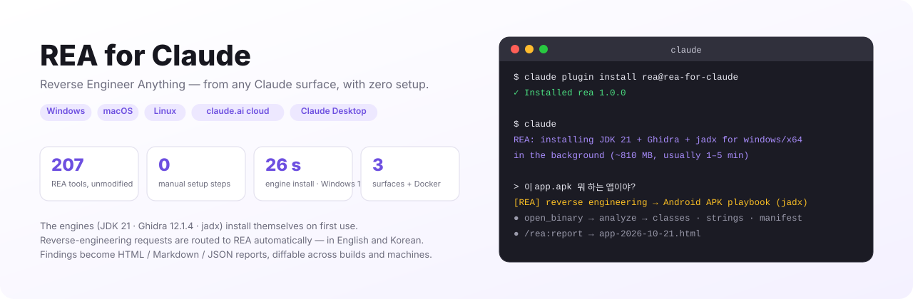
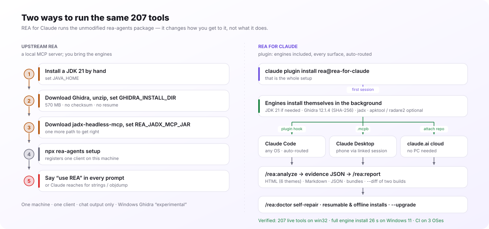
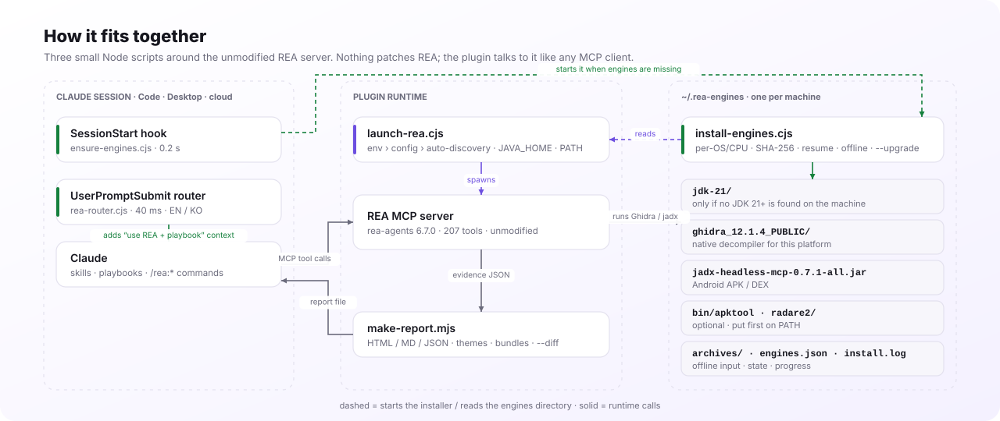

<p align="right"><a href="README.md">English</a> | <b>한국어</b></p>

<h1 align="center">REA for Claude</h1>

<p align="center">
  <b>Reverse Engineer Anything — Claude가 있는 모든 곳에서, 설정 없이.</b><br>
  <a href="https://github.com/morluto/rea">REA</a>의 리버스 엔지니어링 툴 207개를 Claude 플러그인으로: 엔진은 알아서 설치되고,
  리버스 엔지니어링 요청은 자동으로 REA로 라우팅되며, 결과는 공유용 리포트가 됩니다.
</p>

<p align="center">
  <a href="https://github.com/NoLucas/REA-for-Claude/actions/workflows/ci.yml"></a>
  
  
  
  
  <a href="LICENSE"></a>
</p>

<p align="center">
  <a href="#설치">설치</a> ·
  <a href="#핵심-기능">핵심 기능</a> ·
  <a href="#업스트림-rea와-다른-점">REA와 다른 점</a> ·
  <a href="#동작-원리">동작 원리</a> ·
  <a href="#커맨드--스킬">커맨드</a> ·
  <a href="#설정">설정</a> ·
  <a href="#벤치마크">벤치마크</a> ·
  <a href="#문제-해결--faq">FAQ</a>
</p>

<p align="center">
  <picture>
    <source media="(prefers-color-scheme: dark)" srcset="docs/img/hero-dark.svg">
    
  </picture>
</p>

## 설치

```bash
claude plugin marketplace add NoLucas/REA-for-Claude
claude plugin install rea@rea-for-claude
```

**Windows · macOS · Linux** 모두 이게 전부입니다. Java도 Ghidra도 미리 깔 필요 없습니다.

1. **첫 세션** — `SessionStart` 훅이 비어 있는 `~/.rea-engines`를 보고 설치기를 백그라운드로 띄웁니다. Claude에게는 `REA: installing JDK 21 + Ghidra + jadx for windows/x64 … (~810 MB, usually 1–5 min)` 한 줄이 전달됩니다.
2. **설치기** — OS/CPU에 맞는 빌드를 고릅니다: Temurin JDK 21(PC에 JDK 21+가 없을 때만), Ghidra 12.1.4(SHA-256 검증), jadx-headless-mcp 0.7.1; Linux는 apt 도구, 원하면 apktool / radare2.
3. **그동안** — REA는 이미 떠 있습니다. 엔진이 필요 없는 프로바이더는 바로 동작하고, Ghidra/jadx 툴은 `install.done`이 생길 때까지 `provider_unavailable`을 돌려줍니다. 그 뒤 대상을 `open_binary`로 다시 열면 됩니다(재시작 불필요).
4. **그 다음부터** — 그냥 말하면 됩니다. *"이 app.apk 뭐 하는 앱이야?"*, *"what does agent.exe do?"*는 리버스 엔지니어링으로 인식되어 맞는 플레이북과 함께 REA로 갑니다. `/rea:analyze <파일>`, `/rea:report`, `/rea:doctor`는 필요할 때 쓰세요.

<details>
<summary><b>다른 환경</b> — claude.ai 클라우드(PC 없이), Claude Desktop, Docker 어플라이언스</summary>

**claude.ai 클라우드 세션(웹 · 폰 · claude.ai/code)** — 이 저장소를 포크하거나 푸시하고 그 위에서 세션을 시작(또는 채팅에 저장소 첨부)한 뒤 *"`./samples/app.bin` 분석해서 뭐 하는 건지 알려줘"*라고 하세요. `.mcp.json`이 REA를 즉시 띄우고, 같은 훅이 컨테이너에 엔진을 설치합니다(약 2분). 기다리기 싫으면 환경 설정에 `Setup script = bash scripts/install-engines.sh`.

**Claude Desktop** — PC에서 원클릭 확장을 빌드해 설정 › 확장 › 고급 › Install Extension… 으로 설치:

```bash
bash desktop/build-mcpb.sh                                          # macOS / Linux
powershell -ExecutionPolicy Bypass -File desktop\build-mcpb.ps1     # Windows
```

확장은 런처와 설치기를 함께 담고 있어 `~/.rea-engines`를 자동 탐색하고 같은 백그라운드 설치를 시작합니다. 이 PC에 연결된 세션은 웹과 폰의 claude.ai에서도 툴을 쓸 수 있습니다. 태그 릴리스에는 3개 OS용 서명된 `.mcpb`가 올라갑니다.

**원격 어플라이언스(PC 꺼도 됨)** — Cloudflare 터널과 OAuth 2.1 게이트웨이 뒤의 Linux 컨테이너에 REA + 엔진. claude.ai 커스텀 커넥터로 사용:

```bash
cd remote && export REA_UPSTREAM_API_KEY=$(openssl rand -hex 24) GATEWAY_PASSWORD='<12자 이상>'
docker compose -f docker-compose.oauth.yml up --build
```

먼저 [remote/README.md](remote/README.md)의 보안 노트를 읽으세요.

**Windows 참고** — 네이티브 REA는 PE(x86/x64/ARM), Android, 엔진 불필요 프로바이더를 다룹니다. 압축은 내장 `tar.exe`로 풀고 `HTTPS_PROXY`를 따릅니다. Linux 전용 도구(binwalk, tshark, mitmproxy)가 필요하면 `node scripts/install-engines.cjs --wsl` 후 `"use_wsl": true` — 런처가 REA를 WSL 안에서 실행하고 `C:\…` 경로를 `/mnt/c/…`로 변환합니다.

**macOS** — Apple Silicon과 Intel 모두. 맞는 Temurin JDK와 Ghidra의 `mac_arm_64` / `mac_x86_64` 디컴파일러가 자동으로 선택되고, 격리 속성을 지워 Gatekeeper 경고가 뜨지 않습니다.

**직접 제어하려면** — `"auto_engines": false`로 자동 설치를 끄고, `/rea:install-engines`(또는 `node scripts/install-engines.cjs --dry-run`)로 원할 때 설치하며, `ghidra_install_dir` / `jadx_mcp_jar` / `java_home`으로 직접 설치한 경로를 지정합니다.
</details>

> **법적 고지.** 리버스 엔지니어링은 대상의 라이선스, 이용약관, 현지 법을 지켜야 합니다. 사용 전에 업스트림 REA의 [DISCLAIMER](https://github.com/morluto/rea/blob/main/DISCLAIMER.md)를 읽어 주세요.

## 핵심 기능

- **모든 OS에서 무설정 엔진** — JDK 21(필요 시), Ghidra 12.1.4, jadx; 원하면 apktool·radare2. Windows x64, macOS arm64/x64, Linux x64/arm64. 머신당 `~/.rea-engines` 하나를 공유.
- **리버스 엔지니어링이면 REA가 기본** — 40ms짜리 `UserPromptSubmit` 라우터가 영어·한국어 리버스 엔지니어링 프롬프트를 알아보고 REA 툴과 맞는 플레이북을 Claude에게 넘깁니다. allow/deny 패턴으로 조정하거나 끌 수 있고, `/rea:why`가 판단 이유를 설명합니다.
- **자가 복구** — `/rea:doctor`가 디스크 상태(반쯤 풀린 Ghidra, `javac` 없는 JRE, 잘린 jar, 오래된 버전)를 검증하고 정확한 복구 명령을 출력합니다.
- **이어받기·오프라인 설치** — 끊긴 다운로드는 이어받고, `~/.rea-engines/archives/`에 넣어 둔 릴리스 파일은 네트워크 없이 설치되며 SHA-256 검사는 그대로. `--upgrade`는 새 버전이 검증된 뒤에만 옛 복사본을 지웁니다.
- **가이드 조사** — `/rea:analyze`가 대상(ELF/PE/Mach-O, APK, Electron, 펌웨어, wasm, Go/Rust/Flutter)별 플레이북을 고르고 모든 결과를 evidence JSON으로 저장합니다.
- **리포트와 diff** — `/rea:report`가 evidence를 독립 실행 HTML(테마 6종)/Markdown/JSON으로 만들고, `--bundle`은 이동형 evidence 파일을, `--diff`는 두 빌드(다른 머신이어도)를 디컴파일 코드 라인 diff까지 비교합니다.
- **어디서든 실행** — 런처 하나가 Claude Code, Claude Desktop(`.mcpb`), claude.ai 클라우드 세션, OAuth 2.1 게이트웨이가 달린 Docker 어플라이언스를 모두 담당합니다.
- **Windows 네이티브** — 내장 `tar.exe` 압축 해제, `cmd.exe` 인용 없는 npx, `C:\` → `/mnt/c/` 변환, `--wsl` 프로비저닝. Windows 11에서 실기 검증.
- **3개 OS 테스트** — `scripts/selftest.mjs`가 CI에서 Windows·macOS·Linux로 돌며, 실제 서버를 띄우는 라이브 MCP 스모크까지 포함합니다. 1.x에서 유지되는 것은 [docs/STABILITY.md](docs/STABILITY.md)에.

## 업스트림 REA와 다른 점

<p align="center">
  <picture>
    <source media="(prefers-color-scheme: dark)" srcset="docs/img/upstream-vs-plugin-dark.svg">
    
  </picture>
</p>

[REA](https://github.com/morluto/rea)(morluto, MIT)가 엔진입니다: Ghidra·jadx·IDA·Hopper·Kuna와 엔진 불필요 분석기 여럿을 움직이는 MCP 툴 207개. **REA for Claude는 REA를 포크하거나 고치지 않습니다** — 원본 `rea-agents` 패키지를 그대로 실행하고, 그것을 한 줄 설치·무설정·어디서나 쓰는 Claude 플러그인으로 만드는 데 필요한 것만 얹습니다.

| | 업스트림 REA | REA for Claude |
|---|---|---|
| **설치** | JDK 21·Ghidra·jadx를 직접 깔고 경로를 지정한 뒤 `npx rea-agents setup` | `claude plugin install …` — 첫 사용 시 엔진이 알아서 설치 |
| **실행 위치** | 설정한 그 머신, 그 클라이언트 | 3-OS Claude Code · Claude Desktop · claude.ai 클라우드 · Docker 어플라이언스 |
| **사용** | REA를 쓰라고 직접 말하거나, Claude가 `strings`/`objdump`로 대충 봄 | 리버스 엔지니어링 프롬프트를 자동으로 REA로 라우팅(영/한) |
| **가이드** | REA의 `reverse-engineer-anything` 스킬 | 같은 스킬(동봉) **더하기** 대상별 플레이북과 `/rea:analyze` |
| **결과물** | 채팅 속 툴 결과 | HTML / Markdown / JSON 리포트, evidence 번들, 두 빌드 `--diff` |
| **상태 점검** | `rea doctor`가 빠진 것을 나열 | `/rea:doctor`가 디스크를 검증하고 복구 명령 출력; `--upgrade` |
| **네트워크** | 수동 다운로드 | 이어받기, 프록시 인식, `archives/`에서 오프라인 설치 |
| **Windows** | Ghidra "experimental", WSL은 수동 | 네이티브 설치기, `--wsl` 프로비저닝, Windows 11 실기 검증 |
| **배포** | npm 패키지 | 플러그인 마켓플레이스 + 태그마다 서명된 3-OS `.mcpb` |
| **바꾸지 않는 것** | Kuna·IDA·Hopper·JEB는 사용자 제공; 툴 이름과 evidence 형식은 REA의 것 | 동일 — 플러그인은 툴 결과를 절대 변형하지 않음 |

Linux 한 대에서 Claude Code만 쓰고 Ghidra가 이미 잡혀 있다면 업스트림 REA만으로 충분합니다. 두 번째 머신, Windows 노트북, 폰, Ghidra 없는 팀원, 남에게 보낼 리포트 중 하나라도 등장하는 순간 이 플러그인이 값을 합니다.

## 동작 원리

<p align="center">
  <picture>
    <source media="(prefers-color-scheme: dark)" srcset="docs/img/architecture-dark.svg">
    
  </picture>
</p>

의존성 없는 작은 Node 스크립트 셋이 원본 REA 서버를 감쌉니다:

- **`ensure-engines.cjs`**(SessionStart, 0.2초) — `~/.rea-engines`를 확인하고 Ghidra·jadx·JDK 21+ 중 빠진 게 있으면 `install-engines.cjs`를 분리 실행한 뒤 세션에 상태 한 줄을 남깁니다. 배타 락 덕분에 훅과 런처가 동시에 떠도 설치기는 하나만 돕니다.
- **`launch-rea.cjs`** — 모든 엔진 경로를 해석하고(REA 환경변수 › `REA_PLUGIN_*` › `~/.rea-plugin.json` › 자동 탐색) `JAVA_HOME`·`PATH`를 내보내며, REA가 거부하는 빈 값을 걸러낸 뒤 `npx rea-agents@6.7.0 mcp`(Windows에선 선택적으로 WSL 안의 REA)를 띄웁니다. REA는 호출 시점에 프로바이더를 찾으므로 나중에 설치가 끝난 엔진도 재시작 없이 잡힙니다.
- **`rea-router.cjs`**(UserPromptSubmit, 40ms) — 리버스 엔지니어링 프롬프트에 *"REA 툴과 이 플레이북을 써라"* 컨텍스트를 더합니다. 그 외 프롬프트는 건드리지 않습니다.

JDK를 내려받는 이유: Ghidra는 `javac`가 있는 64비트 JDK 21+가 필요합니다. 설치기는 `JAVA_HOME`, `PATH`, `~/.rea-engines/jdk-21`, 흔한 설치 위치(IntelliJ `~/.jdks`, Program Files, Homebrew, `/usr/lib/jvm`, sdkman)를 모두 확인한 뒤에만 Temurin을 받습니다 — REA 자체의 `ghidra-java` doctor 검사로 확인했습니다.

## 커맨드 & 스킬

| 커맨드 | 하는 일 |
|---|---|
| `/rea:analyze <경로> [목표]` | 대상 유형 판별 → 맞는 플레이북 실행 → 모든 결과를 `./rea-evidence/*.json`에 저장 |
| `/rea:report [디렉터리] [--format html\|md\|json\|both\|all] [--theme …] [--bundle]` | 공유용 리포트 생성; `--bundle`은 이동형 evidence 파일 작성 |
| `/rea:report --diff <before> <after>` | 두 evidence 세트 또는 번들을 비교한 변경 리포트 |
| `/rea:doctor` | 서버 상태, 엔진별 검증, 정확한 복구 명령 |
| `/rea:install-engines` | 엔진 설치·복구·업그레이드(`--dry-run`, `--only`, `--upgrade`, `--wsl`) |
| `/rea:capabilities` | 이 호스트에서 지금 가능한 REA 기능을 대상 유형별로 |
| `/rea:why [프롬프트]` | 프롬프트가 REA로 라우팅된(안 된) 이유와 조정 방법 |

| 스킬 | 용도 |
|---|---|
| `reverse-engineer-anything` | REA 공식 207툴 레퍼런스와 복구 가이드(동봉, MIT) |
| `rea-workflows` | 유형별 플레이북: ELF/PE/Mach-O, APK, Electron/JS, 펌웨어, 웹, Go, Rust, Flutter/Dart, WebAssembly |
| `rea-anywhere` | 환경별 운영 노트: 자동 설치, `provider_unavailable`, 파일 위치 |

## 설정

전부 선택 사항입니다. `~/.rea-plugin.json`(또는 `$REA_PLUGIN_CONFIG`); 값별 우선순위: **REA 환경변수 → `REA_PLUGIN_*` 환경변수 → 설정 파일 → `~/.rea-engines` 자동 탐색**. 키와 엔진 레이아웃은 [1.x 동안 유지](docs/STABILITY.md)됩니다.

<details>
<summary><b>모든 키</b></summary>

```jsonc
{
  "rea_version": "6.7.0",
  "ghidra_install_dir": "C:\\tools\\ghidra_12.1.4_PUBLIC",   // ~/.rea-engines 대신 직접 설치한 것을 쓸 때
  "jadx_mcp_jar": "C:\\tools\\jadx-headless-mcp-0.7.1-all.jar",
  "kuna_command": "", "ida_mcp_config": "", "browser_executable": "",
  "java_home": "",                         // 환경변수 JAVA_HOME → 이 값 → 자동 탐지한 JDK 순
  "engines_dir": "",                       // 기본 ~/.rea-engines
  "auto_engines": true,                    // 첫 사용 시 백그라운드 설치
  "jdk": true,                             // JDK 21+가 없을 때 Temurin 다운로드 허용
  "engines": ["ghidra", "jadx", "apt"],    // + "apktool", "radare2"
  "optional_engines": false,               // "all"에 apktool/radare2 포함
  "archive_dir": "",                       // 오프라인 설치용 미리 받은 릴리스 파일
  "router": { "allow": [], "deny": [] },   // 정규식; false면 라우팅 끔
  "use_wsl": false, "wsl_distro": "Ubuntu",
  "rea_command": "",                       // 예: 전역 설치면 "rea"
  "report": { "format": "html", "dir": "rea-reports", "theme": "violet" },
  "env": { "REA_GHIDRA_STARTUP_TIMEOUT_MS": "600000" }
}
```

| 키 | 기본값 | 설명 |
|---|---|---|
| `auto_engines` | `true` | Ghidra가 없으면 백그라운드 설치 |
| `jdk` | `true` | 쓸 만한 JDK 21+가 없을 때만 Temurin JDK 21을 `~/.rea-engines/jdk-21`에 다운로드 |
| `engines` | `["all"]` | `apt` = radare2, binwalk, tshark, apktool, binutils, gdb(Linux); `apktool`, `radare2`는 모든 OS에서 선택 |
| `optional_engines` | `false` | `all`에 선택 엔진 포함 |
| `archive_dir` | — | 릴리스 파일 디렉터리 추가(`~/.rea-engines/archives/`는 항상 확인) |
| `router` | `true` | `false`면 라우팅 끔; `{ "allow": [정규식], "deny": [정규식] }`로 조정; 프로젝트 `.rea-plugin.json`이 우선 |
| `report.format` / `dir` / `theme` | `html` / `rea-reports` / `violet` | 테마: `violet` `ocean` `forest` `amber` `mono` `contrast` |
| `use_wsl` / `wsl_distro` | `false` / `Ubuntu` | Windows 전용; 엔진 경로는 자동으로 Linux 경로가 됨 |
| `env` | — | REA에 넘길 추가 변수(타임아웃, 스키마 프로필 …) |

환경변수 대응: `REA_PLUGIN_CONFIG`, `REA_PLUGIN_ENGINES_DIR`, `REA_PLUGIN_ARCHIVE_DIR`, `REA_PLUGIN_ENGINES`, `REA_PLUGIN_OPTIONAL_ENGINES=1`, `REA_PLUGIN_AUTO_ENGINES=0|1`, `REA_PLUGIN_SKIP_JDK=1`, `REA_PLUGIN_ROUTER=0`, `REA_PLUGIN_USE_WSL=1`, `REA_PLUGIN_VERSION`, 그리고 REA 기본 변수(`GHIDRA_INSTALL_DIR`, `REA_JADX_MCP_JAR`, `REA_KUNA_COMMAND`, `REA_IDA_MCP_CONFIG`, `JAVA_HOME`).
</details>

## 벤치마크

| | Windows 11 x64 (Node 24, 가정용 회선) | Linux x64 (클라우드 컨테이너, 2 vCPU) |
|---|---|---|
| 빈 디렉터리에 전체 엔진 설치 | **26초** — JDK 21 + Ghidra + jadx + apktool + radare2, SHA-256, `tar.exe` | **약 45초** — JDK 21 + jadx 15초, Ghidra 30초 |
| `selftest.mjs`(라이브 MCP 스모크 포함) | win32에서 **207 툴** 서빙 | 207 툴 |
| `launch-rea.cjs doctor` | ghidra·jadx 사용 가능; 네이티브 `win_x86_64` 디컴파일러 일치; JDK 21 승인 | 동일, 내려받은 JDK 승인 |
| 엔진이 있을 때 SessionStart 훅 | 0.2초 | 0.2초 |
| 라우터 판단 | 약 40ms | 약 40ms |
| 작은 ELF Ghidra 디컴파일 | — | 호출당 약 20초 |

PC에 이미 있는 JDK(IntelliJ `~/.jdks`, Temurin, Homebrew, apt)는 찾아서 재사용합니다 — 중복 다운로드 없음. 이어받기: apktool 5 MB 부분 파일을 1초 안에 이어받아 검증.

## 문제 해결 & FAQ

<details>
<summary><b>문제 해결</b></summary>

| 증상 | 원인 | 해결 |
|---|---|---|
| Ghidra / jadx `provider_unavailable` | 백그라운드 설치가 진행 중이거나 실패 | `/rea:doctor`로 상태와 로그 확인; `/rea:install-engines`로 복구; 그 뒤 `open_binary` 다시 |
| `spawn npx.cmd EINVAL`(Windows) | Node 22+가 셸 없이 `.cmd` 실행을 거부 | 런처에서 해결됨(`npx-cli.js`를 Node로 직접 실행) — 플러그인 업데이트 |
| `GHIDRA_INSTALL_DIR must be absolute` | 호스트가 빈 설정을 `""`로 넘김 | 런처가 빈 값을 버림; 직접 지정한다면 전체 경로 사용 |
| Claude Desktop에 `rea` 서버가 안 보임 | MSIX 빌드는 다른 `claude_desktop_config.json`을 읽음 | `.mcpb`로 설치 |
| `.ps1 cannot be loaded … execution policy` | 기본 정책이 스크립트 차단 | `powershell -ExecutionPolicy Bypass -File …` |
| Defender가 Ghidra zip을 잡거나 압축 해제가 느림 | 작은 파일이 많은 큰 아카이브 | `%USERPROFILE%\.rea-engines` 예외 추가; SHA-256이 무결성 보장 |
| 큰 바이너리에서 타임아웃 | 헤드리스 분석이 느림 | `env`의 `REA_GHIDRA_STARTUP_TIMEOUT_MS`를 올리고, 한 번 분석한 뒤 함수 단위 호출 |
| 다운로드 차단 | 프록시 / 허용 목록 | `github.com`, `objects.githubusercontent.com`, `release-assets.githubusercontent.com`, `api.adoptium.net` 허용 — 또는 파일을 `~/.rea-engines/archives/`에 넣기 |

`node scripts/selftest.mjs`로 어느 OS에서든 플러그인 자체를 점검할 수 있습니다.
</details>

<details>
<summary><b>FAQ</b></summary>

**폰의 claude.ai에서도 되나요?** 네 — 이 저장소를 붙인 클라우드 세션은 Anthropic 컨테이너에서 REA를 돌리고, PC에 연결된 세션은 데스크톱 앱의 로컬 REA 툴을 중계합니다.

**Ghidra나 Java를 직접 설치해야 하나요?** 아니요. 첫 세션이 빠진 것을 설치하고, 이미 있는 JDK는 재사용합니다. 직접 설치한 Ghidra를 쓰려면 `ghidra_install_dir`을 지정하세요.

**자동 설치되지 않는 엔진은?** IDA, Kuna, Hopper, JEB(상용 또는 수동). 설정에 본인 설치 경로를 적어 주세요.

**자동 라우팅을 끌 수 있나요?** `"router": false`, 또는 한 세션만 `REA_PLUGIN_ROUTER=0`. allow/deny 정규식으로 사용자별·프로젝트별로 더 세밀하게 조정할 수 있습니다.

**이미 `npx rea-agents setup`을 실행했어요.** 클라이언트당 등록은 하나만 남기세요. 아니면 `rea` 서버가 둘 뜹니다.

**오프라인 / 폐쇄망?** 릴리스 파일을 같은 이름으로 `~/.rea-engines/archives/`에 넣고 `/rea:install-engines`를 실행하세요.
</details>

<details>
<summary><b>저장소 구조</b></summary>

```
.claude-plugin/        plugin.json · marketplace.json (저장소가 마켓플레이스 역할도 함)
hooks/hooks.json       플러그인 훅: SessionStart → ensure-engines.cjs, UserPromptSubmit → rea-router.cjs
.claude/settings.json  저장소 / 클라우드 세션용 같은 훅
.mcp.json              클라우드 / 로컬 세션용 프로젝트 MCP 서버
scripts/
  launch-rea.cjs       범용 런처(`launch-rea.cjs doctor`로 서버와 같은 env에서 doctor 실행)
  ensure-engines.cjs   SessionStart 훅: 확인 → 백그라운드 설치 → 상태 한 줄(--status로 표)
  rea-router.cjs       UserPromptSubmit 훅: RE 프롬프트 → "REA + 이 플레이북 사용"(--why)
  install-engines.cjs  Windows / macOS / Linux 설치기(JDK 21, Ghidra, jadx, apktool, radare2, WSL)
  rea-engines-lib.cjs  공용: 버전 고정, OS 감지, 설정, 엔진 / JDK 탐색, 검증
  install-engines.sh   Linux / Docker 설치기(Ghidra, jadx, apt)
  install-engines.ps1  스크립트 배포용 PowerShell 전용 설치기
  make-report.mjs      evidence → HTML / Markdown / JSON, 테마, 번들, --diff
  selftest.mjs · .sh   크로스플랫폼 점검(CI) · bash 전용 점검
desktop/               manifest.json · build-mcpb.sh · build-mcpb.ps1  (Claude Desktop .mcpb)
remote/                Dockerfile · docker-compose.yml · docker-compose.oauth.yml · oauth-gateway/
skills/                reverse-engineer-anything · rea-workflows · rea-anywhere
commands/              analyze · report · doctor · capabilities · install-engines · why
docs/                  STABILITY.md · img/ (generate.py가 README 그림을 생성)
.github/workflows/     ci.yml (3-OS selftest) · release.yml (v* 태그에 3-OS 서명 .mcpb)
```
</details>

## 기여하기

```bash
git clone https://github.com/NoLucas/REA-for-Claude && cd REA-for-Claude
node scripts/selftest.mjs           # 어느 OS든: 오프라인 점검 + 라이브 MCP 스모크 (REA_SELFTEST_SKIP_MCP=1로 생략)
bash scripts/selftest.sh            # Linux/macOS: OAuth 게이트웨이·엔트리포인트 점검
claude plugin validate --strict .claude-plugin/plugin.json
python3 docs/img/generate.py        # README 그림을 고친 뒤
```

PR 환영합니다 — 플레이북, 엔진 레시피, 리포트 렌더러, macOS 테스트. selftest를 초록으로 유지하고, 최상위 `bin/`은 추가하지 마세요(claude.ai가 그런 플러그인을 거부합니다).

## 라이선스 & 크레딧

플러그인: [MIT](LICENSE). `skills/reverse-engineer-anything/`은 [morluto/rea](https://github.com/morluto/rea)에서 가져왔습니다(MIT, `LICENSE.rea` 참고). REA 자체는 번들하지 않고 실행 시 npm에서 받습니다. Ghidra는 Apache-2.0(NSA); jadx-headless-mcp, apktool, radare2는 각자의 라이선스를 따릅니다. REA, Ghidra, jadx, apktool, radare2 프로젝트와 무관합니다.
