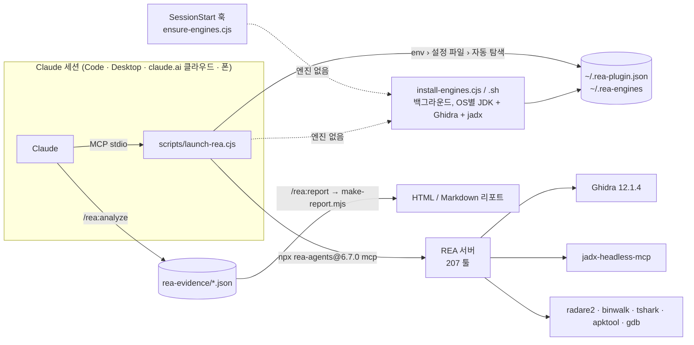

<p align="right"><a href="README.md">English</a> | <b>한국어</b></p>

<h1 align="center">REA for Claude</h1>

<p align="center">
  <b>Reverse Engineer Anything — Claude가 있는 모든 곳에서.</b><br>
  <a href="https://github.com/morluto/rea">REA</a>의 리버스 엔지니어링 툴 207개를 Claude Code, Claude Desktop,
  그리고 <b>Ghidra가 알아서 설치되는 claude.ai 클라우드 세션</b>에서 쓰고, 결과를 공유용 리포트로 만드세요.
</p>

<p align="center">
  <a href="https://github.com/NoLucas/REA-for-Claude/actions/workflows/ci.yml"></a>
  <a href="LICENSE"></a>
  
  
  
  
</p>

<p align="center">
  <a href="#-빠른-시작">빠른 시작</a> ·
  <a href="#-기능">기능</a> ·
  <a href="#-동작-원리">동작 원리</a> ·
  <a href="#-커맨드--스킬">커맨드</a> ·
  <a href="#-설정">설정</a> ·
  <a href="#-faq">FAQ</a> ·
  <a href="#-기여하기">기여</a>
</p>

---

## 왜 만들었나

원본 REA는 로컬 stdio MCP 서버이고 로컬에 설치된 엔진(Ghidra, jadx, IDA…)에 의존합니다.
그래서 기본적으로 Claude Code 터미널 전용 도구가 되죠. **REA for Claude**는 그 전제를 없앱니다.

| 세션이 도는 곳 | 어떻게 되나 | PC 필요 | 상태 |
|---|---|:---:|:---:|
| **claude.ai 클라우드 세션** (웹 · 모바일 · claude.ai/code) | 이 저장소를 붙이면 컨테이너 안에서 REA가 뜨고, **Ghidra 12.1.4 + jadx가 백그라운드로 자동 설치** | ✗ | ✅ 엔드투엔드 검증 |
| **로컬 Claude Code** (Windows · macOS · Linux) | 플러그인을 설치하면 첫 세션에서 **OS/CPU에 맞는 JDK 21(필요 시) + Ghidra + jadx를 백그라운드로 자동 설치** | ✓ | ✅ 설치기 검증(Linux 실제 설치, Windows/macOS는 CI dry-run) |
| **Claude Desktop + 연결된 claude.ai 세션** | REA는 PC에서 돌고 데스크톱 앱이 툴을 중계 → 폰에서 이어서 사용 가능 | ✓ | ⚠️ REA 팀의 Windows 11 검증 경로 사용 |
| **로컬 Claude Code** | 플러그인 또는 `.mcp.json` | ✓ | ✅ |
| **원격 어플라이언스** (Docker + 터널 → 커스텀 커넥터) | REA + 엔진을 Linux 컨테이너에 굽고 HTTPS로 노출 | 서버 | ⚠️ 부품은 검증, 이미지 빌드는 미실행 |

> **법적 안내.** 리버스 엔지니어링은 대상의 라이선스·약관·현지 법을 따라야 합니다.
> 사용 전 REA 원본의 [DISCLAIMER](https://github.com/morluto/rea/blob/main/DISCLAIMER.md)를 읽어 주세요.

## ⚡ 빠른 시작

<details open>
<summary><b>클라우드 세션 (PC 불필요) — 권장</b></summary>

1. 이 저장소를 포크하거나 본인 GitHub에 올립니다(비공개 가능).
2. [claude.ai/code](https://claude.ai/code)에서 이 저장소로 세션을 시작하거나, 채팅에 저장소를 붙입니다.
3. 이렇게 물어보세요: *"`./samples/app.bin` 분석해서 뭘 하는 프로그램인지 알려줘."*

내부 동작: `.mcp.json`이 REA를 즉시 띄우고, `SessionStart` 훅이 `~/.rea-engines`에 Ghidra + jadx를
설치합니다(약 2분). 툴이 `provider_unavailable`을 돌려주면 `~/.rea-engines/install.done`이 생길 때까지
기다렸다가 `open_binary`를 다시 호출하세요 — REA는 호출 시점에 엔진을 찾으므로 재시작이 필요 없습니다.

**기다림 없이 쓰려면:** claude.ai/code 환경 설정에
`Setup script = bash scripts/install-engines.sh`,
`GHIDRA_INSTALL_DIR=/root/.rea-engines/ghidra_12.1.4_PUBLIC`,
`REA_JADX_MCP_JAR=/root/.rea-engines/jadx-headless-mcp-0.7.1-all.jar`를 넣어 두세요.
</details>

<details>
<summary><b>로컬 Claude Code</b></summary>

```bash
claude plugin marketplace add NoLucas/REA-for-Claude
claude plugin install rea@rea-for-claude
# 또는 클론해서
claude --plugin-dir ./REA-for-Claude
```

**Windows · macOS · Linux 모두 설치는 이게 전부입니다.** Java도 Ghidra도 미리 깔 필요가 없습니다.
설치 후에는 이렇게 진행됩니다.

1. **첫 세션 시작** → 플러그인의 `SessionStart` 훅(`scripts/ensure-engines.cjs`)이
   `~/.rea-engines`를 확인하고, 비어 있으면 `scripts/install-engines.cjs`를 백그라운드로
   분리 실행합니다. 세션 컨텍스트에 한 줄을 남겨 Claude가 상황을 알게 합니다:
   `REA: installing JDK 21 + Ghidra + jadx for windows/x64 in the background … (~810 MB, usually 1–5 min)`.
2. **설치기가 OS/CPU에 맞는 빌드를 고릅니다**: Eclipse Temurin JDK 21(`windows/x64`,
   `mac/aarch64`, `mac/x64`, `linux/x64`, `linux/aarch64` — 이미 `javac`가 있는 64비트 JDK 21+가
   있으면 건너뜀), Ghidra 12.1.4(SHA-256 검증, 플랫폼별 네이티브 디컴파일러),
   jadx-headless-mcp 0.7.1, Linux에서는 apt 도구까지. 전부 `~/.rea-engines`
   (`%USERPROFILE%\.rea-engines`)에 들어가며, 같은 PC의 Claude Code·Claude Desktop·클라우드
   세션이 공유합니다. macOS에서는 격리(quarantine) 속성을 지워 Gatekeeper 경고가 뜨지 않습니다.
3. **REA는 즉시 시작**됩니다. 설치기가 만들 경로를 미리 넘겨 받고, 내려받은 JDK를 `JAVA_HOME`으로
   씁니다. 엔진이 필요 없는 프로바이더는 바로 동작하고, Ghidra/jadx 툴은
   `~/.rea-engines/install.done`이 생길 때까지 `provider_unavailable`을 돌려줍니다 — 그 뒤
   대상 파일을 `open_binary`로 다시 열면 됩니다(REA는 호출 시점에 엔진을 찾으므로 재시작 불필요).
4. **REA 사용**: `/rea:doctor`(Ghidra가 쓰는 JDK와, 설치 중이면 로그까지 표시) ·
   `/rea:analyze <파일>` · `/rea:report`. 이후 세션에서는 같은 훅이 0.2초 만에 "준비됨"으로 끝납니다.

직접 제어하고 싶다면 `~/.rea-plugin.json`에 `"auto_engines": false`를 주면 자동 설치가 꺼지고,
`/rea:install-engines`(또는 `node scripts/install-engines.cjs [--dry-run]`)로 원할 때 설치할 수
있으며, `ghidra_install_dir` / `jadx_mcp_jar` / `java_home`으로 직접 설치한 경로를 지정할 수 있습니다.
</details>

<details>
<summary><b>Windows 참고 (네이티브 또는 WSL)</b></summary>

네이티브 Windows REA는 Ghidra로 PE 대상(x86 / x64 / ARM), jadx로 Android, 그리고 엔진 불필요
프로바이더를 지원합니다. 설치기는 Node만 있으면 됩니다(Claude Code가 요구하고 Claude Desktop은
내장). 압축은 Windows 내장 `tar.exe`로 풀고, 사내 프록시는 `HTTPS_PROXY`를 따릅니다.
Linux 전용 도구(binwalk, tshark, mitmproxy)가 필요하면 `~/.rea-plugin.json`에
`"use_wsl": true`를 주세요. 런처가 REA를 WSL 안에서 실행하고 **`C:\…` 경로를 `/mnt/c/…`로 자동
변환**하므로 설정 하나로 두 모드를 다 씁니다. WSL 안에서는 `bash scripts/install-engines.sh`로
전부 설치됩니다.

Claude Desktop: 이 PC에서 원클릭 확장을 빌드한 뒤
(`powershell -ExecutionPolicy Bypass -File desktop\build-mcpb.ps1`)
설정 › 확장 › 고급 › Install Extension… › `dist\rea-for-claude-win32-x64.mcpb`.
확장도 같은 런처를 쓰므로 `%USERPROFILE%\.rea-engines`를 자동 탐색하고, 엔진이 없으면 같은
백그라운드 설치를 시작합니다.

REA 자체의 `npx rea-agents@6.7.0 setup --client claude_desktop`도 됩니다(Claude Desktop을 완전히
종료하고 일반 터미널에서). 설정 파일/WSL 모드를 쓰려면 `rea` 항목을
`node <저장소>\scripts\launch-rea.cjs`로 바꾸세요. `scripts\install-engines.ps1`은 스크립트
배포용 PowerShell 전용 설치기로 남아 있습니다.
</details>

<details>
<summary><b>macOS 참고</b></summary>

Apple Silicon과 Intel 모두 지원합니다. 설치기가 맞는 Temurin JDK를 받고 Ghidra는
`mac_arm_64` / `mac_x86_64` 네이티브 디컴파일러를 씁니다. 이미 `brew install --cask temurin@21`이
되어 있으면 JDK 다운로드는 건너뜁니다. Claude Desktop은 `bash desktop/build-mcpb.sh`로 확장을
빌드하세요.
</details>

<details>
<summary><b>원격 어플라이언스 (어디서든, PC 꺼져도)</b></summary>

```bash
cd remote && export REA_PATH_SECRET=$(openssl rand -hex 24)
docker compose up --build       # REA + Ghidra + jadx + radare2/binwalk/tshark/apktool + Cloudflare 터널
```
claude.ai → Settings → Connectors → *Add custom connector*에 `https://<터널>/<REA_PATH_SECRET>/mcp`를
넣으세요. [remote/README.ko.md](remote/README.ko.md)의 **보안 주의**를 꼭 읽어 주세요.
</details>

## ✨ 기능

| | |
|---|---|
| 🌍 **어디서든 실행** | 범용 런처 하나(`scripts/launch-rea.cjs`)가 Claude Code, Claude Desktop, claude.ai 클라우드 세션, Docker를 모두 담당합니다. |
| ⚙️ **모든 OS에서 엔진 자동 설치** | 첫 세션에서 JDK 21(쓸 만한 게 없을 때), Ghidra 12.1.4(SHA-256 검증), jadx-headless-mcp 0.7.1을 OS와 CPU에 맞춰 백그라운드로 설치합니다 — Windows x64, macOS arm64/x64, Linux x64/arm64. Linux는 apt 도구 묶음까지, 원하면 apktool·radare2도. 엔진별 선택 가능, 멱등, `~/.rea-engines` 하나를 공유. |
| 🩺 **자가 복구** | `/rea:doctor`가 디스크 상태를 검증합니다 — 반쯤 풀린 Ghidra, `javac` 없는 JRE, 잘린 jar, 오래된 버전 — 그리고 고치는 정확한 명령(`install-engines.cjs --force --only …` / `--upgrade`)을 출력합니다. |
| 📡 **이어받기·오프라인 설치** | 끊긴 다운로드는 이어받습니다(`curl -C -` / HTTP Range). 릴리스 파일을 `~/.rea-engines/archives/`(또는 `REA_PLUGIN_ARCHIVE_DIR`)에 넣어 두면 폐쇄망에서도 네트워크 없이 설치되며, 모든 파일은 SHA-256 검사를 거칩니다. |
| 📌 **고정 버전, 검증된 업그레이드** | 버전과 체크섬은 한 곳(`rea-engines-lib.cjs`)에만 있습니다. `install-engines.cjs --upgrade`가 기존 설치를 고정 버전으로 옮기고, 새 것이 검증된 뒤에만 옛 복사본을 지웁니다. |
| 🧲 **리버스 엔지니어링이면 REA가 기본** | `UserPromptSubmit` 훅(`scripts/rea-router.cjs`, 약 40ms)이 리버스 엔지니어링 요청을 알아봅니다 — "reverse engineer", "decompile", 디컴파일, 리버싱, 또는 바이너리/APK/펌웨어 파일 + 분석 동사 — 그리고 Claude에게 REA 툴과 맞는 플레이북을 쓰라고, 현재 엔진 상태와 함께 알려줍니다. 일반 소스코드 질문은 건드리지 않습니다. `"router": false`나 allow/deny 정규식(사용자·프로젝트별)으로 조정하고, `/rea:why`가 판단 이유를 설명합니다. |
| 🧭 **가이드 워크플로** | `/rea:analyze`가 대상 유형(네이티브 바이너리·APK·Electron/JS·펌웨어·웹 번들)별 플레이북을 골라 조사하며 증거를 모읍니다. |
| 📄 **공유용 리포트** | `/rea:report`가 REA evidence를 독립 실행 HTML(라이트/다크, 테마 6종), Markdown 또는 JSON 리포트로 만듭니다 — 디컴파일 코드, 개요, provider, confidence, limitations. 의존성 0. |
| 🔀 **evidence diff & 번들** | `/rea:report --diff <before> <after>`로 두 빌드를 비교: 개요 필드 변화, 추가/삭제된 프로시저·문자열·세그먼트, 디컴파일 코드 라인 diff. `--bundle`은 evidence를 이동 가능한 `*.rea-bundle.json` 하나로 묶고, `--diff`는 어느 머신에서 만든 번들이든 받습니다. |
| 🖥️ **원클릭 데스크톱 확장** | `desktop/build-mcpb.sh` / `.ps1`이 REA·런처·설치기를 엔진 경로 설정 패널이 달린 `.mcpb`로 묶습니다. Claude Desktop 내장 Node를 써서 별도 설치 불필요. 태그 릴리스는 Windows·macOS·Linux용으로 빌드·서명됩니다(`.github/workflows/release.yml`). |
| 🔐 **OAuth 보호 원격** | `remote/docker-compose.oauth.yml`이 의존성 없는 OAuth 2.1 게이트웨이(DCR + PKCE + 로그인 페이지)를 붙여, 경로 비밀 없이 claude.ai 커스텀 커넥터로 쓸 수 있습니다. |
| 🎛️ **사용자 설정** | `~/.rea-plugin.json`: 엔진 경로, 설치할 엔진, 리포트 형식/경로, WSL 모드, REA 버전, env 통과. 빈 값은 무시. |
| 🧪 **3개 OS에서 테스트** | `scripts/selftest.mjs`가 CI에서 Windows·macOS·Linux로 실행: 매니페스트·훅 구조, 문법, 리포트/diff 픽스처, 런처 env 처리, 설치기의 OS별 dry-run 계획, SessionStart 훅의 준비/누락/설치중 상태, 설치 락 처리, 그리고 실제 서버를 띄워 툴 제공을 확인하는 라이브 MCP 스모크. |
| 🪟 **Windows 네이티브, 필요하면 WSL** | 내장 `tar.exe`를 쓰는 네이티브 설치기, Windows에서의 `.mcpb` 빌드, cmd.exe 인용 없는 npx 실행, WSL 모드의 `C:\` → `/mnt/c/` 자동 변환, 그리고 Linux 전용 도구가 필요할 때 WSL 안에 Linux 엔진 세트를 깔아 주는 `install-engines.cjs --wsl`. |
| 📜 **안정성 보장** | [docs/STABILITY.md](docs/STABILITY.md)에 1.x 동안 유지되는 설정 키, `~/.rea-engines` 레이아웃, CLI 플래그, 파일 스키마를 정리했습니다. |

## 🔍 동작 원리



- **런처가 왜 필요한가.** 호스트가 빈 설정값을 `""`로 넘기면 REA가 "절대경로가 아님"으로 거부하고, 클라우드에서는 서버를 즉시 띄운 뒤 엔진을 받아야 하며, Windows는 WSL 분기가 필요합니다.
- **지연 설치가 되는 이유.** REA는 Ghidra 프로바이더를 서버 시작이 아니라 `open_binary` 시점에 해석합니다(테스트로 확인). 설치가 끝나면 대상을 다시 열면 됩니다.
- **`.mcp.json`과 `plugin.json`이 둘 다 있는 이유.** 클라우드/로컬 세션은 프로젝트 `.mcp.json`을, 플러그인 설치는 `plugin.json`을 읽습니다. 같은 `rea` 서버이고 플러그인 설치 시엔 후자가 이깁니다.
- `rea mcp --http`는 REA `main`에는 있지만 npm 6.7.0에는 없어, 원격 어플라이언스는 당분간 `supergateway`로 stdio → Streamable HTTP를 브리지합니다.

## 🧰 커맨드 & 스킬

| 커맨드 | 하는 일 |
|---|---|
| `/rea:analyze <경로> [목표]` | 가이드 조사: 대상 유형 판별 → 맞는 플레이북 실행 → 모든 결과를 `./rea-evidence/*.json`에 저장 |
| `/rea:report [디렉터리] [--format html\|md\|json\|both\|all] [--theme …] [--bundle]` | 저장된 evidence로 공유용 리포트 생성(설정의 `report.*` 반영); `--bundle`은 이동 가능한 evidence 번들 작성 |
| `/rea:report --diff <before> <after>` | 두 evidence 세트 또는 번들(같은 앱의 두 빌드, 다른 머신이어도)을 비교한 변경 리포트 |
| `/rea:doctor` | MCP 서버 상태, 엔진별 가용 여부, 빠진 엔진의 정확한 해결법 |
| `/rea:capabilities` | 이 호스트에서 *지금* 가능한 REA 기능을 대상 유형별로 정리 |
| `/rea:install-engines` | Windows·macOS·Linux 엔진 설치기(멱등, 선택형, `--dry-run`, `--upgrade`, `--wsl`, 선택 엔진 apktool/radare2) |
| `/rea:why [프롬프트]` | 어떤 프롬프트가 REA로 라우팅된(안 된) 이유와 라우터 조정 방법 |

| 스킬 | 용도 |
|---|---|
| `reverse-engineer-anything` | REA 공식 207툴 레퍼런스와 복구 가이드(MIT, 동봉) |
| `rea-workflows` | 유형별 플레이북: 네이티브 ELF/PE/Mach-O, Android APK, Electron/JS, 펌웨어, 웹, **Go, Rust, Flutter/Dart, WebAssembly** |
| `rea-anywhere` | 환경별 운영 노트: 클라우드 자동 설치, `provider_unavailable`, 파일 위치 |

## 🎛️ 설정

`~/.rea-plugin.json` (또는 `$REA_PLUGIN_CONFIG`). 값별 우선순위: **REA 환경변수 → `REA_PLUGIN_*` 환경변수 → 설정 파일 → `~/.rea-engines` 자동 탐색**.

```jsonc
{
  "rea_version": "6.7.0",
  "ghidra_install_dir": "C:\\tools\\ghidra_12.1.4_PUBLIC",   // Linux 경로도 가능
  "jadx_mcp_jar": "C:\\tools\\jadx-headless-mcp-0.7.1-all.jar",
  "kuna_command": "", "ida_mcp_config": "", "browser_executable": "",
  "engines_dir": "",                       // 기본 ~/.rea-engines
  "java_home": "",                         // 선택; 내려받은 ~/.rea-engines/jdk-21은 자동 탐지
  "auto_engines": true,                    // 첫 사용 시 백그라운드 설치(모든 OS)
  "jdk": true,                             // 쓸 만한 JDK가 없으면 JDK 21 다운로드
  "engines": ["ghidra", "jadx", "apt"],    // install-engines가 받을 엔진 (+ "apktool", "radare2")
  "optional_engines": false,               // "all"에 apktool/radare2 포함
  "archive_dir": "",                       // 오프라인 설치용 미리 받은 릴리스 파일
  "router": { "allow": [], "deny": [] },   // false면 자동 라우팅 끔
  "use_wsl": false, "wsl_distro": "Ubuntu",
  "rea_command": "",                       // 전역 설치면 "rea"
  "report": { "format": "html", "dir": "rea-reports", "theme": "violet" },
  "env": { "REA_GHIDRA_STARTUP_TIMEOUT_MS": "600000" }
}
```

| 키 | 타입 | 기본값 | 비고 |
|---|---|---|---|
| `engines` | string[] | `["all"]` | `apt` = radare2, binwalk, tshark, apktool, binutils, gdb(Linux); `apktool`, `radare2`는 모든 OS에서 선택 |
| `optional_engines` | bool | `false` | `all`에 `apktool`·`radare2` 포함 |
| `archive_dir` | 경로 | — | 미리 받은 릴리스 파일 디렉터리(`~/.rea-engines/archives/`도 항상 확인) |
| `router` | bool / 객체 | `true` | `false`면 라우팅 끔; `{ "allow": [정규식], "deny": [정규식] }`로 조정; 프로젝트 `.rea-plugin.json`이 우선 |
| `auto_engines` | bool | `true` | Ghidra가 없으면 백그라운드 설치(Windows·macOS·Linux) |
| `jdk` | bool | `true` | 쓸 만한 JDK 21+가 없으면 Eclipse Temurin JDK 21을 `~/.rea-engines/jdk-21`에 다운로드 |
| `java_home` | 경로 | 자동 | Ghidra/jadx용 JDK; 환경변수 `JAVA_HOME` → 이 값 → 내려받은 JDK 순 |
| `engines_dir` | 경로 | `~/.rea-engines` | 자동 탐색 루트 |
| `report.format` / `report.dir` / `report.theme` | `html`·`md`·`json`·`both`·`all` / 경로 / `violet`·`ocean`·`forest`·`amber`·`mono`·`contrast` | `html` / `rea-reports` / `violet` | `/rea:report` 기본값 |
| `use_wsl` / `wsl_distro` | bool / string | `false` / `Ubuntu` | Windows 전용; 엔진 경로는 Linux 경로 |
| `rea_version` | string | `6.7.0` | 고정 npm 버전 |
| `env` | object | — | REA에 그대로 넘길 추가 변수(타임아웃, 스키마 프로필 등) |

환경변수 대응: `REA_PLUGIN_CONFIG`, `REA_PLUGIN_ENGINES_DIR`, `REA_PLUGIN_ARCHIVE_DIR`, `REA_PLUGIN_ENGINES`,
`REA_PLUGIN_OPTIONAL_ENGINES=1`, `REA_PLUGIN_AUTO_ENGINES=0|1`, `REA_PLUGIN_SKIP_JDK=1`, `REA_PLUGIN_ROUTER=0`, `REA_PLUGIN_USE_WSL=1`, `REA_PLUGIN_VERSION`, 그리고 REA 기본 변수
(`GHIDRA_INSTALL_DIR`, `REA_JADX_MCP_JAR`, `REA_KUNA_COMMAND`, `REA_IDA_MCP_CONFIG`).

## 📊 검증 수치

Anthropic 클라우드 컨테이너(Ubuntu 24.04, 2 vCPU, 8 GB, JDK 21)에서 측정:

| 단계 | 결과 |
|---|---|
| 빈 디렉터리에서 `install-engines.sh` | **1분 46초** (Ghidra 570 MB 다운로드 + SHA-256 + 압축 해제, jadx, apt 도구) |
| 빈 디렉터리에서 `install-engines.cjs` (Linux x64, 시스템 Java 없음) | JDK 21(207 MB) + jadx: **약 15초**; Ghidra 12.1.4(570 MB) 다운로드 + SHA-256 + 해제: **약 30초**; 이후 REA doctor가 내려받은 JDK로 `ghidra-java … accepted a 64-bit full JDK 21` 보고 |
| `ensure-engines.cjs` (SessionStart 훅) | 엔진이 있거나 설치 중이면 **0.2초** |
| `install-engines.cjs` 이어받기 / 오프라인 | apktool 5 MB 부분 파일을 **1초 안에** 이어받아 검증; `archives/`의 릴리스 파일은 네트워크 없이 사용 |
| `rea-router.cjs` (UserPromptSubmit 훅) | **약 40ms**, CI에서 라우팅 케이스 8/8 |
| `rea doctor` | ghidra 12.1.4 `available=true`, jadx `available=true` |
| 작은 ELF Ghidra 디컴파일 | 호출당 ≈ 20초 |
| 런처 기동 → `tools/list` | 207 툴, 1초 미만 |
| 새 Claude Code 세션에서 전체 체인 | `.mcp.json` 자동 로드 → 훅이 엔진 설치 → `procedure_pseudo_code`가 Ghidra 출력 반환 |

## 📁 저장소 구조

```
.claude-plugin/        plugin.json · marketplace.json (저장소가 마켓플레이스를 겸함)
.mcp.json              클라우드/로컬 세션용 프로젝트 MCP 서버 (승인 없이 로드)
.claude/settings.json  SessionStart 훅: 클라우드 세션에서 엔진 백그라운드 설치
scripts/
  launch-rea.cjs       범용 런처
  install-engines.cjs  Windows·macOS·Linux 설치기 (JDK 21, Ghidra, jadx) — 훅과 런처가 실행
  ensure-engines.cjs   SessionStart 훅: 엔진 확인 → 없으면 백그라운드 설치 시작 → 상태 한 줄 출력
  rea-router.cjs       UserPromptSubmit 훅: 리버스 엔지니어링 프롬프트 → "REA + 이 플레이북 사용" 컨텍스트
  rea-engines-lib.cjs  공용: OS 감지, 설정, 엔진/JDK 탐색
  install-engines.sh   Linux/Docker 설치기 (Ghidra, jadx, apt) — 멱등, 선택형
  install-engines.ps1  Windows PowerShell 전용 설치기 (Ghidra, jadx; -SetEnv / -WriteConfig)
  make-report.mjs      REA evidence → HTML/Markdown 리포트, --diff 포함
  selftest.mjs         크로스플랫폼 점검 (Windows/macOS/Linux CI)
  selftest.sh          bash 전용 점검: OAuth 게이트웨이, 엔트리포인트 감지
  rea-config.example.json
desktop/               manifest.json · build-mcpb.sh · build-mcpb.ps1  (Claude Desktop .mcpb)
skills/                reverse-engineer-anything · rea-workflows · rea-anywhere
commands/              analyze · report · doctor · capabilities · install-engines · why
docs/STABILITY.md      1.x에서 유지되는 것: 설정 키, ~/.rea-engines 레이아웃, CLI 플래그, 파일 스키마
.github/workflows/     ci.yml (3-OS selftest) · release.yml (v* 태그에 3-OS 서명 .mcpb)
tests/fixtures/        소형 REA evidence 샘플
remote/                Dockerfile · docker-compose.yml · docker-compose.oauth.yml · oauth-gateway/ · README
.github/workflows/     ci.yml
```

## 🩹 문제 해결 (Windows 우선)

| 증상 | 원인 | 해결 |
|---|---|---|
| `spawn npx.cmd EINVAL` | Node ≥ 22는 셸 없이 `.cmd` 실행을 거부 | 런처가 고침: npm의 `npx-cli.js`를 Node 바이너리로 직접 실행(cmd.exe 미사용). 플러그인 업데이트. |
| `GHIDRA_INSTALL_DIR must be absolute` | 호스트가 빈 설정을 `""`로 전달 | 런처가 빈 값을 버림; 직접 지정할 땐 `C:\tools\ghidra_12.1.4_PUBLIC` 같은 전체 경로 |
| Windows에서 Ghidra `provider_unavailable` | 백그라운드 설치가 아직 진행 중이거나 실패함 | `/rea:doctor`로 상태 확인 → `%USERPROFILE%\.rea-engines\install.log` 확인 → 실패했으면 `/rea:install-engines` 재실행(JDK 21은 자동으로 내려받음) |
| Claude Desktop에 `rea` 서버가 안 보임 | MSIX 빌드는 `%APPDATA%`가 아니라 `%LOCALAPPDATA%\Packages\Claude_…\LocalCache\Roaming\Claude\claude_desktop_config.json`을 읽음 | `.mcpb`로 설치하거나, 앱을 완전히 종료한 뒤 REA의 `setup --client claude_desktop` 실행 |
| `.ps1 cannot be loaded … execution policy` | 기본 정책이 스크립트 차단 | 안내대로 `powershell -ExecutionPolicy Bypass -File …` |
| Ghidra zip을 Defender가 잡거나 압축 해제가 느림 | 작은 파일이 많은 큰 아카이브 | `%USERPROFILE%\.rea-engines` 제외 등록 또는 대기; SHA-256 검증이 무결성 보장 |
| WSL 모드에서 Ghidra를 못 찾음 | Windows 경로를 줬는데 WSL은 Linux 경로 기대 | 0.5.0부터 자동 변환(`C:\x` → `/mnt/c/x`); 또는 WSL 안에 설치한 Ghidra 지정 |
| 큰 바이너리에서 타임아웃 | 헤드리스 분석이 느림 | `env`의 `REA_GHIDRA_STARTUP_TIMEOUT_MS` 증가; 한 번 분석 후 함수 단위 호출 |

어느 OS에서든 `node scripts/selftest.mjs`로 플러그인 자체를 점검할 수 있고, CI는 매 푸시마다
Windows·macOS·Linux에서 이를 실행합니다.

## ❓ FAQ

**폰의 claude.ai에서도 되나요?** 네, 두 가지 방식으로요. 이 저장소를 붙인 클라우드 세션은 Anthropic 컨테이너에서 REA를 돌리므로 PC가 필요 없습니다. 또는 PC에 연결된 세션이 데스크톱 앱의 로컬 REA 툴을 중계합니다.

**Ghidra를 직접 설치해야 하나요?** 아니요 — Windows·macOS·Linux·클라우드 모두 첫 세션에서 설치기가 JDK 21(필요 시)·Ghidra 12.1.4(SHA-256 검증)·jadx를 알아서 받습니다. 직접 설치한 것을 쓰려면 `~/.rea-plugin.json`에 `ghidra_install_dir`(및 `java_home`)을 적으세요.

**자동 설치되지 않는 엔진은?** IDA, Kuna, Hopper(상용 또는 수동 설치). 설정에 본인 설치 경로를 적어 주세요.

**큰 바이너리가 느리거나 타임아웃이 나요.** 클라우드 컨테이너가 작습니다. `env`의 `REA_GHIDRA_STARTUP_TIMEOUT_MS`를 늘리고, 개요는 한 번만 뽑은 뒤 `procedure_pseudo_code`로 함수 단위 호출을 쓰세요.

**이미 `npx rea-agents setup`을 돌렸는데요.** 클라이언트당 등록은 하나만 남기세요. 아니면 `rea` 서버가 둘 뜹니다.

**리포트 내용은 믿어도 되나요?** 아니요. 심볼 이름, 경로, 디컴파일 코드는 분석 대상에서 나온 것이고 리포트 상단에도 그렇게 적혀 있습니다. 명령이 아니라 데이터로 다루세요.

## 🤝 기여하기

```bash
git clone https://github.com/NoLucas/REA-for-Claude && cd REA-for-Claude
node scripts/selftest.mjs           # 모든 OS: 오프라인 점검 + 라이브 MCP 스모크 (REA_SELFTEST_SKIP_MCP=1로 건너뛰기)
bash scripts/selftest.sh            # Linux/macOS: OAuth 게이트웨이·엔트리포인트 점검 추가
claude plugin validate --strict .claude-plugin/plugin.json
```

PR 환영합니다 — 플레이북, 엔진 레시피, 리포트 렌더러, Windows/macOS 테스트. selftest는 녹색으로
유지하고, 최상위 `bin/`은 추가하지 마세요(claude.ai가 그런 플러그인을 거부합니다).

## 📜 라이선스 & 크레딧

플러그인 래퍼: [MIT](LICENSE). `skills/reverse-engineer-anything/`는 [morluto/rea](https://github.com/morluto/rea)에서
가져온 것(MIT, `LICENSE.rea` 참고). REA 본체는 포함되지 않고 실행 시 npm에서 받습니다. Ghidra는 Apache-2.0(NSA),
jadx-headless-mcp는 해당 저장소의 라이선스를 따릅니다. REA·Ghidra·jadx 프로젝트와 공식 관계는 없습니다.
