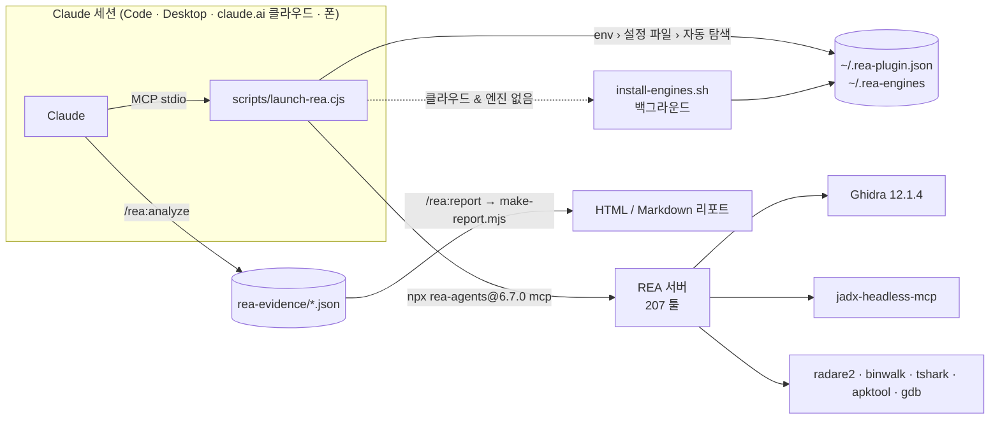

<p align="right"><a href="README.md">English</a> | <b>한국어</b></p>

<h1 align="center">REA for Claude</h1>

<p align="center">
  <b>Reverse Engineer Anything — Claude가 있는 모든 곳에서.</b><br>
  <a href="https://github.com/morluto/rea">REA</a>의 리버스 엔지니어링 툴 207개를 Claude Code, Claude Desktop,
  그리고 <b>Ghidra가 알아서 설치되는 claude.ai 클라우드 세션</b>에서 쓰고, 결과를 공유용 리포트로 만드세요.
</p>

<p align="center">
  <a href="https://github.com/NoLucas/REA-for-Claude/actions/workflows/ci.yml"></a>
  <a href="LICENSE"></a>
  
  
  
  
</p>

<p align="center">
  <a href="#-빠른-시작">빠른 시작</a> ·
  <a href="#-기능">기능</a> ·
  <a href="#-동작-원리">동작 원리</a> ·
  <a href="#-커맨드--스킬">커맨드</a> ·
  <a href="#-설정">설정</a> ·
  <a href="#-faq">FAQ</a> ·
  <a href="#-기여하기">기여</a>
</p>

---

## 왜 만들었나

원본 REA는 로컬 stdio MCP 서버이고 로컬에 설치된 엔진(Ghidra, jadx, IDA…)에 의존합니다.
그래서 기본적으로 Claude Code 터미널 전용 도구가 되죠. **REA for Claude**는 그 전제를 없앱니다.

| 세션이 도는 곳 | 어떻게 되나 | PC 필요 | 상태 |
|---|---|:---:|:---:|
| **claude.ai 클라우드 세션** (웹 · 모바일 · claude.ai/code) | 이 저장소를 붙이면 컨테이너 안에서 REA가 뜨고, **Ghidra 12.1.4 + jadx가 백그라운드로 자동 설치** | ✗ | ✅ 엔드투엔드 검증 |
| **Claude Desktop + 연결된 claude.ai 세션** | REA는 PC에서 돌고 데스크톱 앱이 툴을 중계 → 폰에서 이어서 사용 가능 | ✓ | ⚠️ REA 팀의 Windows 11 검증 경로 사용 |
| **로컬 Claude Code** | 플러그인 또는 `.mcp.json` | ✓ | ✅ |
| **원격 어플라이언스** (Docker + 터널 → 커스텀 커넥터) | REA + 엔진을 Linux 컨테이너에 굽고 HTTPS로 노출 | 서버 | ⚠️ 부품은 검증, 이미지 빌드는 미실행 |

> **법적 안내.** 리버스 엔지니어링은 대상의 라이선스·약관·현지 법을 따라야 합니다.
> 사용 전 REA 원본의 [DISCLAIMER](https://github.com/morluto/rea/blob/main/DISCLAIMER.md)를 읽어 주세요.

## ⚡ 빠른 시작

<details open>
<summary><b>클라우드 세션 (PC 불필요) — 권장</b></summary>

1. 이 저장소를 포크하거나 본인 GitHub에 올립니다(비공개 가능).
2. [claude.ai/code](https://claude.ai/code)에서 이 저장소로 세션을 시작하거나, 채팅에 저장소를 붙입니다.
3. 이렇게 물어보세요: *"`./samples/app.bin` 분석해서 뭘 하는 프로그램인지 알려줘."*

내부 동작: `.mcp.json`이 REA를 즉시 띄우고, `SessionStart` 훅이 `~/.rea-engines`에 Ghidra + jadx를
설치합니다(약 2분). 툴이 `provider_unavailable`을 돌려주면 `~/.rea-engines/install.done`이 생길 때까지
기다렸다가 `open_binary`를 다시 호출하세요 — REA는 호출 시점에 엔진을 찾으므로 재시작이 필요 없습니다.

**기다림 없이 쓰려면:** claude.ai/code 환경 설정에
`Setup script = bash scripts/install-engines.sh`,
`GHIDRA_INSTALL_DIR=/root/.rea-engines/ghidra_12.1.4_PUBLIC`,
`REA_JADX_MCP_JAR=/root/.rea-engines/jadx-headless-mcp-0.7.1-all.jar`를 넣어 두세요.
</details>

<details>
<summary><b>로컬 Claude Code</b></summary>

```bash
claude plugin marketplace add NoLucas/REA-for-Claude
claude plugin install rea@rea-for-claude
# 또는 클론해서
claude --plugin-dir ./REA-for-Claude
```
그 다음 `/rea:doctor`. Linux면 `/rea:install-engines`가 엔진까지 받아 줍니다.
</details>

<details>
<summary><b>Claude Desktop (Windows / macOS) + PC에 연결된 세션</b></summary>

```powershell
# Node.js 22/24 설치 후, Claude Desktop을 완전히 종료(트레이까지)하고 일반 터미널에서:
npx rea-agents@6.7.0 setup --client claude_desktop
# Claude Desktop 재시작 → 설정 › 개발자 탭에 "rea"가 보이면 성공
```
엔진 경로는 시스템 환경변수(`GHIDRA_INSTALL_DIR`, `REA_JADX_MCP_JAR`)로 지정하세요.
이 플러그인의 런처(설정 파일 + WSL 모드)를 쓰려면 `claude_desktop_config.json`의 `rea` 항목을
`node <저장소>/scripts/launch-rea.cjs`로 바꾸면 됩니다.
Windows 팁: `~/.rea-plugin.json`에 `"use_wsl": true`를 주면 REA가 WSL 안에서 실행돼
Linux 전용 도구(binwalk, tshark, mitmproxy)까지 쓸 수 있습니다.
</details>

<details>
<summary><b>원격 어플라이언스 (어디서든, PC 꺼져도)</b></summary>

```bash
cd remote && export REA_PATH_SECRET=$(openssl rand -hex 24)
docker compose up --build       # REA + Ghidra + jadx + radare2/binwalk/tshark/apktool + Cloudflare 터널
```
claude.ai → Settings → Connectors → *Add custom connector*에 `https://<터널>/<REA_PATH_SECRET>/mcp`를
넣으세요. [remote/README.ko.md](remote/README.ko.md)의 **보안 주의**를 꼭 읽어 주세요.
</details>

## ✨ 기능

| | |
|---|---|
| 🌍 **어디서든 실행** | 범용 런처 하나(`scripts/launch-rea.cjs`)가 Claude Code, Claude Desktop, claude.ai 클라우드 세션, Docker를 모두 담당합니다. |
| ⚙️ **엔진 자동 설치** | Ghidra 12.1.4(SHA-256 검증), jadx-headless-mcp 0.7.1, apt 도구 묶음이 Linux에서 백그라운드로 알아서 설치됩니다. 엔진별 선택 가능. |
| 🧭 **가이드 워크플로** | `/rea:analyze`가 대상 유형(네이티브 바이너리·APK·Electron/JS·펌웨어·웹 번들)별 플레이북을 골라 조사하며 증거를 모읍니다. |
| 📄 **공유용 리포트** | `/rea:report`가 REA evidence를 독립 실행 HTML(라이트/다크) 또는 Markdown 리포트로 만듭니다 — 디컴파일 코드, 개요, provider, confidence, limitations. 의존성 0. |
| 🎛️ **사용자 설정** | `~/.rea-plugin.json`: 엔진 경로, 설치할 엔진, 리포트 형식/경로, WSL 모드, REA 버전, env 통과. 빈 값은 무시. |
| 🧪 **테스트** | `scripts/selftest.sh` + GitHub Actions: 매니페스트 구조, 셸/노드 문법, 리포트 픽스처, 그리고 서버를 실제로 띄워 207툴을 확인하는 라이브 MCP 스모크. |
| 🪟 **Windows 고려** | PE 대상은 네이티브 Windows로, 전체 Linux 도구는 `use_wsl`로. `userConfig`에 의존하지 않아 Claude Desktop이 서버를 직접 띄울 수 있습니다. |

## 🔍 동작 원리



- **런처가 왜 필요한가.** 호스트가 빈 설정값을 `""`로 넘기면 REA가 "절대경로가 아님"으로 거부하고, 클라우드에서는 서버를 즉시 띄운 뒤 엔진을 받아야 하며, Windows는 WSL 분기가 필요합니다.
- **지연 설치가 되는 이유.** REA는 Ghidra 프로바이더를 서버 시작이 아니라 `open_binary` 시점에 해석합니다(테스트로 확인). 설치가 끝나면 대상을 다시 열면 됩니다.
- **`.mcp.json`과 `plugin.json`이 둘 다 있는 이유.** 클라우드/로컬 세션은 프로젝트 `.mcp.json`을, 플러그인 설치는 `plugin.json`을 읽습니다. 같은 `rea` 서버이고 플러그인 설치 시엔 후자가 이깁니다.
- `rea mcp --http`는 REA `main`에는 있지만 npm 6.7.0에는 없어, 원격 어플라이언스는 당분간 `supergateway`로 stdio → Streamable HTTP를 브리지합니다.

## 🧰 커맨드 & 스킬

| 커맨드 | 하는 일 |
|---|---|
| `/rea:analyze <경로> [목표]` | 가이드 조사: 대상 유형 판별 → 맞는 플레이북 실행 → 모든 결과를 `./rea-evidence/*.json`에 저장 |
| `/rea:report [디렉터리] [--format html\|md\|both]` | 저장된 evidence로 공유용 리포트 생성(설정의 `report.*` 반영) |
| `/rea:doctor` | MCP 서버 상태, 엔진별 가용 여부, 빠진 엔진의 정확한 해결법 |
| `/rea:capabilities` | 이 호스트에서 *지금* 가능한 REA 기능을 대상 유형별로 정리 |
| `/rea:install-engines` | Linux 엔진 설치기(멱등, 선택형) |

| 스킬 | 용도 |
|---|---|
| `reverse-engineer-anything` | REA 공식 207툴 레퍼런스와 복구 가이드(MIT, 동봉) |
| `rea-workflows` | 유형별 플레이북: 네이티브 ELF/PE/Mach-O, Android APK, Electron/JS, 펌웨어, 웹 |
| `rea-anywhere` | 환경별 운영 노트: 클라우드 자동 설치, `provider_unavailable`, 파일 위치 |

## 🎛️ 설정

`~/.rea-plugin.json` (또는 `$REA_PLUGIN_CONFIG`). 값별 우선순위: **REA 환경변수 → `REA_PLUGIN_*` 환경변수 → 설정 파일 → `~/.rea-engines` 자동 탐색**.

```jsonc
{
  "rea_version": "6.7.0",
  "ghidra_install_dir": "C:\\tools\\ghidra_12.1.4_PUBLIC",   // Linux 경로도 가능
  "jadx_mcp_jar": "C:\\tools\\jadx-headless-mcp-0.7.1-all.jar",
  "kuna_command": "", "ida_mcp_config": "", "browser_executable": "",
  "engines_dir": "",                       // 기본 ~/.rea-engines
  "auto_engines": false,                   // 클라우드 세션은 기본 true
  "engines": ["ghidra", "jadx", "apt"],    // install-engines가 받을 엔진
  "use_wsl": false, "wsl_distro": "Ubuntu",
  "rea_command": "",                       // 전역 설치면 "rea"
  "report": { "format": "html", "dir": "rea-reports" },
  "env": { "REA_GHIDRA_STARTUP_TIMEOUT_MS": "600000" }
}
```

| 키 | 타입 | 기본값 | 비고 |
|---|---|---|---|
| `engines` | string[] | `["ghidra","jadx","apt"]` | `apt` = radare2, binwalk, tshark, apktool, binutils, gdb |
| `auto_engines` | bool | 클라우드 `true`, 그 외 `false` | Ghidra가 없으면 백그라운드 설치(Linux) |
| `engines_dir` | 경로 | `~/.rea-engines` | 자동 탐색 루트 |
| `report.format` / `report.dir` | `html`·`md`·`both` / 경로 | `html` / `rea-reports` | `/rea:report` 기본값 |
| `use_wsl` / `wsl_distro` | bool / string | `false` / `Ubuntu` | Windows 전용; 엔진 경로는 Linux 경로 |
| `rea_version` | string | `6.7.0` | 고정 npm 버전 |
| `env` | object | — | REA에 그대로 넘길 추가 변수(타임아웃, 스키마 프로필 등) |

환경변수 대응: `REA_PLUGIN_CONFIG`, `REA_PLUGIN_ENGINES_DIR`, `REA_PLUGIN_ENGINES`,
`REA_PLUGIN_AUTO_ENGINES=1`, `REA_PLUGIN_USE_WSL=1`, `REA_PLUGIN_VERSION`, 그리고 REA 기본 변수
(`GHIDRA_INSTALL_DIR`, `REA_JADX_MCP_JAR`, `REA_KUNA_COMMAND`, `REA_IDA_MCP_CONFIG`).

## 📊 검증 수치

Anthropic 클라우드 컨테이너(Ubuntu 24.04, 2 vCPU, 8 GB, JDK 21)에서 측정:

| 단계 | 결과 |
|---|---|
| 빈 디렉터리에서 `install-engines.sh` | **1분 46초** (Ghidra 570 MB 다운로드 + SHA-256 + 압축 해제, jadx, apt 도구) |
| `rea doctor` | ghidra 12.1.4 `available=true`, jadx `available=true` |
| 작은 ELF Ghidra 디컴파일 | 호출당 ≈ 20초 |
| 런처 기동 → `tools/list` | 207 툴, 1초 미만 |
| 새 Claude Code 세션에서 전체 체인 | `.mcp.json` 자동 로드 → 훅이 엔진 설치 → `procedure_pseudo_code`가 Ghidra 출력 반환 |

## 📁 저장소 구조

```
.claude-plugin/        plugin.json · marketplace.json (저장소가 마켓플레이스를 겸함)
.mcp.json              클라우드/로컬 세션용 프로젝트 MCP 서버 (승인 없이 로드)
.claude/settings.json  SessionStart 훅: 클라우드 세션에서 엔진 백그라운드 설치
scripts/
  launch-rea.cjs       범용 런처
  install-engines.sh   Linux 설치기 (Ghidra, jadx, apt) — 멱등, 선택형
  make-report.mjs      REA evidence → HTML/Markdown 리포트
  selftest.sh          오프라인 점검 + 라이브 MCP 스모크 (CI가 사용)
  rea-config.example.json
skills/                reverse-engineer-anything · rea-workflows · rea-anywhere
commands/              analyze · report · doctor · capabilities · install-engines
tests/fixtures/        소형 REA evidence 샘플
remote/                Dockerfile · docker-compose.yml (Cloudflare 터널) · README
.github/workflows/     ci.yml
```

## ❓ FAQ

**폰의 claude.ai에서도 되나요?** 네, 두 가지 방식으로요. 이 저장소를 붙인 클라우드 세션은 Anthropic 컨테이너에서 REA를 돌리므로 PC가 필요 없습니다. 또는 PC에 연결된 세션이 데스크톱 앱의 로컬 REA 툴을 중계합니다.

**Ghidra를 직접 설치해야 하나요?** Linux/클라우드에서는 아니요 — `install-engines.sh`가 SHA-256 검증까지 해서 설치합니다. Windows/macOS에서는 Ghidra 12.1.4를 설치하고 `GHIDRA_INSTALL_DIR`을 지정하세요.

**자동 설치되지 않는 엔진은?** IDA, Kuna, Hopper(상용 또는 수동 설치). 설정에 본인 설치 경로를 적어 주세요.

**큰 바이너리가 느리거나 타임아웃이 나요.** 클라우드 컨테이너가 작습니다. `env`의 `REA_GHIDRA_STARTUP_TIMEOUT_MS`를 늘리고, 개요는 한 번만 뽑은 뒤 `procedure_pseudo_code`로 함수 단위 호출을 쓰세요.

**이미 `npx rea-agents setup`을 돌렸는데요.** 클라이언트당 등록은 하나만 남기세요. 아니면 `rea` 서버가 둘 뜹니다.

**리포트 내용은 믿어도 되나요?** 아니요. 심볼 이름, 경로, 디컴파일 코드는 분석 대상에서 나온 것이고 리포트 상단에도 그렇게 적혀 있습니다. 명령이 아니라 데이터로 다루세요.

## 🗺️ 로드맵

- [ ] npm에 네이티브 `rea mcp --http`가 올라오면 원격 어플라이언스를 그것으로 전환
- [ ] Claude Desktop 원클릭 설치용 `.mcpb` 데스크톱 확장 빌드 스크립트
- [ ] 원격 어플라이언스용 OAuth 게이트웨이 레시피
- [ ] 리포트 diff: 두 evidence 세트 비교(같은 앱의 두 빌드)
- [ ] 플레이북 추가(Go/Rust 바이너리, Flutter, WASM)

## 🤝 기여하기

```bash
git clone https://github.com/NoLucas/REA-for-Claude && cd REA-for-Claude
bash scripts/selftest.sh            # 오프라인 점검 + 라이브 MCP 스모크 (REA_SELFTEST_SKIP_MCP=1로 건너뛰기)
claude plugin validate --strict .claude-plugin/plugin.json
```

PR 환영합니다 — 플레이북, 엔진 레시피, 리포트 렌더러, Windows/macOS 테스트. selftest는 녹색으로
유지하고, 최상위 `bin/`은 추가하지 마세요(claude.ai가 그런 플러그인을 거부합니다).

## 📜 라이선스 & 크레딧

플러그인 래퍼: [MIT](LICENSE). `skills/reverse-engineer-anything/`는 [morluto/rea](https://github.com/morluto/rea)에서
가져온 것(MIT, `LICENSE.rea` 참고). REA 본체는 포함되지 않고 실행 시 npm에서 받습니다. Ghidra는 Apache-2.0(NSA),
jadx-headless-mcp는 해당 저장소의 라이선스를 따릅니다. REA·Ghidra·jadx 프로젝트와 공식 관계는 없습니다.
