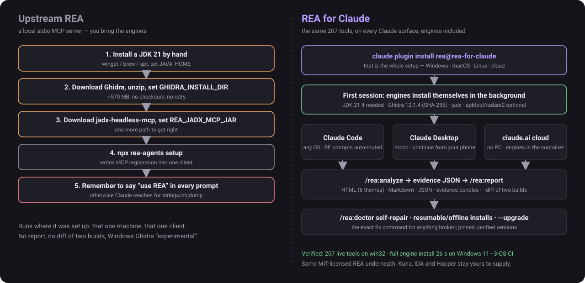
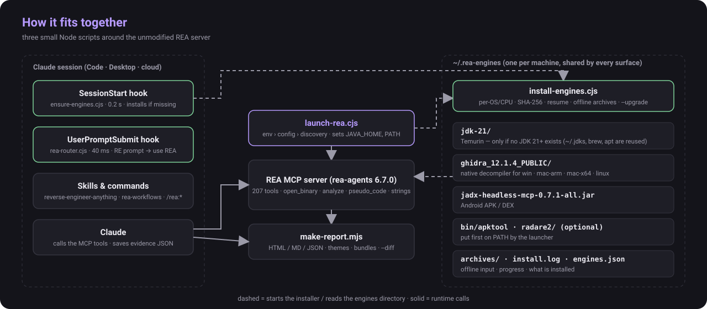
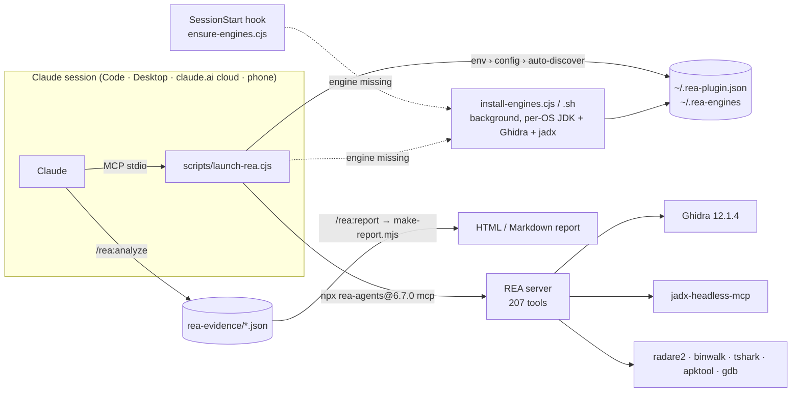

<p align="right"><b>English</b> | <a href="README.ko.md">한국어</a></p>

<h1 align="center">REA for Claude</h1>

<p align="center">
  <b>Reverse Engineer Anything — from any Claude surface, with zero setup.</b><br>
  Run <a href="https://github.com/morluto/rea">REA</a>'s 207 reverse-engineering tools in Claude Code (Windows · macOS · Linux), Claude Desktop
  and claude.ai cloud sessions. <b>The engines install themselves</b>, reverse-engineering requests are <b>routed to REA automatically</b>,
  and the findings become a shareable report.
</p>

<p align="center">
  
</p>

<p align="center">
  <a href="https://github.com/NoLucas/REA-for-Claude/actions/workflows/ci.yml"></a>
  <a href="LICENSE"></a>
  
  
  
  
</p>

<p align="center">
  <a href="#-quick-start">Quick start</a> ·
  <a href="#-how-this-differs-from-upstream-rea">vs. upstream REA</a> ·
  <a href="#-features">Features</a> ·
  <a href="#-how-it-works">How it works</a> ·
  <a href="#-commands--skills">Commands</a> ·
  <a href="#-configuration">Configuration</a> ·
  <a href="#-faq">FAQ</a> ·
  <a href="#-contributing">Contributing</a>
</p>

---

## Why

Upstream REA is a local stdio MCP server that depends on locally installed engines (Ghidra, jadx, IDA…).
That makes it a Claude Code–terminal tool by default. **REA for Claude** removes that assumption:

| Where your session runs | What happens | PC needed | Status |
|---|---|:---:|:---:|
| **claude.ai cloud session** (web · mobile · claude.ai/code) | Attach this repo → REA starts in the container, **Ghidra 12.1.4 + jadx auto-install** in the background | ✗ | ✅ verified end-to-end |
| **Local Claude Code** (Windows · macOS · Linux) | Install the plugin → the first session **auto-installs JDK 21 (if needed) + Ghidra + jadx for your OS/CPU** in the background | ✓ | ✅ verified live on Windows 11 and Linux (207 tools, 26 s install); macOS in CI |
| **Claude Desktop + linked claude.ai session** | REA runs on your PC; the desktop app relays its tools, so you can continue from your phone | ✓ | ⚠️ follows the REA team's Windows 11 path |
| **Remote appliance** (Docker + tunnel → custom connector) | REA + engines baked into a Linux container behind HTTPS | server | ⚠️ components verified, image build not run |

> **Legal note.** Reverse engineering must respect the target's license, terms of service and local law.
> Read upstream REA's [DISCLAIMER](https://github.com/morluto/rea/blob/main/DISCLAIMER.md) before use.

## 🆚 How this differs from upstream REA

[REA](https://github.com/morluto/rea) (by morluto, MIT) is the engine: 207 MCP tools that drive Ghidra, jadx, IDA, Hopper, Kuna and
a dozen engine-free analyzers. **REA for Claude does not fork or modify REA** — it runs the unmodified `rea-agents` package and adds
everything needed to make it a one-line, zero-setup, go-anywhere Claude plugin. Both projects are MIT; the legal notes and provider
licences of upstream apply unchanged.

| | Upstream REA | REA for Claude |
|---|---|---|
| **Install** | `npx rea-agents setup` — you install a JDK 21, Ghidra, jadx (and set `GHIDRA_INSTALL_DIR`, `REA_JADX_MCP_JAR`, `JAVA_HOME`) yourself first | `claude plugin install rea@rea-for-claude` — a SessionStart hook installs JDK 21 (if none is found), Ghidra 12.1.4 (SHA-256 verified) and jadx for your OS/CPU in the background on first use |
| **Where it runs** | The machine and client it was set up on (Claude Code, Codex, Cursor, Gemini CLI, …) | Claude Code on Windows · macOS · Linux, Claude Desktop (`.mcpb`, with linked sessions from your phone), claude.ai cloud sessions with no PC, and a Docker appliance behind OAuth 2.1 |
| **Using it** | You ask for REA in the prompt, or Claude reaches for `strings`/`objdump` | A `UserPromptSubmit` router recognises reverse-engineering requests (EN/KO: "decompile", 리버싱, an `.apk`/`.exe`/firmware file + analysis verb) and steers Claude to the REA tools and the right playbook; `/rea:why` explains, allow/deny patterns tune it |
| **Guidance** | REA's `reverse-engineer-anything` skill | The same skill (vendored, MIT) **plus** per-target playbooks (ELF/PE/Mach-O, APK, Electron, firmware, wasm, Go/Rust/Flutter) and `/rea:analyze` that collects evidence as it goes |
| **Output** | Tool results in the chat | `/rea:report`: self-contained HTML (6 themes) / Markdown / JSON, portable evidence bundles, and `--diff` of two builds (changed fields, added/removed procedures and strings, line diff of decompiled code) |
| **Health** | `rea doctor` reports what is missing | `/rea:doctor` validates what is on disk (half-extracted Ghidra, JRE without `javac`, truncated jar, stale pin) and prints the exact repair command; `--upgrade` moves to new pins safely |
| **Networks** | Manual downloads | Resumable downloads (`curl -C -` / HTTP Range), offline installs from `~/.rea-engines/archives/`, proxy-aware, one shared engine directory per machine |
| **Windows** | Ghidra support "experimental", WSL by hand | Native installer with the built-in `tar.exe`, npx without `cmd.exe` quoting, automatic `C:\` → `/mnt/c/` translation, `--wsl` provisioning — verified on Windows 11 x64 |
| **Releases** | npm package | Plugin marketplace + signed 3-OS `.mcpb` desktop extensions on every tag; `docs/STABILITY.md` lists what 1.x keeps stable |
| **Not changed** | Kuna, IDA, Hopper and JEB stay caller-supplied; analysis semantics, tool names and evidence format are REA's | Same — the plugin never alters a tool result |

If you only use Claude Code on one Linux box and already have Ghidra configured, upstream REA alone is enough. The plugin pays off the moment a
second machine, a Windows laptop, a phone, a teammate without Ghidra, or a report for someone else enters the picture.

## ⚡ Quick start

<details open>
<summary><b>Cloud session (no PC) — recommended</b></summary>

1. Fork or push this repository to your GitHub (private is fine).
2. Start a session on it at [claude.ai/code](https://claude.ai/code), or attach the repo to a chat.
3. Ask: *"Analyze `./samples/app.bin` and tell me what it does."*

Behind the scenes: `.mcp.json` starts REA immediately; a `SessionStart` hook installs
Ghidra + jadx into `~/.rea-engines` (≈2 min). If a tool answers `provider_unavailable`,
wait for `~/.rea-engines/install.done` and call `open_binary` again — REA resolves engines
per call, no restart needed.

**Skip the wait entirely:** in your claude.ai/code environment set
`Setup script = bash scripts/install-engines.sh` and
`GHIDRA_INSTALL_DIR=/root/.rea-engines/ghidra_12.1.4_PUBLIC`,
`REA_JADX_MCP_JAR=/root/.rea-engines/jadx-headless-mcp-0.7.1-all.jar`.
</details>

<details>
<summary><b>Local Claude Code</b></summary>

```bash
claude plugin marketplace add NoLucas/REA-for-Claude
claude plugin install rea@rea-for-claude
# or, from a clone:
claude --plugin-dir ./REA-for-Claude
```

That is the whole install on **Windows, macOS and Linux**. Nothing else to pre-install —
no Java, no Ghidra. What happens next:

1. **First session starts** → the plugin's `SessionStart` hook (`scripts/ensure-engines.cjs`)
   looks at `~/.rea-engines`, sees it is empty, and starts `scripts/install-engines.cjs`
   detached in the background. It prints one line into the session context so Claude knows:
   `REA: installing JDK 21 + Ghidra + jadx for windows/x64 in the background … (~810 MB, usually 1–5 min)`.
2. **Installer picks the right builds** from your OS and CPU: Eclipse Temurin JDK 21
   (`windows/x64`, `mac/aarch64`, `mac/x64`, `linux/x64`, `linux/aarch64` — skipped when a
   64-bit JDK 21+ with `javac` is already usable), Ghidra 12.1.4 (SHA-256 verified, its
   native decompiler for your platform), jadx-headless-mcp 0.7.1, and on Linux the apt
   tools. Everything lands in `~/.rea-engines` (`%USERPROFILE%\.rea-engines`), shared by
   Claude Code, Claude Desktop and cloud sessions on the same machine. macOS gets the
   quarantine attribute cleared so Gatekeeper never prompts.
3. **REA starts immediately** with the paths the installer will produce and the bundled JDK
   exported as `JAVA_HOME`. Engine-free providers work right away; Ghidra/jadx tools answer
   `provider_unavailable` until `~/.rea-engines/install.done` appears — then
   `open_binary` the target again (REA resolves engines per call, no restart).
4. **Using REA**: `/rea:doctor` (shows which JDK Ghidra uses and the install log if it is
   still running) · `/rea:analyze <file>` · `/rea:report`. The same flow runs in every later
   session in well under a second, because everything is already there.

Prefer to control it? `"auto_engines": false` in `~/.rea-plugin.json` turns the automatic
install off, `/rea:install-engines` (or `node scripts/install-engines.cjs [--dry-run]`)
runs it on demand, and `ghidra_install_dir` / `jadx_mcp_jar` / `java_home` point at your own
installs.
</details>

<details>
<summary><b>Windows notes (native or WSL)</b></summary>

Native Windows REA covers PE targets (x86 / x64 / ARM) with Ghidra, Android with jadx, and
the engine-free providers. The installer needs only Node (which Claude Code requires and
Claude Desktop bundles); archives are unpacked with the built-in `tar.exe`, and a corporate
proxy is honoured through `HTTPS_PROXY`. For Linux-only tooling (binwalk, tshark, mitmproxy)
set `"use_wsl": true` in `~/.rea-plugin.json`: the launcher runs REA inside WSL and
**translates `C:\…` paths to `/mnt/c/…` automatically**, so one config serves both modes.
Inside WSL, `bash scripts/install-engines.sh` installs everything.

Claude Desktop: build the one-click extension on this PC
(`powershell -ExecutionPolicy Bypass -File desktop\build-mcpb.ps1`), then
Settings › Extensions › Advanced › Install Extension… › `dist\rea-for-claude-win32-x64.mcpb`.
The extension uses the same launcher, so it auto-discovers `%USERPROFILE%\.rea-engines` and
starts the same background install if the engines are missing.

REA's own `npx rea-agents@6.7.0 setup --client claude_desktop` also works (quit Claude
Desktop completely first, run from a normal terminal); point its `rea` entry at
`node <repo>\scripts\launch-rea.cjs` if you want the config file / WSL mode.
`scripts\install-engines.ps1` remains as a PowerShell-only installer for scripted setups.
</details>

<details>
<summary><b>macOS notes</b></summary>

Apple Silicon and Intel are both supported; the installer fetches the matching Temurin JDK
and Ghidra uses its `mac_arm_64` / `mac_x86_64` native decompiler. If you already have
`brew install --cask temurin@21` the download is skipped. For Claude Desktop build the
extension with `bash desktop/build-mcpb.sh`.
</details>

<details>
<summary><b>Remote appliance (anywhere, PC off)</b></summary>

```bash
cd remote && export REA_PATH_SECRET=$(openssl rand -hex 24)
docker compose up --build       # REA + Ghidra + jadx + radare2/binwalk/tshark/apktool + Cloudflare tunnel
```
Add `https://<tunnel>/<REA_PATH_SECRET>/mcp` under claude.ai → Settings → Connectors →
*Add custom connector*. Read the **security notes** in [remote/README.md](remote/README.md).
</details>

## ✨ Features

| | |
|---|---|
| 🌍 **Runs anywhere** | One universal launcher (`scripts/launch-rea.cjs`) serves Claude Code, Claude Desktop, claude.ai cloud sessions and Docker. |
| ⚙️ **Self-installing engines, every OS** | On the first session the plugin installs JDK 21 (when none is usable), Ghidra 12.1.4 (SHA-256 verified) and jadx-headless-mcp 0.7.1 for your OS and CPU — Windows x64, macOS arm64/x64, Linux x64/arm64 — in the background, plus the apt toolset on Linux and, on request, apktool and radare2. Selectable per engine, idempotent, one shared `~/.rea-engines`. |
| 🩺 **Self-repair** | `/rea:doctor` validates what is on disk — a half-extracted Ghidra, a JRE without `javac`, a truncated jar, an older pin — and prints the exact `install-engines.cjs --force --only …` / `--upgrade` command that fixes it. |
| 📡 **Resumable, offline-capable downloads** | Interrupted downloads resume (`curl -C -` / HTTP Range). Drop the release files into `~/.rea-engines/archives/` (or `REA_PLUGIN_ARCHIVE_DIR`) and air-gapped hosts install without any network; every archive is still SHA-256 checked. |
| 📌 **Pinned versions, verified upgrades** | Versions and checksums live in one place (`rea-engines-lib.cjs`); `install-engines.cjs --upgrade` moves an existing install to the pins and removes the old copies only after the new ones verify. |
| 🧲 **REA by default for reverse engineering** | A `UserPromptSubmit` hook (`scripts/rea-router.cjs`, ~40 ms) recognises reverse-engineering requests — "reverse engineer", "decompile", 디컴파일, 리버싱, or a binary/APK/firmware file plus an analysis verb — and tells Claude to use the REA tools and the matching playbook, with the current engine status. Plain source-code questions are untouched. Tune it with `"router": false` or allow/deny regexes (per user or per project); `/rea:why` explains any decision. |
| 🧭 **Guided workflows** | `/rea:analyze` picks a playbook per target type (native binary, APK, Electron/JS, firmware, web bundle) and collects evidence as it goes. |
| 📄 **Shareable reports** | `/rea:report` renders REA evidence into a self-contained HTML (light/dark, six themes), Markdown or JSON report — decompiled code, overviews, provider, confidence, limitations. Zero dependencies. |
| 🔀 **Evidence diffs & bundles** | `/rea:report --diff <before> <after>` compares two builds: changed overview fields, added/removed procedures, strings and segments, and a line diff of decompiled code. `--bundle` packs evidence into one portable `*.rea-bundle.json` that `--diff` accepts from any machine. |
| 🖥️ **One-click desktop extension** | `desktop/build-mcpb.sh` / `.ps1` bundles REA, the launcher and the installer into a `.mcpb` with a settings panel for engine paths; uses Claude Desktop's built-in Node, no install needed. Tagged releases build and sign it for Windows, macOS and Linux (`.github/workflows/release.yml`). |
| 🔐 **OAuth-protected remote** | `remote/docker-compose.oauth.yml` adds a dependency-free OAuth 2.1 gateway (DCR + PKCE + login page) so the appliance can be a claude.ai custom connector without a path secret. |
| 🎛️ **User-configurable** | `~/.rea-plugin.json`: engine paths, which engines to install, report format/dir, WSL mode, REA version, env passthrough. Blank values are ignored. |
| 🧪 **Tested on 3 OSes** | `scripts/selftest.mjs` runs on Windows, macOS and Linux in CI: manifest and hook shape, syntax, report/diff fixtures, launcher env handling, the installer's per-OS dry-run plan, the SessionStart hook's ready/missing/installing states, install-lock handling, and a live MCP smoke that boots the real server and asserts it serves tools. |
| 🪟 **Windows-native, WSL on demand** | Native installer with the built-in `tar.exe`, `.mcpb` build on Windows, npx without cmd.exe quoting, automatic `C:\` → `/mnt/c/` translation in WSL mode, and `install-engines.cjs --wsl` to provision the Linux engine set inside WSL when Linux-only tooling is needed. |
| 📜 **Stability guarantees** | [docs/STABILITY.md](docs/STABILITY.md) lists the configuration keys, the `~/.rea-engines` layout, CLI flags and file schemas that 1.x keeps stable. |

## 🔍 How it works

<p align="center">
  
</p>



- **Why a launcher?** Hosts may pass blank settings as `""`, which REA rejects ("must be absolute"); the server must start instantly in the cloud and fetch engines afterwards; Windows needs a WSL branch.
- **Why deferred install works.** REA resolves the Ghidra provider when `open_binary` is called, not at startup (confirmed by test). Re-open the target after the install finishes.
- **Why a bundled JDK.** Ghidra needs a 64-bit JDK 21+ with `javac`; most machines don't have one. The installer only downloads Eclipse Temurin when `JAVA_HOME`, `~/.rea-engines/jdk-21` and `PATH` all fail that test, and the launcher exports it as `JAVA_HOME` for REA — verified by REA's own `ghidra-java` doctor check.
- **Why two installers.** `install-engines.cjs` runs anywhere Node runs (it is what the hook and the launcher start); `install-engines.sh` stays for Docker, cloud setup scripts and the apt toolset, which the Node installer delegates to on Linux.
- **Why both `.mcp.json` and `plugin.json`.** Cloud/local sessions read the project `.mcp.json`; plugin installs read `plugin.json`. Same `rea` server; the latter wins when installed as a plugin.
- `rea mcp --http` exists on REA `main` but not in npm 6.7.0, so the remote appliance bridges stdio → Streamable HTTP with `supergateway` for now.

## 🧰 Commands & skills

| Command | What it does |
|---|---|
| `/rea:analyze <path> [goal]` | Guided investigation: detect target type, run the matching playbook, save every result to `./rea-evidence/*.json` |
| `/rea:report [dir] [--format html\|md\|json\|both\|all] [--theme …] [--bundle]` | Build the shareable report from saved evidence (honours `report.*` in your config); `--bundle` writes a portable evidence bundle |
| `/rea:report --diff <before> <after>` | Diff two evidence sets or bundles (two builds of the same app, even from different machines) into a change report |
| `/rea:doctor` | Is the MCP server healthy? Which engines are available, and the exact fix for missing ones |
| `/rea:capabilities` | What REA can do *right now* on this host, grouped by target type |
| `/rea:install-engines` | Engine installer for Windows, macOS and Linux (idempotent, selectable, `--dry-run`, `--upgrade`, `--wsl`, optional apktool/radare2) |
| `/rea:why [prompt]` | Why a prompt was (or wasn't) routed to REA, and how to tune the router |

| Skill | Purpose |
|---|---|
| `reverse-engineer-anything` | REA's official 207-tool reference and recovery guide (MIT, vendored) |
| `rea-workflows` | Per-target playbooks: native ELF/PE/Mach-O, Android APK, Electron/JS, firmware, web, **Go, Rust, Flutter/Dart, WebAssembly** |
| `rea-anywhere` | Operating notes per environment: cloud auto-install, `provider_unavailable`, where files live |

## 🎛️ Configuration

`~/.rea-plugin.json` (or `$REA_PLUGIN_CONFIG`). Precedence per value: **REA env var → `REA_PLUGIN_*` env → config file → auto-discovery in `~/.rea-engines`**.

```jsonc
{
  "rea_version": "6.7.0",
  "ghidra_install_dir": "C:\\tools\\ghidra_12.1.4_PUBLIC",   // or Linux path
  "jadx_mcp_jar": "C:\\tools\\jadx-headless-mcp-0.7.1-all.jar",
  "kuna_command": "", "ida_mcp_config": "", "browser_executable": "",
  "java_home": "",                         // optional; bundled ~/.rea-engines/jdk-21 is auto-detected
  "engines_dir": "",                       // default ~/.rea-engines
  "auto_engines": true,                    // background install on first use (all OSes)
  "jdk": true,                             // download JDK 21 when none is usable
  "engines": ["ghidra", "jadx", "apt"],    // what install-engines fetches (+ "apktool", "radare2")
  "optional_engines": false,               // let "all" include apktool/radare2
  "archive_dir": "",                       // pre-downloaded release files for offline installs
  "router": { "allow": [], "deny": [] },   // or false to turn automatic routing off
  "use_wsl": false, "wsl_distro": "Ubuntu",
  "rea_command": "",                       // e.g. "rea" for a global install
  "report": { "format": "html", "dir": "rea-reports", "theme": "violet" },
  "env": { "REA_GHIDRA_STARTUP_TIMEOUT_MS": "600000" }
}
```

| Key | Type | Default | Notes |
|---|---|---|---|
| `engines` | string[] | `["all"]` | `apt` = radare2, binwalk, tshark, apktool, binutils, gdb (Linux); `apktool`, `radare2` are optional on every OS |
| `optional_engines` | bool | `false` | let `all` include `apktool` and `radare2` |
| `archive_dir` | path | — | extra directory of pre-downloaded release files (also `~/.rea-engines/archives/`) |
| `router` | bool / object | `true` | `false` turns routing off; `{ "allow": [regex], "deny": [regex] }` tunes it; a project `.rea-plugin.json` overrides |
| `auto_engines` | bool | `true` | background install when Ghidra is missing (Windows, macOS, Linux) |
| `jdk` | bool | `true` | download Eclipse Temurin JDK 21 into `~/.rea-engines/jdk-21` when no usable JDK 21+ is found |
| `java_home` | path | auto | JDK for Ghidra/jadx; `JAVA_HOME` in the environment wins, then this, then the bundled JDK |
| `engines_dir` | path | `~/.rea-engines` | auto-discovery root |
| `report.format` / `report.dir` / `report.theme` | `html`·`md`·`json`·`both`·`all` / path / `violet`·`ocean`·`forest`·`amber`·`mono`·`contrast` | `html` / `rea-reports` / `violet` | defaults for `/rea:report` |
| `use_wsl` / `wsl_distro` | bool / string | `false` / `Ubuntu` | Windows only; engine paths become Linux paths |
| `rea_version` | string | `6.7.0` | pinned npm version |
| `env` | object | — | extra variables passed to REA (timeouts, schema profiles…) |

Environment equivalents: `REA_PLUGIN_CONFIG`, `REA_PLUGIN_ENGINES_DIR`, `REA_PLUGIN_ARCHIVE_DIR`, `REA_PLUGIN_ENGINES`,
`REA_PLUGIN_OPTIONAL_ENGINES=1`, `REA_PLUGIN_AUTO_ENGINES=0|1`, `REA_PLUGIN_SKIP_JDK=1`, `REA_PLUGIN_ROUTER=0`, `REA_PLUGIN_USE_WSL=1`, `REA_PLUGIN_VERSION`,
and the plain REA variables (`GHIDRA_INSTALL_DIR`, `REA_JADX_MCP_JAR`, `REA_KUNA_COMMAND`,
`REA_IDA_MCP_CONFIG`, `JAVA_HOME`).

## 📊 Verified numbers

Measured in an Anthropic cloud container (Ubuntu 24.04, 2 vCPU, 8 GB, JDK 21):

| Step | Result |
|---|---|
| `install-engines.sh` from empty dir | **1 min 46 s** (Ghidra 570 MB download + SHA-256 + unzip, jadx, apt tools) |
| `install-engines.cjs` from empty dir (Linux x64, no system Java) | JDK 21 (207 MB) + jadx: **~15 s**; Ghidra 12.1.4 (570 MB) download + SHA-256 + extract: **~30 s**; REA doctor then reports `ghidra-java … accepted a 64-bit full JDK 21` from the bundled JDK |
| `ensure-engines.cjs` (SessionStart hook) | **0.2 s** when engines are present or already installing |
| `install-engines.cjs` resume / offline | a 5 MB partial of apktool resumed and verified in **< 1 s**; a release file in `archives/` is used with no network at all |
| `rea-router.cjs` (UserPromptSubmit hook) | **~40 ms**, 8/8 routing cases in CI |

Measured on a real **Windows 11 x64** desktop (Node 24.19, home broadband), plugin 1.0.0:

| Step | Result |
|---|---|
| `node scripts/selftest.mjs` | all sections pass incl. the live MCP smoke: **207 tools on win32** |
| `install-engines.cjs --force --only jdk,ghidra,jadx,apktool,radare2` into an empty dir | **26.2 s** for all five downloads (JDK 21 207 MB, Ghidra 570 MB, jadx, apktool, radare2 w64) + SHA-256 + extraction with the built-in `tar.exe` |
| `launch-rea.cjs doctor` | `ghidra` and `jadx` `available: true`; `ghidra-native_decompiler: win_x86_64/decompile.exe reports pe x86_64, which matches win32/x64`; `ghidra-java: 21.0.12.1; 64-bit; JDK … accepted` |
| JDK already on the machine (IntelliJ `~/.jdks`) | found by the system-JDK scan and reused — no second JDK download |
| `rea doctor` | ghidra 12.1.4 `available=true`, jadx `available=true` |
| Ghidra decompile, small ELF | ≈ 20 s per call |
| Launcher boot → `tools/list` | 207 tools, < 1 s |
| Full chain in a fresh Claude Code session | `.mcp.json` auto-load → hook installs engines → `procedure_pseudo_code` returns Ghidra output |

## 📁 Repository layout

```
.claude-plugin/        plugin.json · marketplace.json (repo doubles as a marketplace)
.mcp.json              project MCP server for cloud/local sessions (loads without a prompt)
.claude/settings.json  SessionStart hook for repo/cloud sessions (same ensure-engines.cjs)
hooks/hooks.json       plugin hooks: SessionStart → ensure-engines.cjs, UserPromptSubmit → rea-router.cjs
scripts/
  launch-rea.cjs       universal launcher (also `launch-rea.cjs doctor` with the server's env)
  ensure-engines.cjs   SessionStart hook: check engines → start background install → one status line
  rea-router.cjs       UserPromptSubmit hook: reverse-engineering prompt → "use REA + this playbook" context (--why)
  install-engines.cjs  Windows/macOS/Linux installer (JDK 21, Ghidra, jadx) — what the hook/launcher run
  rea-engines-lib.cjs  shared: OS detection, config, engine/JDK discovery
  install-engines.sh   Linux/Docker installer (Ghidra, jadx, apt) — idempotent, selectable
  install-engines.ps1  Windows PowerShell-only installer (Ghidra, jadx; -SetEnv / -WriteConfig)
  make-report.mjs      REA evidence → HTML/Markdown report, plus --diff
  selftest.mjs         cross-platform checks (Windows/macOS/Linux CI)
  selftest.sh          bash-only checks: OAuth gateway, entrypoint detection
  rea-config.example.json
desktop/               manifest.json · build-mcpb.sh · build-mcpb.ps1  (Claude Desktop .mcpb)
skills/                reverse-engineer-anything · rea-workflows · rea-anywhere
commands/              analyze · report · doctor · capabilities · install-engines · why
docs/STABILITY.md      what 1.x keeps stable: config keys, ~/.rea-engines layout, CLI flags, file schemas
.github/workflows/     ci.yml (3-OS selftest) · release.yml (3-OS signed .mcpb on v* tags)
tests/fixtures/        small REA evidence samples
remote/                Dockerfile · docker-compose.yml · docker-compose.oauth.yml · oauth-gateway/ · README
.github/workflows/     ci.yml
```

## 🩹 Troubleshooting (Windows first)

| Symptom | Cause | Fix |
|---|---|---|
| `spawn npx.cmd EINVAL` | Node ≥ 22 refuses to spawn `.cmd` without a shell | Fixed in the launcher: it runs npm's `npx-cli.js` with the Node binary directly, no cmd.exe. Update the plugin. |
| `GHIDRA_INSTALL_DIR must be absolute` | A host passed a blank setting as `""` | The launcher drops blanks; if you set it yourself, use a full path like `C:\tools\ghidra_12.1.4_PUBLIC` |
| `provider_unavailable` for Ghidra on Windows/macOS | The background install is still running or failed | `/rea:doctor` shows the state; read `~/.rea-engines/install.log`; if it failed, `/rea:install-engines` (JDK 21 is downloaded automatically when none is usable) |
| Claude Desktop shows no `rea` server | MSIX build reads `%LOCALAPPDATA%\Packages\Claude_…\LocalCache\Roaming\Claude\claude_desktop_config.json`, not `%APPDATA%` | Install the `.mcpb` instead, or run REA's `setup --client claude_desktop` with the app fully quit |
| `.ps1 cannot be loaded … execution policy` | Default policy blocks scripts | Run with `powershell -ExecutionPolicy Bypass -File …` (as shown) |
| Ghidra zip flagged by Defender / slow extract | Large archive with many small files | Add an exclusion for `%USERPROFILE%\.rea-engines` or wait; the SHA-256 check guarantees integrity |
| WSL mode can't find Ghidra | Windows path given, WSL expects Linux path | Automatic since 0.5.0 (`C:\x` → `/mnt/c/x`); or point at a Ghidra installed inside WSL |
| Tools time out on big binaries | Headless analysis is slow | Raise `REA_GHIDRA_STARTUP_TIMEOUT_MS` under `env`; analyse once, then per-function calls |

Run `node scripts/selftest.mjs` on any OS to check the plugin itself; CI runs it on Windows,
macOS and Linux for every push.

## ❓ FAQ

**Does this work in claude.ai on my phone?** Yes — in two ways. A cloud session (this repo attached) runs REA in Anthropic's container, no PC involved. Or a session linked to your PC relays the desktop app's local REA tools.

**Do I need to install Ghidra myself?** No — on Windows, macOS, Linux and in the cloud the first session installs JDK 21 (when needed), Ghidra 12.1.4 (SHA-256 verified) and jadx for you. To use your own installs, set `ghidra_install_dir` (and `java_home`) in `~/.rea-plugin.json`.

**Which engines are *not* auto-installed?** IDA, Kuna and Hopper (commercial or manual). Point the config at your own copies.

**Large binaries are slow / time out.** Cloud containers are small. Raise `REA_GHIDRA_STARTUP_TIMEOUT_MS` under `env`, run the overview once, then use targeted `procedure_pseudo_code` calls.

**I already ran `npx rea-agents setup`.** Keep only one registration per client, or you'll get two `rea` servers.

**Is the report content trusted?** No. Symbol names, paths and decompiled code come from the analysed artifact; the report says so on top. Treat it as data, not instructions.

## 🤝 Contributing

```bash
git clone https://github.com/NoLucas/REA-for-Claude && cd REA-for-Claude
node scripts/selftest.mjs           # any OS: offline checks + live MCP smoke (REA_SELFTEST_SKIP_MCP=1 to skip)
bash scripts/selftest.sh            # Linux/macOS: adds the OAuth gateway and entrypoint checks
claude plugin validate --strict .claude-plugin/plugin.json
```

PRs welcome — playbooks, engine recipes, report renderers, Windows/macOS testing. Keep the
selftest green and don't add a top-level `bin/` (claude.ai rejects plugins that have one).

## 📜 License & credits

Plugin wrapper: [MIT](LICENSE). `skills/reverse-engineer-anything/` is vendored from
[morluto/rea](https://github.com/morluto/rea) (MIT, see `LICENSE.rea`). REA itself is not bundled;
it is fetched from npm at run time. Ghidra is Apache-2.0 (NSA); jadx-headless-mcp follows its own
repository's license. Not affiliated with the REA, Ghidra or jadx projects.
