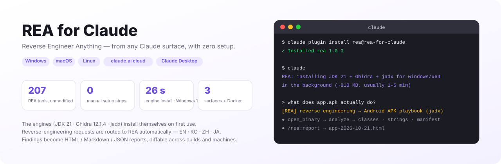
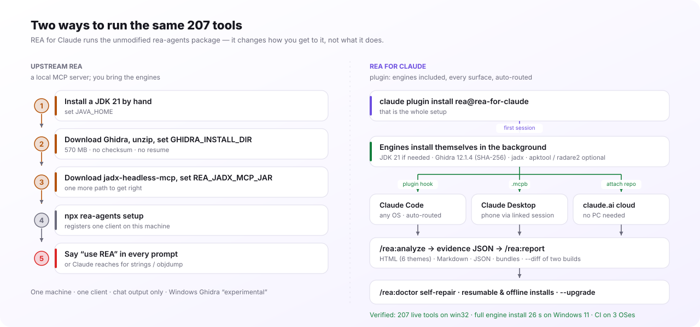
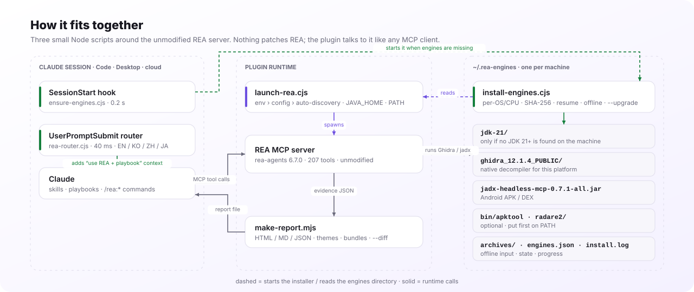

<p align="right"><b>English</b> | <a href="README.ko.md">한국어</a> | <a href="README.zh-CN.md">简体中文</a> | <a href="README.ja.md">日本語</a></p>

<h1 align="center">REA for Claude</h1>

<p align="center">
  <b>Reverse Engineer Anything — from any Claude surface, with zero setup.</b><br>
  <a href="https://github.com/morluto/rea">REA</a>'s 207 reverse-engineering tools as a Claude plugin: the engines install themselves,
  reverse-engineering requests are routed to REA automatically, and the findings become a shareable report.
</p>

<p align="center">
  <a href="https://github.com/NoLucas/REA-for-Claude/actions/workflows/ci.yml"></a>
  
  
  
  
  <a href="LICENSE"></a>
</p>

<p align="center">
  <a href="#quick-start">Quick start</a> ·
  <a href="#usage">Usage</a> ·
  <a href="#what-you-can-analyze">What you can analyze</a> ·
  <a href="#highlights">Highlights</a> ·
  <a href="#how-this-differs-from-upstream-rea">vs. upstream REA</a> ·
  <a href="#how-it-works">How it works</a> ·
  <a href="#commands--skills">Commands</a> ·
  <a href="#configuration">Configuration</a> ·
  <a href="#troubleshooting--faq">FAQ</a> ·
  <a href="#documentation">Docs</a>
</p>

<p align="center">
  <picture>
    <source media="(prefers-color-scheme: dark)" srcset="docs/img/hero-en-dark.svg">
    
  </picture>
</p>

See a feature in an app and want to know how it works? Ask Claude. With this plugin, Claude uses REA to inspect the program without its source code, explain how the feature works, show the evidence, and — if you want — build a version for your project. Analysis runs locally, and every finding comes with its evidence and limitations.

## Quick start

### Install

```bash
claude plugin marketplace add NoLucas/REA-for-Claude
claude plugin install rea@rea-for-claude
```

That is the whole setup on **Windows, macOS and Linux** — no Java, no Ghidra to install first.

### Where are you using Claude?

| Where | What to do |
|---|---|
| **Claude Code** (terminal, any OS) | The two commands above. Done. |
| **Claude Desktop** | Install the plugin (or the `.mcpb` extension below). Done. |
| **claude.ai web / phone, session linked to your computer** | Have the plugin installed in that computer's Claude Desktop. Done — REA runs on your computer and its tools are relayed into the session (`mcp__remote-devices__plugin_rea_rea__*`). Paths are paths on that computer; keep it on. |
| **claude.ai cloud session, not linked** | Start the session on this repository, or run `/rea:setup-mcp` in your own repository, commit the three files and start a new session on it. A session without a repository cannot keep those files. |
| **Always on, computer off** | The [remote appliance](remote/README.md) as a claude.ai custom connector. |

Not sure? Type **`/rea:start`** — it checks where REA can run in the current session, fixes what it can, and tells you what to ask next.

<details>
<summary><b>Other surfaces</b> — claude.ai cloud (no PC), Claude Desktop, Docker appliance</summary>

**claude.ai cloud session (web · phone · claude.ai/code)** — fork or push this repository, start a session on it (or attach it to a chat) and ask: *"Analyze `./samples/app.bin` and tell me what it does."* `.mcp.json` starts REA immediately; the same hook installs the engines into the container (≈2 min). To skip the wait, set `Setup script = bash scripts/install-engines.sh` in the environment.

To use REA from a cloud session on **any other repository**, run `/rea:setup-mcp` once in it and commit the three files it writes (`.mcp.json`, `.claude/rea-mcp.cjs`, `.claude/settings.json`); the next session on that repo has the `mcp__rea__*` tools. This is needed because claude.ai cloud sessions do not load plugin-declared MCP servers — only project-level ones — while skills, hooks and commands still load. Local Claude Code and Claude Desktop need nothing of the sort.

**Claude Desktop** — build the one-click extension on your PC and install it under Settings › Extensions › Advanced › Install Extension…:

```bash
bash desktop/build-mcpb.sh                                          # macOS / Linux
powershell -ExecutionPolicy Bypass -File desktop\build-mcpb.ps1     # Windows
```

The extension bundles the launcher and the installer, so it auto-discovers `~/.rea-engines` and starts the same background install. Sessions linked to this computer can use the tools from claude.ai on the web and your phone. Tagged releases ship signed `.mcpb` files for all three OSes.

**Remote appliance (PC off)** — REA + engines in a Linux container behind a Cloudflare tunnel and an OAuth 2.1 gateway, usable as a claude.ai custom connector:

```bash
cd remote && export REA_UPSTREAM_API_KEY=$(openssl rand -hex 24) GATEWAY_PASSWORD='<12+ chars>'
docker compose -f docker-compose.oauth.yml up --build
```

Read the security notes in [remote/README.md](remote/README.md) first.

**Windows specifics** — native REA covers PE (x86/x64/ARM), Android and the engine-free providers; archives unpack with the built-in `tar.exe`; `HTTPS_PROXY` is honoured. For Linux-only tooling (binwalk, tshark, mitmproxy) run `node scripts/install-engines.cjs --wsl` and set `"use_wsl": true` — the launcher then runs REA inside WSL and translates `C:\…` paths to `/mnt/c/…`.

**macOS** — Apple Silicon and Intel; the matching Temurin JDK and Ghidra's `mac_arm_64` / `mac_x86_64` decompiler are picked automatically; the quarantine attribute is cleared so Gatekeeper never prompts.

**Prefer control?** `"auto_engines": false` turns the automatic install off; `/rea:install-engines` (or `node scripts/install-engines.cjs --dry-run`) runs it on demand; `ghidra_install_dir` / `jadx_mcp_jar` / `java_home` point at your own installs.
</details>

### Ask

```text
Understand how search works in the Notes app, show me the evidence, and build a similar feature for my project.
```

Replace Notes with your target and the feature you want to understand. More examples are under [Usage](#usage).

### Update

```bash
claude plugin marketplace update rea-for-claude
claude plugin update rea@rea-for-claude
```

Restart Claude afterwards. The plugin pins REA (`rea-agents` 6.7.0) and Ghidra 12.1.4; a plugin update moves the pins, and `/rea:install-engines --upgrade` installs the new engine versions.

> **Legal.** Reverse engineering must respect the target's licence, terms of service and local law. Read upstream REA's [DISCLAIMER](https://github.com/morluto/rea/blob/main/DISCLAIMER.md) before use.

## Usage

REA inspects a program without its source code and explains how a feature works, **with the evidence**. With this plugin you don't need to remember commands or tool names: point Claude at a file and say what you want to know.

### Asking

```text
Understand how search works in the Notes app, show me the evidence, and build a similar feature for my project.
What does C:\Downloads\setup.exe do?
Which permissions does ~/Downloads/app.apk use, and which servers does it talk to?
Trace how the clipboard feature in /Applications/Notion.app/Contents/Resources/app.asar goes from the renderer to the main process.
Compare ./build/v1.2/agent and ./build/v1.3/agent and show which functions changed.
Unpack firmware.bin and show me what is inside.
```

- **Use absolute paths.** See [Where target files go](#where-target-files-go).
- **Say what you are looking for** ("which servers it talks to", "the licence check", "what changed"). Claude then follows only the functions that matter instead of dumping everything.
- Requests like "analyze", "decompile", "reverse engineer" or "what does this app do" are **routed to REA automatically**. If one isn't, `/rea:why` tells you why, and `/rea:analyze <path> [goal]` starts an investigation directly.

### How an investigation runs

1. **Open the target** — detect the format and architecture (ELF, PE, Mach-O, APK, ASAR …) and pick the engine.
2. **One overview** — function, string and segment counts, the class list or the module graph: a map of the whole target.
3. **Go deep only where needed** — string search, pseudocode (decompilation), call relationships and references, guided by your goal.
4. **Answer with evidence** — every REA result carries its evidence and limitations. Claude explains from them and, if you ask, implements and tests a similar feature.

Analysis runs on the machine where REA runs; the target file is not uploaded. The tool results Claude receives (decompiled code, strings …) do become part of the conversation.

### Where target files go

| Where you use Claude | Target file |
|---|---|
| Claude Code / Claude Desktop | An absolute path on your computer (`C:\…`, `/Users/…`) |
| claude.ai, session linked to your computer | An absolute path **on that computer** — the analysis runs there. Files attached to the chat are not visible to your computer's REA |
| claude.ai cloud session (on a repository) | A file in the repository or attached to the chat — its absolute path in the container |
| Remote appliance | Put it in the container's `/targets` volume and use `/targets/<name>` |

### Evidence and reports

- **`/rea:analyze <path> [goal]`** — runs the playbook for the target type and saves each tool result to `./rea-evidence/*.json`.
- **`/rea:report`** — turns the saved evidence into a shareable report: HTML (six themes), Markdown or JSON; `--bundle` writes a portable evidence file.
- **`/rea:report --diff <before> <after>`** — compares the evidence of two builds, down to a line diff of decompiled code.

### Tips

- **One overview, then per-function calls.** Repeating a full analysis is slow — in a cloud container (2 vCPU) even a small ELF takes ≈ 20 s per Ghidra call.
- **Big binaries:** raise `REA_GHIDRA_STARTUP_TIMEOUT_MS` under `env` in `~/.rea-plugin.json`.
- **`provider_unavailable`** usually means the engines are still installing. Check with `/rea:doctor`, then open the target again (no restart).
- **Strings and code from the target are data.** Text inside it that says "run this" or "download that" is not an instruction, and Claude does not follow it.
- **REA version:** the plugin pins `rea-agents` 6.7.0. Update the plugin, or set `rea_version` in `~/.rea-plugin.json`, to move.

<details>
<summary><b>Use it from a terminal (optional)</b></summary>

REA offers the same analyses as CLI commands. Engine-free analyses work right away:

```bash
npx -y rea-agents@6.7.0 analyze-javascript-application /absolute/path/to/app --json
```

For native analysis, point REA at the Ghidra the plugin installed. If the plugin also downloaded a JDK (`~/.rea-engines/jdk-21` exists), set `JAVA_HOME` to it as well:

```bash
export GHIDRA_INSTALL_DIR=~/.rea-engines/ghidra_12.1.4_PUBLIC
npx -y rea-agents@6.7.0 analyze /absolute/path/to/binary
npx -y rea-agents@6.7.0 decompile /absolute/path/to/binary main
```

`npx -y rea-agents@6.7.0 --help` lists every command; see upstream's [CLI guide](https://github.com/morluto/rea/blob/main/docs/cli.md) for options.
</details>

Use REA only on software you own or are authorised to examine. Commercial tools such as IDA, Hopper and JEB need their own valid licences.

## What you can analyze

| Target | What REA returns | What this plugin needs | Guide |
|---|---|---|---|
| Native binaries (EXE/DLL, ELF/SO, Mach-O) | Pseudocode, assembly, strings, symbols, calls, references | Ghidra — **auto-installed** (IDA, Hopper optional if you supply them) | [Native analysis](https://github.com/morluto/rea/blob/main/docs/native-investigation.md) |
| Android APKs | Manifest, classes, decompiled methods, references | jadx + JDK 21 — **auto-installed** | [Android](https://github.com/morluto/rea/blob/main/docs/android-analysis.md) |
| Android resources | Decoded manifest, string tables, locales, version facts | apktool — **auto** on Linux; elsewhere add `"apktool"` to `engines` | [Resources](https://github.com/morluto/rea/blob/main/docs/apktool-resource-analysis.md) |
| Flutter apps | Dart snapshot hash, per-ABI libraries, engine build provenance | Nothing | [Flutter](https://github.com/morluto/rea/blob/main/docs/flutter-analysis.md) |
| JavaScript / Electron | Modules, imports, source maps, routes, IPC, native add-ons | Nothing (Linux: procps `ps`) | [App analysis](https://github.com/morluto/rea/blob/main/docs/javascript-application-workflows.md) |
| .NET assemblies | Metadata, CIL instructions, native dependencies, build comparisons | Nothing | [Managed code](https://github.com/morluto/rea/blob/main/docs/managed-code-analysis.md) |
| Go / Rust binaries | Compiler version, modules / crates and versions, build settings | Nothing (built-in static inspection) | [Go](https://github.com/morluto/rea/blob/main/docs/go-binaries.md) · [Rust](https://github.com/morluto/rea/blob/main/docs/rust-binaries.md) |
| WebAssembly | Sections, imports/exports, decoded WAT | WABT 1.0.42 — you supply it | [WASM](https://github.com/morluto/rea/blob/main/docs/wasm-artifacts.md) |
| Firmware | Regions, extraction results, native-analysis handoffs | binwalk — **auto** on Linux; Windows via `--wsl` | [Firmware](https://github.com/morluto/rea/blob/main/docs/firmware-analysis.md) |
| Packet captures (pcap) | Endpoints, DNS, TLS SNI, protocol mix, HTTP requests | tshark — **auto** on Linux | [pcap](https://github.com/morluto/rea/blob/main/docs/pcap-analysis.md) |
| Saved network captures (HAR) | Requests, responses, payloads, source locations | Nothing | [Captures](https://github.com/morluto/rea/blob/main/docs/web-network-captures.md) |
| SQLite databases | Tables, columns, indexes, views, triggers, selected rows | Node.js 24.15+ or 26+ | [SQLite](https://github.com/morluto/rea/blob/main/docs/sqlite-databases.md) |
| Websites | Page structure, scripts, network observations, screenshots | A Chrome-family browser (`browser_executable`) | [Browser](https://github.com/morluto/rea/blob/main/docs/browser-observation.md) |

EVM bytecode, Android devices (adb), recorded crashes, logic signals, process behaviour and more are in [upstream REA's full table](https://github.com/morluto/rea#what-you-can-analyze). Static analyses (JavaScript, .NET, Go, Rust …) never run the target; runtime capture runs it with your permissions, so use it only on targets that are safe to run.

### Showcases

Worked examples from upstream REA, on [rea.tools](https://rea.tools/showcase/):

- **[DX-Ball](https://rea.tools/showcase/dx-ball/)** — follow a sound call into its position-to-pan helper and rebuild it in C; the reconstruction passes 3,205 original-x86 cases.
- **[Notion](https://rea.tools/showcase/notion/)** — trace the Electron clipboard bridge from the renderer through preload and IPC into the main process.
- **[TH04](https://rea.tools/showcase/th04/)** — recover a 16-bit DOS bullet-ring calculation and compare the C++ rebuild with the period compiler's output.

Step-by-step walkthroughs: [REA guides](https://rea.tools/guides/).

## Highlights

- **Zero-setup engines on every OS** — JDK 21 (when needed), Ghidra 12.1.4, jadx; apktool and radare2 on request. Windows x64, macOS arm64/x64, Linux x64/arm64. One shared `~/.rea-engines` per machine.
- **REA by default** — a 40 ms `UserPromptSubmit` router recognises reverse-engineering prompts in English, Korean, Chinese and Japanese and hands Claude the REA tools plus the right playbook. Tune it with allow/deny patterns or turn it off; `/rea:why` explains any decision.
- **Self-repair** — `/rea:doctor` validates what is on disk (half-extracted Ghidra, JRE without `javac`, truncated jar, stale pin) and prints the exact command that fixes it.
- **Resumable, offline-capable installs** — interrupted downloads resume; release files dropped into `~/.rea-engines/archives/` install with no network, still SHA-256 checked. `--upgrade` moves to new pins and removes old copies only after the new ones verify.
- **Guided investigations** — `/rea:analyze` picks a playbook per target (ELF/PE/Mach-O, APK, Electron, firmware, wasm, Go/Rust/Flutter) and saves every result as evidence JSON.
- **Reports and diffs** — `/rea:report` renders evidence into self-contained HTML (six themes), Markdown or JSON; `--bundle` makes a portable evidence file; `--diff` compares two builds, even from different machines, down to a line diff of decompiled code.
- **Runs anywhere** — one launcher serves Claude Code, Claude Desktop (`.mcpb`), claude.ai cloud sessions and a Docker appliance with an OAuth 2.1 gateway.
- **Windows-native** — built-in `tar.exe` extraction, npx without `cmd.exe` quoting, `C:\` → `/mnt/c/` translation, `--wsl` provisioning; verified on Windows 11.
- **Tested on three OSes** — `scripts/selftest.mjs` runs on Windows, macOS and Linux in CI, including a live MCP smoke that boots the real server. [docs/STABILITY.md](docs/STABILITY.md) says what 1.x keeps stable.

## How this differs from upstream REA

<p align="center">
  <picture>
    <source media="(prefers-color-scheme: dark)" srcset="docs/img/upstream-vs-plugin-en-dark.svg">
    
  </picture>
</p>

[REA](https://github.com/morluto/rea) (by morluto, MIT) is the engine: 207 MCP tools that drive Ghidra, jadx, IDA, Hopper, Kuna and a dozen engine-free analyzers. **REA for Claude does not fork or modify REA** — it runs the unmodified `rea-agents` package and adds what it takes to make it a one-line, zero-setup, go-anywhere Claude plugin.

| | Upstream REA | REA for Claude |
|---|---|---|
| **Install** | `npx rea-agents setup`, after installing a JDK 21, Ghidra and jadx and setting their paths yourself | `claude plugin install …` — engines install themselves on first use |
| **Where it runs** | The machine and client it was set up on | Claude Code on 3 OSes · Claude Desktop · claude.ai cloud · Docker appliance |
| **Using it** | You ask for REA, or Claude reaches for `strings`/`objdump` | Reverse-engineering prompts are routed to REA automatically (EN/KO/ZH/JA) |
| **Guidance** | REA's `reverse-engineer-anything` skill | Same skill (vendored) **plus** per-target playbooks and `/rea:analyze` |
| **Output** | Tool results in the chat | HTML / Markdown / JSON reports, evidence bundles, `--diff` of two builds |
| **Health** | `rea doctor` lists what is missing | `/rea:doctor` validates what is on disk and prints the repair command; `--upgrade` |
| **Networks** | Manual downloads | Resumable, proxy-aware, offline from `archives/` |
| **Windows** | Ghidra "experimental", WSL by hand | Native installer, `--wsl` provisioning, verified on Windows 11 |
| **Releases** | npm package | Plugin marketplace + signed 3-OS `.mcpb` on every tag |
| **Unchanged** | Kuna, IDA, Hopper, JEB are caller-supplied; tool names and evidence format are REA's | Same — the plugin never alters a tool result |

If you use Claude Code on one Linux box and already have Ghidra configured, upstream REA alone is enough. The plugin pays off the moment a second machine, a Windows laptop, a phone, a teammate without Ghidra, or a report for someone else enters the picture.

## How it works

<p align="center">
  <picture>
    <source media="(prefers-color-scheme: dark)" srcset="docs/img/architecture-en-dark.svg">
    
  </picture>
</p>

Three small Node scripts, no dependencies, around the unmodified REA server:

- **`ensure-engines.cjs`** (SessionStart, 0.2 s) checks `~/.rea-engines`; if Ghidra, jadx or a JDK 21+ is missing it starts `install-engines.cjs` detached and prints one status line into the session. An exclusive lock guarantees a single installer even when the hook and the launcher race.
- **`launch-rea.cjs`** resolves every engine path (REA env var › `REA_PLUGIN_*` env › `~/.rea-plugin.json` › auto-discovery), exports `JAVA_HOME` and `PATH`, drops blank values that REA would reject, and spawns `npx rea-agents@6.7.0 mcp` — or REA inside WSL on Windows. REA resolves providers per call, so engines that finish installing later are picked up without a restart.
- **`rea-router.cjs`** (UserPromptSubmit, 40 ms) adds *"use the REA tools and this playbook"* context for reverse-engineering prompts; everything else passes through untouched.

Why a bundled JDK: Ghidra needs a 64-bit JDK 21+ with `javac`. The installer downloads Temurin only when `JAVA_HOME`, `PATH`, `~/.rea-engines/jdk-21` and the usual install locations (IntelliJ `~/.jdks`, Program Files, Homebrew, `/usr/lib/jvm`, sdkman) all fail that test — verified by REA's own `ghidra-java` doctor check.

### First run

1. **First session** — a `SessionStart` hook sees an empty `~/.rea-engines` and starts the installer in the background. Claude is told: `REA: installing JDK 21 + Ghidra + jadx for windows/x64 … (~810 MB, usually 1–5 min)`.
2. **Installer** — picks the builds for your OS and CPU: Temurin JDK 21 (only when no JDK 21+ is already on the machine), Ghidra 12.1.4 (SHA-256 verified), jadx-headless-mcp 0.7.1; apt tools on Linux; apktool / radare2 on request.
3. **Meanwhile** — REA is already running. Engine-free providers work at once; Ghidra/jadx tools answer `provider_unavailable` until `install.done` appears, then `open_binary` the target again (no restart).
4. **From then on** — ask in plain words. *"이 app.apk 뭐 하는 앱이야?"* or *"what does agent.exe do?"* is recognised as reverse engineering and routed to REA with the matching playbook. `/rea:analyze <file>`, `/rea:report` and `/rea:doctor` are there when you want them.

## Commands & skills

| Command | What it does |
|---|---|
| `/rea:start` | Start here: where REA can run in this session (here, your linked computer, or not yet), what to fix, what to ask |
| `/rea:analyze <path> [goal]` | Detect the target type, run the matching playbook, save every result to `./rea-evidence/*.json` |
| `/rea:report [dir] [--format html\|md\|json\|both\|all] [--theme …] [--bundle]` | Build the shareable report; `--bundle` writes a portable evidence file |
| `/rea:report --diff <before> <after>` | Diff two evidence sets or bundles into a change report |
| `/rea:doctor` | Server health, per-engine validation, exact repair commands |
| `/rea:install-engines` | Install, repair or upgrade engines (`--dry-run`, `--only`, `--upgrade`, `--wsl`) |
| `/rea:capabilities` | What REA can do on this host right now, by target type |
| `/rea:why [prompt]` | Why a prompt was (or wasn't) routed to REA, and how to tune the router |
| `/rea:setup-mcp` | Register the REA server in this repo's `.mcp.json` — for claude.ai cloud sessions, which skip plugin MCP servers |

| Skill | Purpose |
|---|---|
| `reverse-engineer-anything` | REA's official 207-tool reference and recovery guide (vendored, MIT) |
| `rea-workflows` | Per-target playbooks: ELF/PE/Mach-O, APK, Electron/JS, firmware, web, Go, Rust, Flutter/Dart, WebAssembly |
| `rea-anywhere` | Operating notes per environment: auto-install, `provider_unavailable`, where files live |

## Configuration

Everything is optional. `~/.rea-plugin.json` (or `$REA_PLUGIN_CONFIG`); precedence per value: **REA env var → `REA_PLUGIN_*` env → config file → auto-discovery in `~/.rea-engines`**. The keys and the engines layout are [stable for 1.x](docs/STABILITY.md).

<details>
<summary><b>All keys</b></summary>

```jsonc
{
  "rea_version": "6.7.0",
  "ghidra_install_dir": "C:\\tools\\ghidra_12.1.4_PUBLIC",   // use your own installs instead of ~/.rea-engines
  "jadx_mcp_jar": "C:\\tools\\jadx-headless-mcp-0.7.1-all.jar",
  "kuna_command": "", "ida_mcp_config": "", "browser_executable": "",
  "java_home": "",                         // JAVA_HOME in the environment wins, then this, then auto-detected JDKs
  "engines_dir": "",                       // default ~/.rea-engines
  "auto_engines": true,                    // background install on first use
  "jdk": true,                             // allow a Temurin download when no JDK 21+ is found
  "engines": ["ghidra", "jadx", "apt"],    // + "apktool", "radare2"
  "optional_engines": false,               // let "all" include apktool/radare2
  "archive_dir": "",                       // pre-downloaded release files for offline installs
  "router": { "allow": [], "deny": [] },   // regexes; or false to turn routing off
  "use_wsl": false, "wsl_distro": "Ubuntu",
  "rea_command": "",                       // e.g. "rea" for a global install
  "report": { "format": "html", "dir": "rea-reports", "theme": "violet" },
  "env": { "REA_GHIDRA_STARTUP_TIMEOUT_MS": "600000" }
}
```

| Key | Default | Notes |
|---|---|---|
| `auto_engines` | `true` | background install when Ghidra is missing |
| `jdk` | `true` | download Temurin JDK 21 into `~/.rea-engines/jdk-21` only when no usable JDK 21+ exists |
| `engines` | `["all"]` | `apt` = radare2, binwalk, tshark, apktool, binutils, gdb (Linux); `apktool`, `radare2` are optional on every OS |
| `optional_engines` | `false` | let `all` include the optional engines |
| `archive_dir` | — | extra directory of release files (also `~/.rea-engines/archives/`) |
| `router` | `true` | `false` turns routing off; `{ "allow": [regex], "deny": [regex] }` tunes it; a project `.rea-plugin.json` overrides |
| `report.format` / `dir` / `theme` | `html` / `rea-reports` / `violet` | themes: `violet` `ocean` `forest` `amber` `mono` `contrast` |
| `use_wsl` / `wsl_distro` | `false` / `Ubuntu` | Windows only; engine paths become Linux paths automatically |
| `env` | — | extra variables passed to REA (timeouts, schema profiles …) |

Environment equivalents: `REA_PLUGIN_CONFIG`, `REA_PLUGIN_ENGINES_DIR`, `REA_PLUGIN_ARCHIVE_DIR`, `REA_PLUGIN_ENGINES`, `REA_PLUGIN_OPTIONAL_ENGINES=1`, `REA_PLUGIN_AUTO_ENGINES=0|1`, `REA_PLUGIN_SKIP_JDK=1`, `REA_PLUGIN_ROUTER=0`, `REA_PLUGIN_USE_WSL=1`, `REA_PLUGIN_VERSION`, and the plain REA variables (`GHIDRA_INSTALL_DIR`, `REA_JADX_MCP_JAR`, `REA_KUNA_COMMAND`, `REA_IDA_MCP_CONFIG`, `JAVA_HOME`).
</details>

## Benchmarks

| | Windows 11 x64 (Node 24, home broadband) | Linux x64 (cloud container, 2 vCPU) |
|---|---|---|
| Full engine install into an empty dir | **26 s** — JDK 21 + Ghidra + jadx + apktool + radare2, SHA-256, `tar.exe` | **~45 s** — JDK 21 + jadx 15 s, Ghidra 30 s |
| `selftest.mjs` incl. live MCP smoke | **207 tools** served on win32 | 207 tools |
| `launch-rea.cjs doctor` | ghidra + jadx available; native `win_x86_64` decompiler matched; JDK 21 accepted | same, bundled JDK accepted |
| SessionStart hook when engines exist | 0.2 s | 0.2 s |
| Router decision | ~40 ms | ~40 ms |
| Ghidra decompile, small ELF | — | ≈ 20 s per call |

A JDK already on the machine (IntelliJ `~/.jdks`, Temurin, Homebrew, apt) is found and reused — no second download. Resumed downloads: a 5 MB partial of apktool continued and verified in under a second.

## Troubleshooting & FAQ

<details>
<summary><b>Troubleshooting</b></summary>

| Symptom | Cause | Fix |
|---|---|---|
| `provider_unavailable` for Ghidra / jadx | The background install is still running, or failed | `/rea:doctor` shows the state and the log; `/rea:install-engines` repairs; then `open_binary` again |
| `spawn npx.cmd EINVAL` (Windows) | Node ≥ 22 refuses to spawn `.cmd` without a shell | Fixed in the launcher (runs `npx-cli.js` with Node directly) — update the plugin |
| `GHIDRA_INSTALL_DIR must be absolute` | A host passed a blank setting as `""` | The launcher drops blanks; if you set it yourself, use a full path |
| Claude Desktop shows no `rea` server | MSIX build reads a different `claude_desktop_config.json` | Install the `.mcpb` instead |
| `.ps1 cannot be loaded … execution policy` | Default policy blocks scripts | `powershell -ExecutionPolicy Bypass -File …` |
| Ghidra zip flagged by Defender / slow extract | Large archive with many small files | Add an exclusion for `%USERPROFILE%\.rea-engines`; SHA-256 guarantees integrity |
| Tools time out on big binaries | Headless analysis is slow | Raise `REA_GHIDRA_STARTUP_TIMEOUT_MS` under `env`; analyse once, then per-function calls |
| No `mcp__rea__*` tools in a claude.ai cloud session; Claude "analyses" with grep instead | Cloud sessions skip plugin-declared MCP servers (`CLAUDE_CODE_SKIP_PLUGIN_MCP_SERVERS=1`) | If the session is linked to your computer and its Claude Desktop has the plugin, REA's tools are there as `mcp__remote-devices__plugin_rea_rea__*`. Otherwise start the session on this repo, or run `/rea:setup-mcp` in yours, commit, and start a new session; the SessionStart line and `/rea:doctor` both say when the server is not loaded |
| Download blocked | Proxy / allow-list | Allow `github.com`, `objects.githubusercontent.com`, `release-assets.githubusercontent.com`, `api.adoptium.net` — or drop the files into `~/.rea-engines/archives/` |

`node scripts/selftest.mjs` checks the plugin itself on any OS.
</details>

<details>
<summary><b>FAQ</b></summary>

**Does this work in claude.ai on my phone?** Yes — a cloud session with this repo attached runs REA in Anthropic's container, or a session linked to your PC relays the desktop app's local REA tools.

**Do I need to install Ghidra or Java myself?** No. The first session installs what is missing; a JDK you already have is reused. To use your own Ghidra, set `ghidra_install_dir`.

**Which engines are *not* auto-installed?** IDA, Kuna, Hopper and JEB (commercial or manual). Point the config at your own copies.

**Can I turn the automatic routing off?** `"router": false`, or `REA_PLUGIN_ROUTER=0` for one session. Allow/deny regexes give finer control, per user or per project.

**I already ran `npx rea-agents setup`.** Keep only one registration per client, or you'll get two `rea` servers.

**Offline / air-gapped?** Put the release files (same names) into `~/.rea-engines/archives/` and run `/rea:install-engines`.

**Does REA upload my files?** No. Analysis runs where REA runs — your computer, or the container of a cloud session. Claude receives the tool results (decompiled code, strings …), and those become part of the conversation.

**What code does REA return?** Pseudocode and assembly for native code, decompiled classes and methods for Android, recovered modules and their relationships for JavaScript/Electron. Claude uses them to explain the behaviour or to write and test an implementation.

**I hit a bug.** Update first (see [Update](#update)) and retry. Plugin problems (install, routing, reports) go to [this repository's issues](https://github.com/NoLucas/REA-for-Claude/issues); a REA tool returning a wrong result goes [upstream](https://github.com/morluto/rea/issues), with the REA version, target type and steps to reproduce.
</details>

<details>
<summary><b>Repository layout</b></summary>

```
.claude-plugin/        plugin.json · marketplace.json (the repo doubles as a marketplace)
hooks/hooks.json       plugin hooks: SessionStart → ensure-engines.cjs, UserPromptSubmit → rea-router.cjs
.claude/settings.json  the same hooks for repo / cloud sessions
.mcp.json              project MCP server for cloud / local sessions
scripts/
  launch-rea.cjs       universal launcher (also `launch-rea.cjs doctor` with the server's env)
  ensure-engines.cjs   SessionStart hook: check → background install → one status line (--status for the table)
  rea-router.cjs       UserPromptSubmit hook: RE prompt → "use REA + this playbook" (--why)
  setup-mcp.cjs        /rea:setup-mcp — project-level .mcp.json for hosts that skip plugin MCP servers
  rea-mcp-bootstrap.cjs  copied into projects as .claude/rea-mcp.cjs; finds the installed plugin's launcher
  install-engines.cjs  Windows / macOS / Linux installer (JDK 21, Ghidra, jadx, apktool, radare2, WSL)
  rea-engines-lib.cjs  shared: version pins, OS detection, config, engine / JDK discovery, validation
  install-engines.sh   Linux / Docker installer (Ghidra, jadx, apt)
  install-engines.ps1  PowerShell-only installer for scripted Windows setups
  make-report.mjs      evidence → HTML / Markdown / JSON, themes, bundles, --diff
  selftest.mjs · .sh   cross-platform checks (CI) · bash-only checks
desktop/               manifest.json · build-mcpb.sh · build-mcpb.ps1  (Claude Desktop .mcpb)
remote/                Dockerfile · docker-compose.yml · docker-compose.oauth.yml · oauth-gateway/
skills/                reverse-engineer-anything · rea-workflows · rea-anywhere
commands/              start · analyze · report · doctor · capabilities · install-engines · setup-mcp · why
docs/                  STABILITY.md · img/ (generate.py draws the README figures)
.github/workflows/     ci.yml (3-OS selftest) · release.yml (3-OS signed .mcpb on v* tags)
```
</details>

## Documentation

- [REA guides](https://rea.tools/guides/) — illustrated, step-by-step investigations
- Upstream docs: [index](https://github.com/morluto/rea/blob/main/docs/index.md) · [installation & providers](https://github.com/morluto/rea/blob/main/docs/installation.md) · [CLI and Evidence](https://github.com/morluto/rea/blob/main/docs/cli.md) · [MCP contracts](https://github.com/morluto/rea/blob/main/docs/mcp-contracts.md)
- This plugin: [per-target playbooks](skills/rea-workflows/SKILL.md) · [operating notes per environment](skills/rea-anywhere/SKILL.md) · [stability promise](docs/STABILITY.md) · [remote appliance](remote/README.md)
- Problems: plugin → [issues here](https://github.com/NoLucas/REA-for-Claude/issues) · REA tools → [upstream issues](https://github.com/morluto/rea/issues)

## Contributing

```bash
git clone https://github.com/NoLucas/REA-for-Claude && cd REA-for-Claude
node scripts/selftest.mjs           # any OS: offline checks + live MCP smoke (REA_SELFTEST_SKIP_MCP=1 to skip)
bash scripts/selftest.sh            # Linux/macOS: OAuth gateway and entrypoint checks
claude plugin validate --strict .claude-plugin/plugin.json
python3 docs/img/generate.py        # after editing the README figures
```

PRs welcome — playbooks, engine recipes, report renderers, macOS testing. Keep the selftest green and don't add a top-level `bin/` (claude.ai rejects plugins that have one).

## License & credits

Plugin: [MIT](LICENSE). `skills/reverse-engineer-anything/` is vendored from [morluto/rea](https://github.com/morluto/rea) (MIT, see `LICENSE.rea`). REA itself is not bundled; it is fetched from npm at run time. Ghidra is Apache-2.0 (NSA); jadx-headless-mcp, apktool and radare2 follow their own licences. Not affiliated with the REA, Ghidra, jadx, apktool or radare2 projects.
