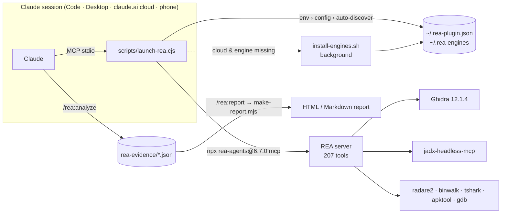

<p align="right"><b>English</b> | <a href="README.ko.md">한국어</a></p>

<h1 align="center">REA for Claude</h1>

<p align="center">
  <b>Reverse Engineer Anything — from any Claude surface.</b><br>
  Run <a href="https://github.com/morluto/rea">REA</a>'s 207 reverse-engineering tools in Claude Code, Claude Desktop,
  and <b>claude.ai cloud sessions where Ghidra installs itself</b> — then turn the findings into a shareable report.
</p>

<p align="center">
  <a href="https://github.com/NoLucas/REA-for-Claude/actions/workflows/ci.yml"></a>
  <a href="LICENSE"></a>
  
  
  
  
</p>

<p align="center">
  <a href="#-quick-start">Quick start</a> ·
  <a href="#-features">Features</a> ·
  <a href="#-how-it-works">How it works</a> ·
  <a href="#-commands--skills">Commands</a> ·
  <a href="#-configuration">Configuration</a> ·
  <a href="#-faq">FAQ</a> ·
  <a href="#-contributing">Contributing</a>
</p>

---

## Why

Upstream REA is a local stdio MCP server that depends on locally installed engines (Ghidra, jadx, IDA…).
That makes it a Claude Code–terminal tool by default. **REA for Claude** removes that assumption:

| Where your session runs | What happens | PC needed | Status |
|---|---|:---:|:---:|
| **claude.ai cloud session** (web · mobile · claude.ai/code) | Attach this repo → REA starts in the container, **Ghidra 12.1.4 + jadx auto-install** in the background | ✗ | ✅ verified end-to-end |
| **Claude Desktop + linked claude.ai session** | REA runs on your PC; the desktop app relays its tools, so you can continue from your phone | ✓ | ⚠️ follows the REA team's Windows 11 path |
| **Local Claude Code** | Plugin or `.mcp.json` | ✓ | ✅ |
| **Remote appliance** (Docker + tunnel → custom connector) | REA + engines baked into a Linux container behind HTTPS | server | ⚠️ components verified, image build not run |

> **Legal note.** Reverse engineering must respect the target's license, terms of service and local law.
> Read upstream REA's [DISCLAIMER](https://github.com/morluto/rea/blob/main/DISCLAIMER.md) before use.

## ⚡ Quick start

<details open>
<summary><b>Cloud session (no PC) — recommended</b></summary>

1. Fork or push this repository to your GitHub (private is fine).
2. Start a session on it at [claude.ai/code](https://claude.ai/code), or attach the repo to a chat.
3. Ask: *"Analyze `./samples/app.bin` and tell me what it does."*

Behind the scenes: `.mcp.json` starts REA immediately; a `SessionStart` hook installs
Ghidra + jadx into `~/.rea-engines` (≈2 min). If a tool answers `provider_unavailable`,
wait for `~/.rea-engines/install.done` and call `open_binary` again — REA resolves engines
per call, no restart needed.

**Skip the wait entirely:** in your claude.ai/code environment set
`Setup script = bash scripts/install-engines.sh` and
`GHIDRA_INSTALL_DIR=/root/.rea-engines/ghidra_12.1.4_PUBLIC`,
`REA_JADX_MCP_JAR=/root/.rea-engines/jadx-headless-mcp-0.7.1-all.jar`.
</details>

<details>
<summary><b>Local Claude Code</b></summary>

```bash
claude plugin marketplace add NoLucas/REA-for-Claude
claude plugin install rea@rea-for-claude
# or, from a clone:
claude --plugin-dir ./REA-for-Claude
```
Then `/rea:doctor`. On Linux, `/rea:install-engines` fetches the engines for you.
</details>

<details>
<summary><b>Windows (native) — Claude Code or Claude Desktop</b></summary>

```powershell
# 1) Node.js 22/24 and a 64-bit JDK 21+ (needed by Ghidra)
winget install OpenJS.NodeJS.LTS EclipseAdoptium.Temurin.21.JDK

# 2) Engines: Ghidra 12.1.4 (SHA-256 verified) + jadx into %USERPROFILE%\.rea-engines,
#    and write the paths into %USERPROFILE%\.rea-plugin.json
git clone https://github.com/NoLucas/REA-for-Claude; cd REA-for-Claude
powershell -ExecutionPolicy Bypass -File scripts\install-engines.ps1 -WriteConfig

# 3a) Claude Code
claude plugin marketplace add NoLucas/REA-for-Claude; claude plugin install rea@rea-for-claude
# 3b) Claude Desktop: build the one-click extension on this PC, then
#     Settings › Extensions › Advanced › Install Extension… › dist\rea-for-claude-win32-x64.mcpb
powershell -ExecutionPolicy Bypass -File desktop\build-mcpb.ps1
```

Native Windows REA covers PE targets (x86 / x64 / ARM) with Ghidra, Android with jadx, and
the engine-free providers. For Linux-only tooling (binwalk, tshark, mitmproxy) set
`"use_wsl": true` in `~/.rea-plugin.json`: the launcher runs REA inside WSL and **translates
`C:\…` paths to `/mnt/c/…` automatically**, so one config serves both modes. Inside WSL,
`bash scripts/install-engines.sh` installs everything.

REA's own `npx rea-agents@6.7.0 setup --client claude_desktop` also works (quit Claude
Desktop completely first, run from a normal terminal); point its `rea` entry at
`node <repo>\scripts\launch-rea.cjs` if you want the config file / WSL mode.
</details>

<details>
<summary><b>macOS — Claude Code or Claude Desktop</b></summary>

Install Ghidra 12.1.4 + JDK 21 (`brew install --cask temurin@21`), set `ghidra_install_dir`
in `~/.rea-plugin.json`, then either `claude plugin install rea@rea-for-claude` or build the
extension with `bash desktop/build-mcpb.sh`.
</details>

<details>
<summary><b>Remote appliance (anywhere, PC off)</b></summary>

```bash
cd remote && export REA_PATH_SECRET=$(openssl rand -hex 24)
docker compose up --build       # REA + Ghidra + jadx + radare2/binwalk/tshark/apktool + Cloudflare tunnel
```
Add `https://<tunnel>/<REA_PATH_SECRET>/mcp` under claude.ai → Settings → Connectors →
*Add custom connector*. Read the **security notes** in [remote/README.md](remote/README.md).
</details>

## ✨ Features

| | |
|---|---|
| 🌍 **Runs anywhere** | One universal launcher (`scripts/launch-rea.cjs`) serves Claude Code, Claude Desktop, claude.ai cloud sessions and Docker. |
| ⚙️ **Self-installing engines** | Ghidra 12.1.4 (SHA-256 verified), jadx-headless-mcp 0.7.1 and the apt toolset install themselves on Linux — in the background, selectable per engine. |
| 🧭 **Guided workflows** | `/rea:analyze` picks a playbook per target type (native binary, APK, Electron/JS, firmware, web bundle) and collects evidence as it goes. |
| 📄 **Shareable reports** | `/rea:report` renders REA evidence into a self-contained HTML (light/dark) or Markdown report — decompiled code, overviews, provider, confidence, limitations. Zero dependencies. |
| 🔀 **Evidence diffs** | `/rea:report --diff <before> <after>` compares two builds: changed overview fields, added/removed procedures, strings and segments, and a line diff of decompiled code. |
| 🖥️ **One-click desktop extension** | `desktop/build-mcpb.sh` / `.ps1` bundles REA into a `.mcpb` with a settings panel for engine paths; uses Claude Desktop's built-in Node, no install needed. |
| 🔐 **OAuth-protected remote** | `remote/docker-compose.oauth.yml` adds a dependency-free OAuth 2.1 gateway (DCR + PKCE + login page) so the appliance can be a claude.ai custom connector without a path secret. |
| 🎛️ **User-configurable** | `~/.rea-plugin.json`: engine paths, which engines to install, report format/dir, WSL mode, REA version, env passthrough. Blank values are ignored. |
| 🧪 **Tested on 3 OSes** | `scripts/selftest.mjs` runs on Windows, macOS and Linux in CI: manifest shape, syntax, report/diff fixtures, launcher env handling, and a live MCP smoke that boots the real server and asserts it serves tools. |
| 🪟 **Windows-native** | `install-engines.ps1`, `.mcpb` build on Windows, npx without cmd.exe quoting, automatic `C:\` → `/mnt/c/` translation in WSL mode. No `userConfig` dependency, so Claude Desktop can start the server itself. |

## 🔍 How it works



- **Why a launcher?** Hosts may pass blank settings as `""`, which REA rejects ("must be absolute"); the server must start instantly in the cloud and fetch engines afterwards; Windows needs a WSL branch.
- **Why deferred install works.** REA resolves the Ghidra provider when `open_binary` is called, not at startup (confirmed by test). Re-open the target after the install finishes.
- **Why both `.mcp.json` and `plugin.json`.** Cloud/local sessions read the project `.mcp.json`; plugin installs read `plugin.json`. Same `rea` server; the latter wins when installed as a plugin.
- `rea mcp --http` exists on REA `main` but not in npm 6.7.0, so the remote appliance bridges stdio → Streamable HTTP with `supergateway` for now.

## 🧰 Commands & skills

| Command | What it does |
|---|---|
| `/rea:analyze <path> [goal]` | Guided investigation: detect target type, run the matching playbook, save every result to `./rea-evidence/*.json` |
| `/rea:report [dir] [--format html\|md\|both]` | Build the shareable report from saved evidence (honours `report.*` in your config) |
| `/rea:report --diff <before> <after>` | Diff two evidence sets (two builds of the same app) into a change report |
| `/rea:doctor` | Is the MCP server healthy? Which engines are available, and the exact fix for missing ones |
| `/rea:capabilities` | What REA can do *right now* on this host, grouped by target type |
| `/rea:install-engines` | Linux engine installer (idempotent, selectable) |

| Skill | Purpose |
|---|---|
| `reverse-engineer-anything` | REA's official 207-tool reference and recovery guide (MIT, vendored) |
| `rea-workflows` | Per-target playbooks: native ELF/PE/Mach-O, Android APK, Electron/JS, firmware, web, **Go, Rust, Flutter/Dart, WebAssembly** |
| `rea-anywhere` | Operating notes per environment: cloud auto-install, `provider_unavailable`, where files live |

## 🎛️ Configuration

`~/.rea-plugin.json` (or `$REA_PLUGIN_CONFIG`). Precedence per value: **REA env var → `REA_PLUGIN_*` env → config file → auto-discovery in `~/.rea-engines`**.

```jsonc
{
  "rea_version": "6.7.0",
  "ghidra_install_dir": "C:\\tools\\ghidra_12.1.4_PUBLIC",   // or Linux path
  "jadx_mcp_jar": "C:\\tools\\jadx-headless-mcp-0.7.1-all.jar",
  "kuna_command": "", "ida_mcp_config": "", "browser_executable": "",
  "engines_dir": "",                       // default ~/.rea-engines
  "auto_engines": false,                   // cloud sessions default to true
  "engines": ["ghidra", "jadx", "apt"],    // what install-engines fetches
  "use_wsl": false, "wsl_distro": "Ubuntu",
  "rea_command": "",                       // e.g. "rea" for a global install
  "report": { "format": "html", "dir": "rea-reports" },
  "env": { "REA_GHIDRA_STARTUP_TIMEOUT_MS": "600000" }
}
```

| Key | Type | Default | Notes |
|---|---|---|---|
| `engines` | string[] | `["ghidra","jadx","apt"]` | `apt` = radare2, binwalk, tshark, apktool, binutils, gdb |
| `auto_engines` | bool | `true` in cloud, else `false` | background install when Ghidra is missing (Linux) |
| `engines_dir` | path | `~/.rea-engines` | auto-discovery root |
| `report.format` / `report.dir` | `html`·`md`·`both` / path | `html` / `rea-reports` | defaults for `/rea:report` |
| `use_wsl` / `wsl_distro` | bool / string | `false` / `Ubuntu` | Windows only; engine paths become Linux paths |
| `rea_version` | string | `6.7.0` | pinned npm version |
| `env` | object | — | extra variables passed to REA (timeouts, schema profiles…) |

Environment equivalents: `REA_PLUGIN_CONFIG`, `REA_PLUGIN_ENGINES_DIR`, `REA_PLUGIN_ENGINES`,
`REA_PLUGIN_AUTO_ENGINES=1`, `REA_PLUGIN_USE_WSL=1`, `REA_PLUGIN_VERSION`, and the plain REA
variables (`GHIDRA_INSTALL_DIR`, `REA_JADX_MCP_JAR`, `REA_KUNA_COMMAND`, `REA_IDA_MCP_CONFIG`).

## 📊 Verified numbers

Measured in an Anthropic cloud container (Ubuntu 24.04, 2 vCPU, 8 GB, JDK 21):

| Step | Result |
|---|---|
| `install-engines.sh` from empty dir | **1 min 46 s** (Ghidra 570 MB download + SHA-256 + unzip, jadx, apt tools) |
| `rea doctor` | ghidra 12.1.4 `available=true`, jadx `available=true` |
| Ghidra decompile, small ELF | ≈ 20 s per call |
| Launcher boot → `tools/list` | 207 tools, < 1 s |
| Full chain in a fresh Claude Code session | `.mcp.json` auto-load → hook installs engines → `procedure_pseudo_code` returns Ghidra output |

## 📁 Repository layout

```
.claude-plugin/        plugin.json · marketplace.json (repo doubles as a marketplace)
.mcp.json              project MCP server for cloud/local sessions (loads without a prompt)
.claude/settings.json  SessionStart hook: background engine install in cloud sessions
scripts/
  launch-rea.cjs       universal launcher
  install-engines.sh   Linux installer (Ghidra, jadx, apt) — idempotent, selectable
  install-engines.ps1  Windows installer (Ghidra, jadx; -SetEnv / -WriteConfig)
  make-report.mjs      REA evidence → HTML/Markdown report, plus --diff
  selftest.mjs         cross-platform checks (Windows/macOS/Linux CI)
  selftest.sh          bash-only checks: OAuth gateway, entrypoint detection
  rea-config.example.json
desktop/               manifest.json · build-mcpb.sh · build-mcpb.ps1  (Claude Desktop .mcpb)
skills/                reverse-engineer-anything · rea-workflows · rea-anywhere
commands/              analyze · report · doctor · capabilities · install-engines
tests/fixtures/        small REA evidence samples
remote/                Dockerfile · docker-compose.yml · docker-compose.oauth.yml · oauth-gateway/ · README
.github/workflows/     ci.yml
```

## 🩹 Troubleshooting (Windows first)

| Symptom | Cause | Fix |
|---|---|---|
| `spawn npx.cmd EINVAL` | Node ≥ 22 refuses to spawn `.cmd` without a shell | Fixed in the launcher: it runs npm's `npx-cli.js` with the Node binary directly, no cmd.exe. Update the plugin. |
| `GHIDRA_INSTALL_DIR must be absolute` | A host passed a blank setting as `""` | The launcher drops blanks; if you set it yourself, use a full path like `C:\tools\ghidra_12.1.4_PUBLIC` |
| `provider_unavailable` for Ghidra on Windows | No 64-bit JDK 21+ with `javac` on PATH, or Ghidra ≠ 12.1.x | `winget install EclipseAdoptium.Temurin.21.JDK`, re-run `install-engines.ps1`, then `/rea:doctor` |
| Claude Desktop shows no `rea` server | MSIX build reads `%LOCALAPPDATA%\Packages\Claude_…\LocalCache\Roaming\Claude\claude_desktop_config.json`, not `%APPDATA%` | Install the `.mcpb` instead, or run REA's `setup --client claude_desktop` with the app fully quit |
| `.ps1 cannot be loaded … execution policy` | Default policy blocks scripts | Run with `powershell -ExecutionPolicy Bypass -File …` (as shown) |
| Ghidra zip flagged by Defender / slow extract | Large archive with many small files | Add an exclusion for `%USERPROFILE%\.rea-engines` or wait; the SHA-256 check guarantees integrity |
| WSL mode can't find Ghidra | Windows path given, WSL expects Linux path | Automatic since 0.5.0 (`C:\x` → `/mnt/c/x`); or point at a Ghidra installed inside WSL |
| Tools time out on big binaries | Headless analysis is slow | Raise `REA_GHIDRA_STARTUP_TIMEOUT_MS` under `env`; analyse once, then per-function calls |

Run `node scripts/selftest.mjs` on any OS to check the plugin itself; CI runs it on Windows,
macOS and Linux for every push.

## ❓ FAQ

**Does this work in claude.ai on my phone?** Yes — in two ways. A cloud session (this repo attached) runs REA in Anthropic's container, no PC involved. Or a session linked to your PC relays the desktop app's local REA tools.

**Do I need to install Ghidra myself?** Not on Linux/cloud: `install-engines.sh` does it (SHA-256 verified). On Windows/macOS, install Ghidra 12.1.4 and set `GHIDRA_INSTALL_DIR`.

**Which engines are *not* auto-installed?** IDA, Kuna and Hopper (commercial or manual). Point the config at your own copies.

**Large binaries are slow / time out.** Cloud containers are small. Raise `REA_GHIDRA_STARTUP_TIMEOUT_MS` under `env`, run the overview once, then use targeted `procedure_pseudo_code` calls.

**I already ran `npx rea-agents setup`.** Keep only one registration per client, or you'll get two `rea` servers.

**Is the report content trusted?** No. Symbol names, paths and decompiled code come from the analysed artifact; the report says so on top. Treat it as data, not instructions.

## 🗺️ Roadmap

- [x] Remote appliance auto-selects native `rea mcp --http` when the installed REA supports it (REA `main`); bridges with supergateway on npm 6.7.0
- [x] `.mcpb` desktop-extension build (`desktop/build-mcpb.sh` / `.ps1`) — Linux bundle built and booted here; build on Windows/macOS for those platforms
- [x] OAuth 2.1 gateway for the remote appliance (`remote/oauth-gateway`, `docker-compose.oauth.yml`) — verified against a live REA bridge
- [x] Evidence diffs (`/rea:report --diff`)
- [x] Playbooks for Go, Rust, Flutter/Dart and WebAssembly
- [ ] Verify the OAuth gateway against claude.ai's own connector client (needs a public host)
- [ ] Signed `.mcpb` releases via GitHub Actions matrix (win32 / darwin / linux)
- [ ] Report themes and a JSON export for downstream tooling

## 🤝 Contributing

```bash
git clone https://github.com/NoLucas/REA-for-Claude && cd REA-for-Claude
node scripts/selftest.mjs           # any OS: offline checks + live MCP smoke (REA_SELFTEST_SKIP_MCP=1 to skip)
bash scripts/selftest.sh            # Linux/macOS: adds the OAuth gateway and entrypoint checks
claude plugin validate --strict .claude-plugin/plugin.json
```

PRs welcome — playbooks, engine recipes, report renderers, Windows/macOS testing. Keep the
selftest green and don't add a top-level `bin/` (claude.ai rejects plugins that have one).

## 📜 License & credits

Plugin wrapper: [MIT](LICENSE). `skills/reverse-engineer-anything/` is vendored from
[morluto/rea](https://github.com/morluto/rea) (MIT, see `LICENSE.rea`). REA itself is not bundled;
it is fetched from npm at run time. Ghidra is Apache-2.0 (NSA); jadx-headless-mcp follows its own
repository's license. Not affiliated with the REA, Ghidra or jadx projects.
