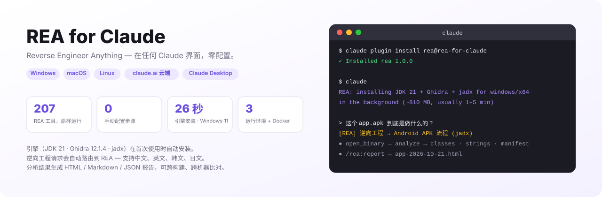
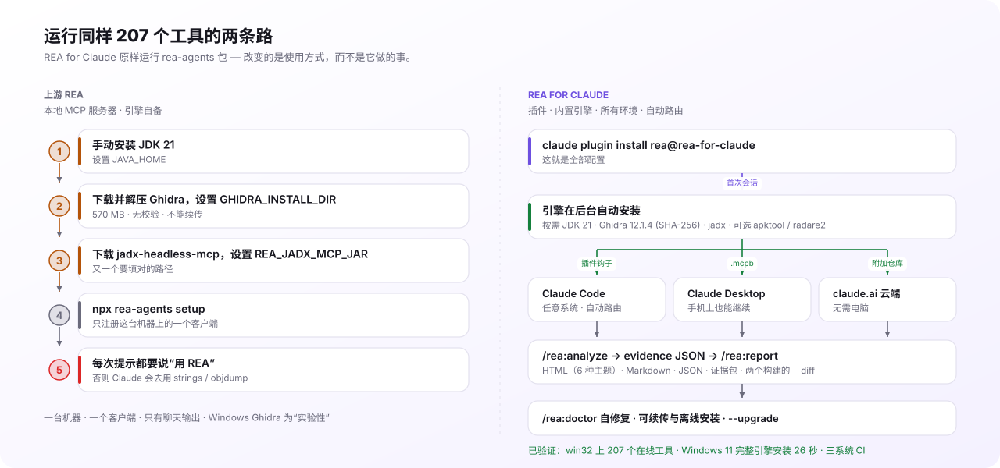
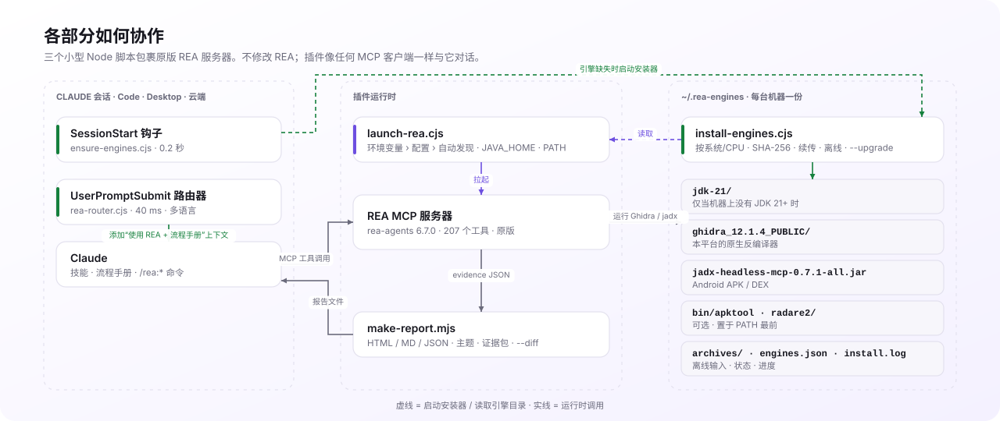

<p align="right"><a href="README.md">English</a> | <a href="README.ko.md">한국어</a> | <b>简体中文</b> | <a href="README.ja.md">日本語</a></p>

<h1 align="center">REA for Claude</h1>

<p align="center">
  <b>Reverse Engineer Anything — 在任何 Claude 界面，零配置。</b><br>
  把 <a href="https://github.com/morluto/rea">REA</a> 的 207 个逆向工程工具做成 Claude 插件：引擎自动安装，
  逆向工程请求自动路由到 REA，分析结果变成可分享的报告。
</p>

<p align="center">
  <a href="https://github.com/NoLucas/REA-for-Claude/actions/workflows/ci.yml"></a>
  
  
  
  
  <a href="LICENSE"></a>
</p>

<p align="center">
  <a href="#安装">安装</a> ·
  <a href="#核心特性">核心特性</a> ·
  <a href="#与上游-rea-的区别">与上游 REA 的区别</a> ·
  <a href="#工作原理">工作原理</a> ·
  <a href="#命令与技能">命令</a> ·
  <a href="#配置">配置</a> ·
  <a href="#基准数据">基准数据</a> ·
  <a href="#故障排查与-faq">FAQ</a>
</p>

<p align="center">
  <picture>
    <source media="(prefers-color-scheme: dark)" srcset="docs/img/hero-zh-dark.svg">
    
  </picture>
</p>

## 安装

```bash
claude plugin marketplace add NoLucas/REA-for-Claude
claude plugin install rea@rea-for-claude
```

在 **Windows、macOS 和 Linux** 上这就是全部 — 不需要先装 Java，也不需要先装 Ghidra。

### 你在哪里用 Claude？

| 环境 | 要做什么 |
|---|---|
| **Claude Code**（终端，任意 OS） | 上面两行即可。 |
| **Claude Desktop** | 安装插件（或下面的 `.mcpb` 扩展）即可。 |
| **claude.ai 网页/手机，已链接到你电脑的会话** | 只要那台电脑的 Claude Desktop 装了插件即可。REA 在你的电脑上运行，工具被转发到会话中（`mcp__remote-devices__plugin_rea_rea__*`）；路径是那台电脑上的路径，电脑需保持开机。 |
| **claude.ai 云会话，未链接** | 如果会话已链接到你的电脑且那台电脑的 Claude Desktop 装了插件，REA 工具已以 `mcp__remote-devices__plugin_rea_rea__*` 存在。否则在本仓库上开会话，或在你的仓库运行 `/rea:setup-mcp` → 提交生成的 3 个文件 → 在该仓库开新会话。没有仓库的会话无法保留这些文件。 |
| **电脑关机也要用** | 把[远程设备](remote/README.md)作为 claude.ai 自定义连接器。 |

不确定？输入 **`/rea:start`**——它会检查当前会话里 REA 能在哪里运行，修复能修复的，并告诉你接下来可以问什么。

1. **首次会话** — `SessionStart` 钩子发现 `~/.rea-engines` 为空，在后台启动安装器，并告诉 Claude：`REA: installing JDK 21 + Ghidra + jadx for windows/x64 … (~810 MB, usually 1–5 min)`。
2. **安装器** — 按你的系统和 CPU 选择构建：Temurin JDK 21（仅当机器上没有 JDK 21+ 时）、Ghidra 12.1.4（SHA-256 校验）、jadx-headless-mcp 0.7.1；Linux 上还有 apt 工具；按需安装 apktool / radare2。
3. **与此同时** — REA 已经在运行。无需引擎的分析器立即可用；Ghidra/jadx 工具在 `install.done` 出现前返回 `provider_unavailable`，之后再次 `open_binary` 目标即可（无需重启）。
4. **从此以后** — 直接用自然语言提问。*"这个 app.apk 到底是做什么的？"* 或 *"what does agent.exe do?"* 会被识别为逆向工程请求并连同对应流程手册一起路由到 REA。需要时也可以用 `/rea:analyze <文件>`、`/rea:report`、`/rea:doctor`。

<details>
<summary><b>其他环境</b> — claude.ai 云端（无需电脑）、Claude Desktop、Docker 设备</summary>

**claude.ai 云端会话（网页 · 手机 · claude.ai/code）** — fork 或推送本仓库，在其上开启会话（或把仓库附加到聊天），然后说：*"分析一下 `./samples/app.bin`，告诉我它做什么。"* `.mcp.json` 会立即启动 REA；同一个钩子把引擎装进容器（约 2 分钟）。想跳过等待，在环境里设置 `Setup script = bash scripts/install-engines.sh`。

要在**其他仓库**的云会话里使用 REA，在该仓库运行一次 `/rea:setup-mcp` 并提交它写出的三个文件（`.mcp.json`、`.claude/rea-mcp.cjs`、`.claude/settings.json`）；下一次会话就有 `mcp__rea__*` 工具了。原因是 claude.ai 云会话会加载技能、钩子和命令，却不加载插件声明的 MCP 服务器，只认项目级的。本地 Claude Code 和 Claude Desktop 不需要这一步。

**Claude Desktop** — 在你的电脑上构建一键扩展，然后在 设置 › 扩展 › 高级 › Install Extension… 安装：

```bash
bash desktop/build-mcpb.sh                                          # macOS / Linux
powershell -ExecutionPolicy Bypass -File desktop\build-mcpb.ps1     # Windows
```

扩展打包了启动器和安装器，会自动发现 `~/.rea-engines` 并启动同样的后台安装。关联到这台电脑的会话可以在网页和手机的 claude.ai 上使用这些工具。打标签的发布会提供三个系统的签名 `.mcpb`。

**远程设备（电脑关机也行）** — REA + 引擎运行在 Linux 容器里，位于 Cloudflare 隧道和 OAuth 2.1 网关之后，可作为 claude.ai 自定义连接器：

```bash
cd remote && export REA_UPSTREAM_API_KEY=$(openssl rand -hex 24) GATEWAY_PASSWORD='<12 位以上>'
docker compose -f docker-compose.oauth.yml up --build
```

请先阅读 [remote/README.md](remote/README.md) 中的安全说明。

**Windows 细节** — 原生 REA 覆盖 PE（x86/x64/ARM）、Android 和无需引擎的分析器；压缩包用系统自带的 `tar.exe` 解压；遵循 `HTTPS_PROXY`。需要 Linux 专属工具（binwalk、tshark、mitmproxy）时，运行 `node scripts/install-engines.cjs --wsl` 并设置 `"use_wsl": true` — 启动器会在 WSL 里运行 REA，并把 `C:\…` 路径翻译成 `/mnt/c/…`。

**macOS** — 支持 Apple Silicon 和 Intel；自动选择匹配的 Temurin JDK 和 Ghidra 的 `mac_arm_64` / `mac_x86_64` 反编译器；清除隔离属性，Gatekeeper 不会弹窗。

**想自己掌控？** `"auto_engines": false` 关闭自动安装；`/rea:install-engines`（或 `node scripts/install-engines.cjs --dry-run`）按需运行；用 `ghidra_install_dir` / `jadx_mcp_jar` / `java_home` 指向你自己的安装。
</details>

> **法律声明。** 逆向工程必须遵守目标的许可证、服务条款和当地法律。使用前请阅读上游 REA 的 [DISCLAIMER](https://github.com/morluto/rea/blob/main/DISCLAIMER.md)。

## 核心特性

- **所有系统零配置引擎** — JDK 21（按需）、Ghidra 12.1.4、jadx；可选 apktool 和 radare2。Windows x64、macOS arm64/x64、Linux x64/arm64。每台机器共享一个 `~/.rea-engines`。
- **逆向工程默认用 REA** — 40 ms 的 `UserPromptSubmit` 路由器识别中文、英文、韩文、日文的逆向工程提示，把 REA 工具和对应流程手册交给 Claude。可用 allow/deny 模式调整或关闭；`/rea:why` 解释每次判断。
- **自修复** — `/rea:doctor` 校验磁盘上的内容（解压一半的 Ghidra、没有 `javac` 的 JRE、截断的 jar、过时的版本）并打印精确的修复命令。
- **可续传、可离线安装** — 中断的下载可续传；放进 `~/.rea-engines/archives/` 的发布文件无需网络即可安装，仍做 SHA-256 校验。`--upgrade` 迁移到新版本，新版本验证通过后才删除旧副本。
- **引导式分析** — `/rea:analyze` 按目标（ELF/PE/Mach-O、APK、Electron、固件、wasm、Go/Rust/Flutter）选择流程手册，并把每个结果保存为 evidence JSON。
- **报告与 diff** — `/rea:report` 把证据渲染成独立 HTML（6 种主题）、Markdown 或 JSON；`--bundle` 生成可移植的证据文件；`--diff` 比较两个构建（即使来自不同机器），精确到反编译代码的逐行差异。
- **随处运行** — 一个启动器服务于 Claude Code、Claude Desktop（`.mcpb`）、claude.ai 云端会话和带 OAuth 2.1 网关的 Docker 设备。
- **Windows 原生** — 自带 `tar.exe` 解压、无需 `cmd.exe` 引用的 npx、`C:\` → `/mnt/c/` 翻译、`--wsl` 配置；在 Windows 11 上实机验证。
- **三系统测试** — `scripts/selftest.mjs` 在 CI 中于 Windows、macOS、Linux 运行，包括启动真实服务器的在线 MCP 冒烟测试。[docs/STABILITY.md](docs/STABILITY.md) 说明 1.x 保持稳定的内容。

## 与上游 REA 的区别

<p align="center">
  <picture>
    <source media="(prefers-color-scheme: dark)" srcset="docs/img/upstream-vs-plugin-zh-dark.svg">
    
  </picture>
</p>

[REA](https://github.com/morluto/rea)（作者 morluto，MIT）是引擎：207 个 MCP 工具，驱动 Ghidra、jadx、IDA、Hopper、Kuna 以及十几个无需引擎的分析器。**REA for Claude 不 fork、不修改 REA** — 它原样运行 `rea-agents` 包，只添加把它变成一行安装、零配置、随处可用的 Claude 插件所需的部分。

| | 上游 REA | REA for Claude |
|---|---|---|
| **安装** | 先自行安装 JDK 21、Ghidra、jadx 并设置路径，再 `npx rea-agents setup` | `claude plugin install …` — 首次使用时引擎自动安装 |
| **运行位置** | 配置它的那台机器和那个客户端 | 三系统 Claude Code · Claude Desktop · claude.ai 云端 · Docker 设备 |
| **使用方式** | 你得主动要求用 REA，否则 Claude 会去用 `strings`/`objdump` | 逆向工程提示自动路由到 REA（中/英/韩/日） |
| **指引** | REA 的 `reverse-engineer-anything` 技能 | 同一技能（内置）**加上**按目标的流程手册和 `/rea:analyze` |
| **输出** | 聊天中的工具结果 | HTML / Markdown / JSON 报告、证据包、两个构建的 `--diff` |
| **健康检查** | `rea doctor` 列出缺失项 | `/rea:doctor` 校验磁盘内容并打印修复命令；`--upgrade` |
| **网络** | 手动下载 | 可续传、识别代理、从 `archives/` 离线安装 |
| **Windows** | Ghidra 为"实验性"，WSL 手动 | 原生安装器、`--wsl` 配置，Windows 11 实机验证 |
| **发布** | npm 包 | 插件市场 + 每个标签三系统签名 `.mcpb` |
| **不改变的** | Kuna、IDA、Hopper、JEB 由使用者提供；工具名和证据格式是 REA 的 | 相同 — 插件从不改动工具结果 |

如果你只在一台 Linux 上用 Claude Code，并且已经配好 Ghidra，上游 REA 就够了。一旦出现第二台机器、一台 Windows 笔记本、一部手机、一位没有 Ghidra 的同事，或者要给别人看的报告，这个插件就值回票价。

## 工作原理

<p align="center">
  <picture>
    <source media="(prefers-color-scheme: dark)" srcset="docs/img/architecture-zh-dark.svg">
    
  </picture>
</p>

三个无依赖的小型 Node 脚本，包裹原版 REA 服务器：

- **`ensure-engines.cjs`**（SessionStart，0.2 秒）检查 `~/.rea-engines`；若缺少 Ghidra、jadx 或 JDK 21+，就分离启动 `install-engines.cjs` 并向会话打印一行状态。独占锁保证即使钩子和启动器同时启动也只有一个安装器。
- **`launch-rea.cjs`** 解析每个引擎路径（REA 环境变量 › `REA_PLUGIN_*` 环境变量 › `~/.rea-plugin.json` › 自动发现），导出 `JAVA_HOME` 和 `PATH`，丢弃 REA 会拒绝的空值，然后拉起 `npx rea-agents@6.7.0 mcp` — Windows 上也可在 WSL 内运行 REA。REA 按调用解析 provider，所以稍后装好的引擎无需重启即可被用上。
- **`rea-router.cjs`**（UserPromptSubmit，40 ms）为逆向工程提示添加*"使用 REA 工具和这份流程手册"*的上下文；其他提示原样通过。

为什么要自带 JDK：Ghidra 需要带 `javac` 的 64 位 JDK 21+。安装器只在 `JAVA_HOME`、`PATH`、`~/.rea-engines/jdk-21` 和常见安装位置（IntelliJ `~/.jdks`、Program Files、Homebrew、`/usr/lib/jvm`、sdkman）都不满足时才下载 Temurin — 已由 REA 自己的 `ghidra-java` doctor 检查验证。

## 命令与技能

| 命令 | 作用 |
|---|---|
| `/rea:start` | 从这里开始：当前会话中 REA 能在哪里运行（本地、已链接的电脑、暂不可用）、需要修复什么、可以问什么 |
| `/rea:analyze <路径> [目标]` | 判断目标类型，运行对应流程手册，把每个结果保存到 `./rea-evidence/*.json` |
| `/rea:report [目录] [--format html\|md\|json\|both\|all] [--theme …] [--bundle]` | 生成可分享的报告；`--bundle` 写出可移植的证据文件 |
| `/rea:report --diff <before> <after>` | 比较两组证据或两个证据包，生成变更报告 |
| `/rea:doctor` | 服务器健康状况、逐引擎校验、精确的修复命令 |
| `/rea:install-engines` | 安装、修复或升级引擎（`--dry-run`、`--only`、`--upgrade`、`--wsl`） |
| `/rea:capabilities` | 这台主机上 REA 现在能做什么，按目标类型分组 |
| `/rea:why [提示]` | 某条提示为什么被（或没被）路由到 REA，以及如何调整路由器 |
| `/rea:setup-mcp` | 把 REA 服务器注册进本仓库的 `.mcp.json` — 供跳过插件 MCP 服务器的 claude.ai 云会话使用 |

| 技能 | 用途 |
|---|---|
| `reverse-engineer-anything` | REA 官方 207 工具参考与恢复指南（内置，MIT） |
| `rea-workflows` | 按目标的流程手册：ELF/PE/Mach-O、APK、Electron/JS、固件、Web、Go、Rust、Flutter/Dart、WebAssembly |
| `rea-anywhere` | 各环境的操作说明：自动安装、`provider_unavailable`、文件位置 |

## 配置

全部可选。`~/.rea-plugin.json`（或 `$REA_PLUGIN_CONFIG`）；每个值的优先级：**REA 环境变量 → `REA_PLUGIN_*` 环境变量 → 配置文件 → `~/.rea-engines` 自动发现**。键和引擎目录布局在 [1.x 内保持稳定](docs/STABILITY.md)。

<details>
<summary><b>全部键</b></summary>

```jsonc
{
  "rea_version": "6.7.0",
  "ghidra_install_dir": "C:\\tools\\ghidra_12.1.4_PUBLIC",   // 用你自己的安装代替 ~/.rea-engines
  "jadx_mcp_jar": "C:\\tools\\jadx-headless-mcp-0.7.1-all.jar",
  "kuna_command": "", "ida_mcp_config": "", "browser_executable": "",
  "java_home": "",                         // 环境变量 JAVA_HOME 优先，其次此值，再次自动检测到的 JDK
  "engines_dir": "",                       // 默认 ~/.rea-engines
  "auto_engines": true,                    // 首次使用时后台安装
  "jdk": true,                             // 找不到 JDK 21+ 时允许下载 Temurin
  "engines": ["ghidra", "jadx", "apt"],    // + "apktool", "radare2"
  "optional_engines": false,               // 让 "all" 包含 apktool/radare2
  "archive_dir": "",                       // 离线安装用的预下载发布文件
  "router": { "allow": [], "deny": [] },   // 正则；或 false 关闭路由
  "use_wsl": false, "wsl_distro": "Ubuntu",
  "rea_command": "",                       // 例如全局安装时为 "rea"
  "report": { "format": "html", "dir": "rea-reports", "theme": "violet" },
  "env": { "REA_GHIDRA_STARTUP_TIMEOUT_MS": "600000" }
}
```

| 键 | 默认值 | 说明 |
|---|---|---|
| `auto_engines` | `true` | 缺少 Ghidra 时后台安装 |
| `jdk` | `true` | 仅当没有可用的 JDK 21+ 时把 Temurin JDK 21 下载到 `~/.rea-engines/jdk-21` |
| `engines` | `["all"]` | `apt` = radare2、binwalk、tshark、apktool、binutils、gdb（Linux）；`apktool`、`radare2` 在所有系统上可选 |
| `optional_engines` | `false` | 让 `all` 包含可选引擎 |
| `archive_dir` | — | 额外的发布文件目录（`~/.rea-engines/archives/` 总会被检查） |
| `router` | `true` | `false` 关闭路由；`{ "allow": [正则], "deny": [正则] }` 调整；项目级 `.rea-plugin.json` 优先 |
| `report.format` / `dir` / `theme` | `html` / `rea-reports` / `violet` | 主题：`violet` `ocean` `forest` `amber` `mono` `contrast` |
| `use_wsl` / `wsl_distro` | `false` / `Ubuntu` | 仅 Windows；引擎路径自动变为 Linux 路径 |
| `env` | — | 传给 REA 的额外变量（超时、schema 配置 …） |

环境变量对应：`REA_PLUGIN_CONFIG`、`REA_PLUGIN_ENGINES_DIR`、`REA_PLUGIN_ARCHIVE_DIR`、`REA_PLUGIN_ENGINES`、`REA_PLUGIN_OPTIONAL_ENGINES=1`、`REA_PLUGIN_AUTO_ENGINES=0|1`、`REA_PLUGIN_SKIP_JDK=1`、`REA_PLUGIN_ROUTER=0`、`REA_PLUGIN_USE_WSL=1`、`REA_PLUGIN_VERSION`，以及 REA 原生变量（`GHIDRA_INSTALL_DIR`、`REA_JADX_MCP_JAR`、`REA_KUNA_COMMAND`、`REA_IDA_MCP_CONFIG`、`JAVA_HOME`）。
</details>

## 基准数据

| | Windows 11 x64（Node 24，家用宽带） | Linux x64（云容器，2 vCPU） |
|---|---|---|
| 空目录完整引擎安装 | **26 秒** — JDK 21 + Ghidra + jadx + apktool + radare2，SHA-256，`tar.exe` | **约 45 秒** — JDK 21 + jadx 15 秒，Ghidra 30 秒 |
| `selftest.mjs` 含在线 MCP 冒烟 | win32 上提供 **207 个工具** | 207 个工具 |
| `launch-rea.cjs doctor` | ghidra + jadx 可用；原生 `win_x86_64` 反编译器匹配；JDK 21 通过 | 相同，自带 JDK 通过 |
| 引擎已存在时的 SessionStart 钩子 | 0.2 秒 | 0.2 秒 |
| 路由器判断 | 约 40 ms | 约 40 ms |
| 小型 ELF 的 Ghidra 反编译 | — | 每次调用约 20 秒 |

机器上已有的 JDK（IntelliJ `~/.jdks`、Temurin、Homebrew、apt）会被发现并复用 — 不会二次下载。续传：apktool 的 5 MB 部分文件在一秒内续传并校验完成。

## 故障排查与 FAQ

<details>
<summary><b>故障排查</b></summary>

| 现象 | 原因 | 解决 |
|---|---|---|
| Ghidra / jadx 返回 `provider_unavailable` | 后台安装仍在进行或失败 | `/rea:doctor` 显示状态和日志；`/rea:install-engines` 修复；然后再次 `open_binary` |
| `spawn npx.cmd EINVAL`（Windows） | Node ≥ 22 拒绝在没有 shell 的情况下启动 `.cmd` | 启动器已修复（直接用 Node 运行 `npx-cli.js`）— 更新插件 |
| `GHIDRA_INSTALL_DIR must be absolute` | 宿主把空设置作为 `""` 传入 | 启动器会丢弃空值；若自己设置，请用完整路径 |
| Claude Desktop 看不到 `rea` 服务器 | MSIX 版本读取的是另一个 `claude_desktop_config.json` | 改用 `.mcpb` 安装 |
| `.ps1 cannot be loaded … execution policy` | 默认策略阻止脚本 | `powershell -ExecutionPolicy Bypass -File …` |
| Ghidra 压缩包被 Defender 拦截 / 解压很慢 | 大压缩包含大量小文件 | 为 `%USERPROFILE%\.rea-engines` 添加排除项；SHA-256 保证完整性 |
| 大二进制文件超时 | 无头分析很慢 | 在 `env` 下调高 `REA_GHIDRA_STARTUP_TIMEOUT_MS`；分析一次后按函数调用 |
| claude.ai 云会话里没有 `mcp__rea__*` 工具，Claude 改用 grep "分析" | 云会话跳过插件声明的 MCP 服务器（`CLAUDE_CODE_SKIP_PLUGIN_MCP_SERVERS=1`） | 如果会话已链接到你的电脑且那台电脑的 Claude Desktop 装了插件，REA 工具已以 `mcp__remote-devices__plugin_rea_rea__*` 存在。否则在本仓库上开会话，或在你的仓库运行 `/rea:setup-mcp` → 提交 → 新会话；SessionStart 那一行和 `/rea:doctor` 都会指出服务器未加载 |
| 下载被拦截 | 代理 / 白名单 | 放行 `github.com`、`objects.githubusercontent.com`、`release-assets.githubusercontent.com`、`api.adoptium.net` — 或把文件放进 `~/.rea-engines/archives/` |

`node scripts/selftest.mjs` 可在任何系统上检查插件本身。
</details>

<details>
<summary><b>FAQ</b></summary>

**手机上的 claude.ai 能用吗？** 能 — 附加了本仓库的云端会话在 Anthropic 容器里运行 REA；关联到你电脑的会话则中继桌面应用的本地 REA 工具。

**需要自己装 Ghidra 或 Java 吗？** 不需要。首次会话会安装缺少的部分；已有的 JDK 会被复用。要用自己的 Ghidra，设置 `ghidra_install_dir`。

**哪些引擎*不会*自动安装？** IDA、Kuna、Hopper 和 JEB（商业或手动）。在配置里指向你自己的副本。

**能关闭自动路由吗？** `"router": false`，或单次会话用 `REA_PLUGIN_ROUTER=0`。allow/deny 正则可按用户或按项目做更细的控制。

**我已经运行过 `npx rea-agents setup`。** 每个客户端只保留一个注册，否则会出现两个 `rea` 服务器。

**离线 / 隔离网络？** 把发布文件（同名）放进 `~/.rea-engines/archives/`，然后运行 `/rea:install-engines`。
</details>

<details>
<summary><b>仓库结构</b></summary>

```
.claude-plugin/        plugin.json · marketplace.json（仓库同时也是插件市场）
hooks/hooks.json       插件钩子：SessionStart → ensure-engines.cjs，UserPromptSubmit → rea-router.cjs
.claude/settings.json  仓库 / 云端会话使用的同一组钩子
.mcp.json              云端 / 本地会话的项目 MCP 服务器
scripts/
  launch-rea.cjs       通用启动器（`launch-rea.cjs doctor` 以服务器的环境运行 doctor）
  ensure-engines.cjs   SessionStart 钩子：检查 → 后台安装 → 一行状态（--status 输出表格）
  rea-router.cjs       UserPromptSubmit 钩子：逆向提示 → "使用 REA + 这份流程手册"（--why）
  setup-mcp.cjs        /rea:setup-mcp — 为跳过插件 MCP 服务器的宿主写项目级 .mcp.json
  rea-mcp-bootstrap.cjs  复制到项目中作为 .claude/rea-mcp.cjs；定位已安装插件的启动器
  install-engines.cjs  Windows / macOS / Linux 安装器（JDK 21、Ghidra、jadx、apktool、radare2、WSL）
  rea-engines-lib.cjs  共享：版本锁定、系统检测、配置、引擎 / JDK 发现、校验
  install-engines.sh   Linux / Docker 安装器（Ghidra、jadx、apt）
  install-engines.ps1  面向脚本化 Windows 部署的纯 PowerShell 安装器
  make-report.mjs      证据 → HTML / Markdown / JSON，主题，证据包，--diff
  selftest.mjs · .sh   跨平台检查（CI）· 仅 bash 的检查
desktop/               manifest.json · build-mcpb.sh · build-mcpb.ps1（Claude Desktop .mcpb）
remote/                Dockerfile · docker-compose.yml · docker-compose.oauth.yml · oauth-gateway/
skills/                reverse-engineer-anything · rea-workflows · rea-anywhere
commands/              analyze · report · doctor · capabilities · install-engines · why
docs/                  STABILITY.md · img/（generate.py 生成 README 插图）
.github/workflows/     ci.yml（三系统 selftest）· release.yml（v* 标签上三系统签名 .mcpb）
```
</details>

## 参与贡献

```bash
git clone https://github.com/NoLucas/REA-for-Claude && cd REA-for-Claude
node scripts/selftest.mjs           # 任何系统：离线检查 + 在线 MCP 冒烟（REA_SELFTEST_SKIP_MCP=1 跳过）
bash scripts/selftest.sh            # Linux/macOS：OAuth 网关和入口检查
claude plugin validate --strict .claude-plugin/plugin.json
python3 docs/img/generate.py        # 修改 README 插图之后
```

欢迎 PR — 流程手册、引擎配方、报告渲染器、macOS 测试。保持 selftest 通过，不要添加顶层 `bin/`（claude.ai 会拒绝含有该目录的插件）。

## 许可证与致谢

插件：[MIT](LICENSE)。`skills/reverse-engineer-anything/` 取自 [morluto/rea](https://github.com/morluto/rea)（MIT，见 `LICENSE.rea`）。REA 本身不打包，运行时从 npm 获取。Ghidra 为 Apache-2.0（NSA）；jadx-headless-mcp、apktool、radare2 遵循各自的许可证。与 REA、Ghidra、jadx、apktool、radare2 项目无关联。
